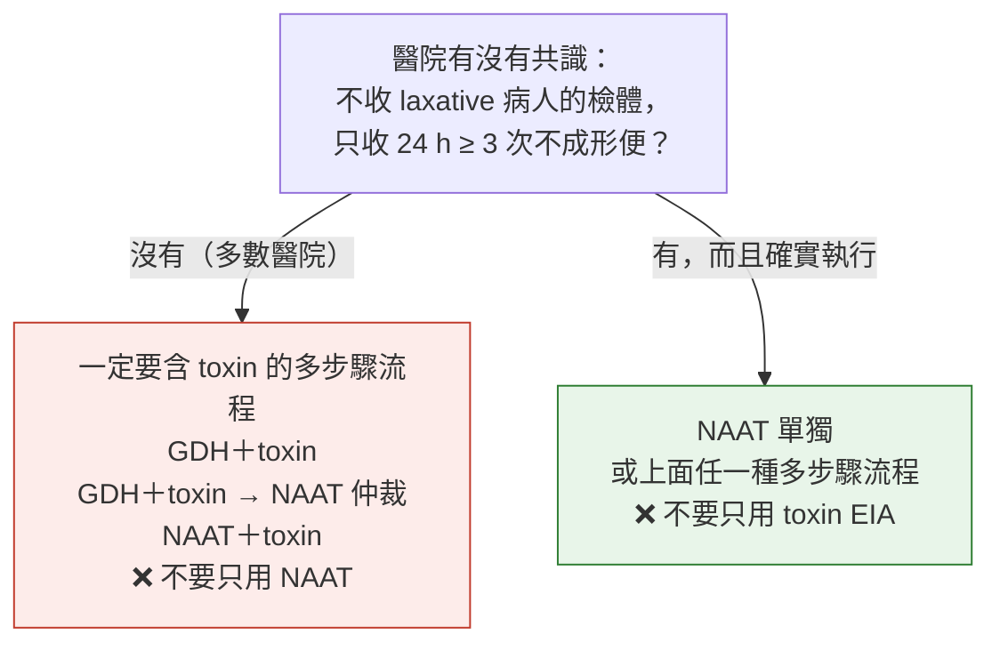

> [!abstract] 一句話重點
> **只驗「說不出原因、新發生、24 小時 ≥ 3 次不成形便」的人**——**==先確認 48 小時內沒用 laxative==**。檢驗方法看醫院有沒有「送檢門檻」：**沒有門檻 → 一定要含 toxin 的多步驟流程**（GDH＋toxin、GDH＋toxin 再用 NAAT 仲裁、NAAT＋toxin），**不要只用 NAAT**；**有門檻 → NAAT 單獨或多步驟都可以**。**NAAT 陽性、toxin 陰性**常是**帶菌**，併發症很少。**==7 天內不重驗、沒腹瀉不驗、不做 test of cure==**。**≤ 12 個月嬰兒不常規驗**（帶菌率可 > 40%）；1–2 歲先排除其他原因；≥ 2 歲有長期或惡化的腹瀉＋危險因子才驗。

> [!info] 系列導覽
> ↑ 回到 [[infectious-disease/c-difficile-idsa/index|IDSA/SHEA *C. difficile* 指引總覽]]
>
> ① 流行病學與診斷（本篇）｜② [[infectious-disease/c-difficile-idsa/cdi-2-prevention|感染管制與預防]]｜③ [[infectious-disease/c-difficile-idsa/cdi-3-treatment|治療（含 2021 更新）]]｜④ [[infectious-disease/c-difficile-idsa/cdi-exam|內專考點]]
>
> 本篇來源：2017 IDSA/SHEA *C. difficile* 指引 Section I–XII、Table 3–4、Figure 2

## CDI 的定義

**CDI＝症狀（通常是腹瀉）＋下面其中一個**：

- 糞便驗到 ***C. difficile* toxin**，或驗到**產毒的 *C. difficile***（toxigenic culture、NAAT）
- **大腸鏡或病理**看到 **pseudomembranous colitis**

> [!warning] Pitfall：「驗到菌」不等於「CDI」
> 定義要**有症狀**。沒有腹瀉（或 ileus、megacolon）的人驗到菌，只是**帶菌**——不驗、不治。

### 時間定義：新發作、復發與感染地點

| 名詞 | 定義 |
| --- | --- |
| **新的發作（incident）** | 前 **8 週**內沒有發作＋陽性 |
| **==復發（recurrent）==** | 上一次陽性後 **==2–8 週==** 內再發作＋陽性 |
| **HO（healthcare facility–onset）** | **住院 > 3 天**（第 4 天以後）才採檢陽性 |
| **CO-HCFA**（社區發作、醫療相關） | 門診或入院 ≤ 3 天內陽性，且**過去 12 週**內有住過醫療機構 |
| **CA（community-associated）** | 門診或入院 ≤ 3 天內陽性，且**過去 12 週沒有住過**醫療機構 |

- 監測（Section I–V）：**每家醫院至少要監測 HO-CDI**；HO 以「每 10,000 住院人日」、CO-HCFA 以「每 1,000 入院」表示；發生率高或群突發時**依病房分層**找熱點。兒科監測不納入 < 2 歲
- 美國 2011 年估計約 **45 萬例**，**≥ 65 歲發生率最高**；社區型其實多數（82%）有門診醫療接觸，所以「純社區」很少

### 危險因子

| 類別 | 內容 |
| --- | --- |
| 發生 CDI | **抗生素**（最重要）、**住院或長照**、**高齡**、**PPI**、免疫抑制、腸胃道手術或操作（含**管灌**） |
| **==復發==** | **高齡**、**治療期間或之後又用其他抗生素**、**PPI**、菌株型別、對毒素的**抗體反應差**、底層疾病重 |
| 病情嚴重或死亡 | 高齡、**白血球上升**、**腎衰竭**、低白蛋白、共病、**ribotype 027** |

> [!tip] Pearl：NAP1/BI/027 是什麼
> 2000 年代造成歐美醫院群突發的 **hypervirulent strain**（PCR ribotype 027＝NAP1＝REA type BI）：**毒素量大增**、多了 **binary toxin**、**對 fluoroquinolone 抗藥**（FQ 用得多就選出它）。美國仍占醫療相關 CDI 的一部分；荷蘭另有 **ribotype 078**，病人較年輕、社區型多。

## 誰要驗：Section VI

| # | 建議 | 強度 |
| --- | --- | --- |
| VI-1 | **==說不出原因、新發生、24 小時內 ≥ 3 次不成形便==** 是最適合驗的族群 | Weak, very low |

- **住院病人的腹瀉 *C. difficile* 只占 < 30%，常常只有 5–10%**——其他常見原因：**laxative**、管灌、化療、IBD
- 一個研究裡 **19% 送檢前 48 小時用過 laxative**、**36% 根本沒達到腹瀉定義**——高敏感度的檢驗會把這些人「驗出來」，造成過度診斷
- 實務：送檢前先看 **laxative、管灌、新藥**；停掉可疑原因後仍持續腹瀉再驗

## 怎麼驗：Section VII–VIII、Figure 2

### 各種檢驗方法（Table 3 依內容重新整理）

| 檢驗 | 驗到什麼 | 敏感度 | 特異度（對「臨床 CDI」） | 一句話 |
| --- | --- | --- | --- | --- |
| **Toxigenic culture** | 菌（營養體或孢子）＋確認會產毒 | 高 | 低 | 參考標準之一，太慢不實用 |
| **NAAT（PCR）** | **毒素基因** | 高 | **低到中** | 抓到「有產毒能力的菌」，不代表正在產毒 → **帶菌也陽性** |
| **GDH** | 所有 *C. difficile* 的共同抗原 | 高 | 低 | 當**篩檢**；陰性幾乎排除；陽性要再驗 toxin |
| **CCNA**（cell culture cytotoxicity neutralization） | **游離毒素** | 高 | **高** | 參考標準之一，費時 |
| **Toxin A/B EIA** | **游離毒素** | **低** | 中 | 單獨用會漏掉不少 |

> [!tip] Pearl：為什麼要驗「毒素」
> **游離 toxin 陽性**的病人才真正併發症多：
> - Toxin＋／PCR＋：CDI 併發症 **7.6%**；**toxin－／PCR＋：0%**，跟兩者都陰性（0.3%）一樣（Polage 2015，1,416 人）
> - **NAAT＋3 步驟流程都陽性**的併發症（30 天死亡、大腸切除、ICU、再住院）**39%**，**只有 NAAT 陽性只有 3%**
> - CCNA 陽性者 30 天死亡率比「只培養陽性」高
>
> 所以 **NAAT 陽性、toxin 陰性 → 很可能只是帶菌**，要看臨床。

### 依醫院有沒有「送檢門檻」選方法（Figure 2 依內容重新繪製）

| # | 建議 | 強度 |
| --- | --- | --- |
| VII-1 | **沒有送檢門檻**時：用 **toxin 為其中一步的多步驟流程**（GDH＋toxin；GDH＋toxin，NAAT 仲裁；NAAT＋toxin），**不要只用 NAAT** | Weak, low |
| VIII-1 | **有送檢門檻**（病人臨床上很可能是 CDI）時：**NAAT 單獨或多步驟流程**，**不要只用 toxin** | Weak, low |

### 多步驟流程的結果怎麼讀（臨床推論整理）

| GDH | Toxin | NAAT（仲裁） | 解讀 |
| --- | --- | --- | --- |
| ＋ | **＋** | 不用做 | **CDI** |
| － | － | 不用做 | **不是 CDI**（NPV 高） |
| ＋ | － | **＋** | 有產毒菌、沒驗到游離毒素 → **可能 CDI 或帶菌**，看臨床（腹瀉程度、有沒有其他原因） |
| ＋ | － | － | 非產毒菌 → **不是 CDI** |

## 重驗與 test of cure：Section IX–X

| # | 建議 | 強度 |
| --- | --- | --- |
| IX-1 | **==同一次腹瀉 7 天內不重驗==**；**沒症狀的人不驗**（含 **test of cure**），流行病學研究除外 | **Strong, moderate** |
| X-1 | **Fecal lactoferrin 等生物標記**：資料不足，**不建議**用來輔助診斷 | No recommendation |

- 7 天內重驗的**多檢出率只有約 2%**；高敏感度流程**單次 NPV 通常 > 99%**
- 治療結束後檢驗結果和症狀對不太起來（一個研究中，復發腹瀉的 CDI 病人有 35% toxin 陰性）→ **追蹤看症狀，不靠檢驗**

## 兒童：Section XI–XII

| # | 年齡 | 建議 | 強度 |
| --- | --- | --- | --- |
| XI-1 | **≤ 12 個月** | **==不常規驗==**（無症狀帶菌太常見） | **Strong, moderate** |
| XII-1 | **1–2 歲** | 不常規驗，**除非已排除其他感染或非感染原因** | Weak, low |
| XII-2 | **≥ 2 歲** | **長期或惡化的腹瀉**＋**危險因子**（IBD、免疫不全）或**暴露**（醫療接觸、最近抗生素）才驗 | Weak, moderate |

- 嬰兒無症狀帶菌**可 > 40%**；**12 個月大仍約 15% 驗得到 toxin**；到 **2–3 歲降到 1–3%**（接近成人）
- < 12 個月只有在 **pseudomembranous colitis、toxic megacolon**，或明顯腹瀉且**其他原因已排除**時才驗
- 驗到其他腸道病原的兒童，**> 50% 也同時驗得到 *C. difficile***——別急著歸因

## 相關筆記

- [[infectious-disease/c-difficile-idsa/cdi-2-prevention|② 感染管制與預防]]
- [[infectious-disease/c-difficile-idsa/cdi-3-treatment|③ 治療]]
- [[infectious-disease/infectious-diarrhea-idsa/dia-2-diagnostics|感染性腹瀉 ② 診斷檢查]]（急性腹瀉誰要驗 *C. difficile*）
- [[infectious-disease/c-difficile-idsa/cdi-exam|④ 內專考點]]

## 參考資料

- McDonald LC, Gerding DN, Johnson S, et al. Clinical Practice Guidelines for *Clostridium difficile* Infection in Adults and Children: 2017 Update by the IDSA and SHEA. *Clin Infect Dis* 2018;66(7):e1–e48. doi:10.1093/cid/cix1085（Section I–XII、Table 3–4、Figure 2）（參考資料庫：感染科／Clinical Practice Guidelines for Clostridium difficile Infection in Adults and Children 2017.pdf）
