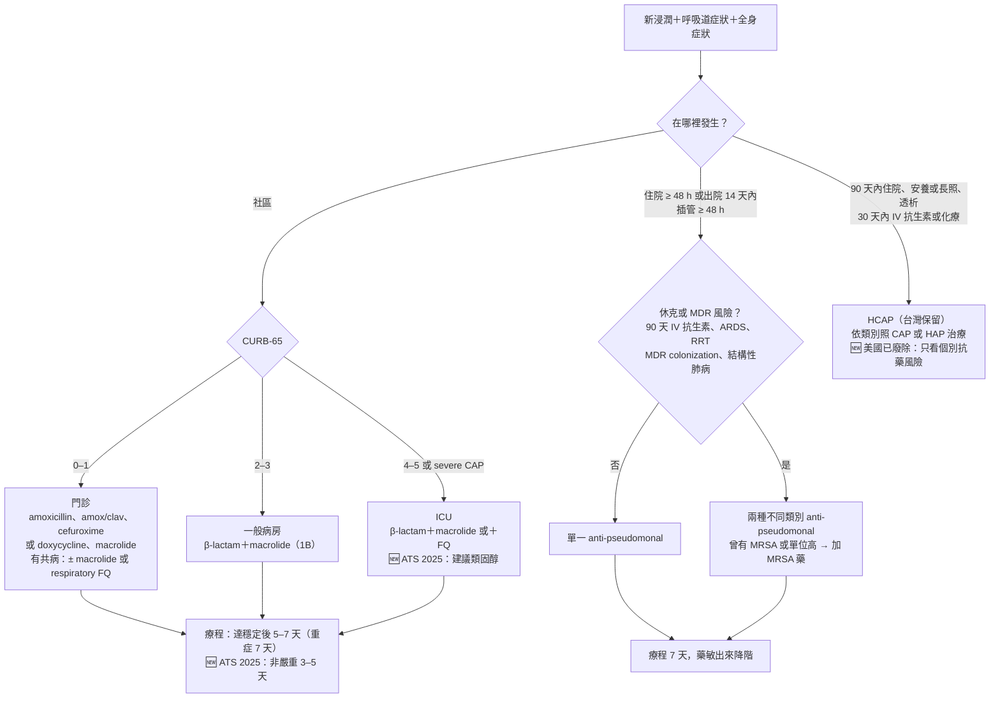

> [!abstract] 一句話重點
> 先**分類**（CAP、HCAP、HAP、VAP），再**評估嚴重度**（CURB-65）與**抗藥風險**，最後看**免疫狀態**。CAP：門診 β-lactam 或 doxycycline／macrolide，**==CURB-65 ≥ 2 用 β-lactam＋macrolide==**，ICU 用 β-lactam＋macrolide 或 FQ，**懷疑 TB 別用 FQ**；療程 5–7 天、穩定後 IV 2–4 天改口服。HAP／VAP：台灣以 ***P. aeruginosa*、*K. pneumoniae*、*A. baumannii*** 為主，**MDR 風險低單一 anti-pseudomonal、高風險或休克用兩類**，**==不例行 cover MRSA==**，療程 7 天。🆕 2018 年後的重要更新：**HCAP 已被美國指引廢除**、**ATS 2025 嚴重 CAP 給類固醇且非嚴重 CAP 療程可縮到 3–5 天**、**IDSA 2024 抗藥 GNB 改用新一代 β-lactam 組合**、**台灣 2026 成人公費肺炎鏈球菌疫苗改 PCV20／PCV21 一劑**。

本系列依 **台灣肺炎診治指引 2018**（台灣感染症醫學會＋台灣胸腔暨重症加護醫學會）成人部分，整理成 5 篇指引筆記，加上第 6 篇內專考點；兒童肺炎章節未收錄。2018 年之後被新指引取代的地方，都用 🆕 框標出新版建議。

> [!tip] 原圖
> 各篇的表格、流程圖下方都有「📷 原圖」區塊。原圖存在私人資料庫，只有設定過權杖的瀏覽器看得到。<a class="of-settings-link" href="javascript:void 0">🔑 原圖設定</a>

## 🌳 一張圖看懂：肺炎從分類到用藥

## 📌 必看表：CAP vs HAP／VAP 對照

| | CAP | HAP／VAP |
| --- | --- | --- |
| **定義** | 社區發生 | **HAP**：住院 ≥ 48 h 或出院 14 天內；**VAP**：插管 ≥ 48 h 後 |
| **台灣常見菌** | *S. pneumoniae* 23%、*Mycoplasma* 14%、*C. pneumoniae* 8%、*K. pneumoniae* 7%、*H. influenzae* 5% | ***P. aeruginosa*、*K. pneumoniae*、*A. baumannii***；*S. aureus* 約 10%（歐美 20–30%） |
| **台灣特殊** | **Melioidosis**（颱風後）、Q fever、scrub typhus；**macrolide 抗藥**（肺炎鏈球菌、*Mycoplasma*） | **CRKP 約 30%、CRAB 約 70%**（醫學中心 ICU 2017） |
| **嚴重度工具** | **CURB-65**（2B）；**CPIS 不適用** | CPIS **不當常規診斷**；可輔助監測與停藥（2C） |
| **血液培養** | 門診不常規（1C）；住院做（1C）；2 套各 10 mL（1B） | **例行做**（1C） |
| **呼吸道檢體** | 痰 Gram stain＋培養（1B）；嚴重 CAP 加**尿液抗原**（1B） | **ETA 半定量培養優先**（2C）；Gram stain 對 *S. aureus* NPV 高（2B） |
| **生物標記** | PCT 可輔助抗生素管理（1B）；🆕 不用 PCT 決定是否開始 | **PCT、CRP 都不用來決定開始**；**VAE 不用來診斷 VAP**（1A） |
| **經驗性治療** | 依 CURB-65：門診單方 → 中度 BL＋macrolide → ICU BL＋macrolide 或 FQ | MDR 風險低：單一 anti-pseudomonal；高或休克：兩類合併 |
| **MRSA** | 有風險才加（嚴重、cavitation、MRSA 病史等） | **==台灣不例行 cover==**；曾培養出或單位比例高才加 |
| **療程** | 達穩定後 **5–7 天**（1B）、重度 **7 天**（2C）；🆕 ATS 2025 非嚴重 **3–5 天** | **7 天**；非發酵菌可能較易復發 |
| **改口服** | 穩定後 **IV 2–4 天改口服**（1B） | 依藥敏降階 |
| **治療失敗判定** | **72 h** 分早期與晚期 | 治療 **48–96 h** 後惡化 |
| **預防** | **疫苗**：流感每年；🆕 2026 公費 **PCV20／PCV21 一劑** | **VAP bundle**：每日評估拔管、床頭 30–45°、口腔照護、每日中斷鎮靜；**不常規用制酸劑** |

## 分篇筆記

<a class="af-card internal" href="/infectious-disease/pneumonia/pna-1-definition-prevention">

①

定義、分類與預防

CAP、HCAP（HDAP、NHAP）、HAP、VAP、RCW 肺炎的定義；一般預防；流感與肺炎鏈球菌疫苗（🆕 2026 PCV20／PCV21、RSV）

第一章｜圖二｜2-6 預防

</a>
<a class="af-card internal" href="/infectious-disease/pneumonia/pna-2-cap-diagnosis">

②

CAP 病原、診斷與嚴重度

台灣 CAP 病原與 MDR 危險因子、CURB-65、影像、血液與尿液檢查、痰與支氣管鏡、<b>治療失敗流程</b>、<b>病史與病原對應表</b>

表 2.1、2.3.1、2.3.2、2.5.1、2.5.2｜圖 2.5.1、2.5.2

</a>
<a class="af-card internal" href="/infectious-disease/pneumonia/pna-3-cap-treatment">

③

CAP 與 HCAP 治療

<b>依 CURB-65 的經驗性用藥</b>、已知病原用藥與療程、改口服、FQ 與 TB、HCAP 分類用藥；🆕 ATS/IDSA 2019、ATS 2025（療程、類固醇）

表 2.7.1、2.7.2、2.7.4.1、2.7.4.2

</a>
<a class="af-card internal" href="/infectious-disease/pneumonia/pna-4-special-pathogens">

④

特殊病原與免疫不全

免疫不全宿主的病原、流感、隱球菌、麴菌、<b>PCP</b>、CMV、<b>類鼻疽</b>、TB、NTM 的診斷與治療

表 2.2.1–2.2.4、2.7.3.1–2.7.3.3｜圖 2.7.3

</a>
<a class="af-card internal" href="/infectious-disease/pneumonia/pna-5-hap-vap">

⑤

HAP／VAP

台灣 ICU 菌種與抗藥趨勢、MDR 危險因子、CPIS、VAE、呼吸道檢體、<b>VAP bundle</b>、經驗與針對性治療（colistin）；🆕 IDSA 2024 抗藥 GNB

表 3.1.1–3.1.3、3.2.1、3.2.2、3.6.1.1、3.6.1.2、3.6.2.1｜圖 3.4.1

</a>
<a class="af-card internal" href="/infectious-disease/pneumonia/pna-exam">

⑥

內專考點

104–114 年肺炎相關考古題 38 題（病原與宿主配對、Legionella、CURB-65、VAP bundle、melioidosis），附 2 題模擬題

CAP、HAP-VAP、Pneumonia-Chest 標籤

</a>

## 依臨床情境找重點

### 急診遇到疑似 CAP

- <a class="internal" href="/infectious-disease/pneumonia/pna-2-cap-diagnosis#curb-65">CURB-65 分層</a>、<a class="internal" href="/infectious-disease/pneumonia/pna-2-cap-diagnosis#-cap-診斷流程">CAP 診斷流程</a>　②
- <a class="internal" href="/infectious-disease/pneumonia/pna-3-cap-treatment#table-271cap-經驗性抗生素重新整理">經驗性抗生素表</a>　③
- 該抽什麼：<a class="internal" href="/infectious-disease/pneumonia/pna-2-cap-diagnosis#血液培養">血液培養</a>、<a class="internal" href="/infectious-disease/pneumonia/pna-2-cap-diagnosis#尿液抗原">尿液抗原</a>　②

### 住院後沒有改善

- <a class="internal" href="/infectious-disease/pneumonia/pna-2-cap-diagnosis#治療評估與治療失敗">CAP 治療失敗的原因與檢查</a>　②
- 想想特殊病原：<a class="internal" href="/infectious-disease/pneumonia/pna-4-special-pathogens#免疫不全宿主要想的病原">免疫不全宿主</a>、<a class="internal" href="/infectious-disease/pneumonia/pna-4-special-pathogens#肺結核tb">TB</a>　④

### 從安養院、洗腎室來的肺炎

- <a class="internal" href="/infectious-disease/pneumonia/pna-3-cap-treatment#健康照護相關肺炎hcap">HCAP 分類用藥</a>（與 🆕 美國的作法）　③

### ICU 的 HAP／VAP

- <a class="internal" href="/infectious-disease/pneumonia/pna-5-hap-vap#經驗性治療">經驗性治療</a>、<a class="internal" href="/infectious-disease/pneumonia/pna-5-hap-vap#已知病原的治療">CRAB、CRE 用藥</a>　⑤
- <a class="internal" href="/infectious-disease/pneumonia/pna-5-hap-vap#vap-bundle">VAP bundle</a>　⑤

## 相關筆記

- [[pulmonology/emergent-airway-management|緊急呼吸道處置]]
- [[gastroenterology/acute-biliary-infection/index|急性膽道感染 TG18]]（另一個感染症指引系列）

## 參考資料

- 台灣感染症醫學會、台灣胸腔暨重症加護醫學會。台灣肺炎診治指引 2018（主編：吳杰亮、李欣蓉、曾健華）。（參考資料庫：感染科／台灣肺炎指引.pdf）
- Metlay JP, et al. Diagnosis and Treatment of Adults with Community-acquired Pneumonia. *Am J Respir Crit Care Med* 2019;200:e45-e67.
- Jones BE, et al. Diagnosis and Management of Community-acquired Pneumonia. An Official ATS Clinical Practice Guideline. *Am J Respir Crit Care Med* 2025. doi:10.1164/rccm.202507-1692ST
- Kalil AC, et al. Management of Adults With HAP and VAP: 2016 Clinical Practice Guidelines by the IDSA and ATS. *Clin Infect Dis* 2016;63:e61-e111.
- Tamma PD, et al. IDSA 2024 Guidance on the Treatment of Antimicrobial-Resistant Gram-Negative Infections. *Clin Infect Dis* 2024.
- 衛生福利部疾病管制署。成人公費肺炎鏈球菌疫苗政策（2026）。
