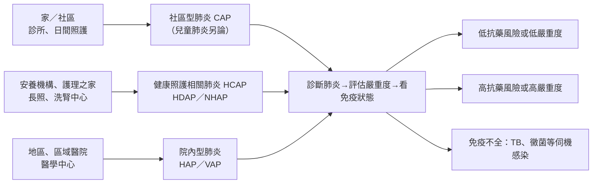

> [!abstract] 一句話重點
> 台灣指引把肺炎分成 **CAP、HCAP（含 HDAP、NHAP）、HAP、VAP**，再加上台灣特有的**呼吸照護病房（RCW）肺炎**。**HAP**＝住院 **≥ 48 h** 或出院 **14 天內**發生；**VAP**＝插管 **≥ 48 h** 後發生。台灣因為健保與長照普及而**保留 HCAP**，但 ==美國 2016 HAP 與 2019 CAP 指引已廢除 HCAP，改看「個別抗藥風險」==。預防最強的證據是**疫苗**：流感疫苗每年打；**==成人肺炎鏈球菌疫苗自 2026 年起台灣公費改為 PCV20 或 PCV21 一劑==**，取代原書的 PCV13→PPV23 兩劑。

> [!info] 系列導覽
> ↑ 回到 [[infectious-disease/pneumonia/index|台灣肺炎診治指引總覽]]
>
> ① 定義、分類與預防（本篇）｜② [[infectious-disease/pneumonia/pna-2-cap-diagnosis|CAP 病原、診斷與嚴重度]]｜③ [[infectious-disease/pneumonia/pna-3-cap-treatment|CAP 與 HCAP 治療]]｜④ [[infectious-disease/pneumonia/pna-4-special-pathogens|特殊病原與免疫不全]]｜⑤ [[infectious-disease/pneumonia/pna-5-hap-vap|HAP／VAP]]｜⑥ [[infectious-disease/pneumonia/pna-exam|內專考點]]
>
> 本篇來源：台灣肺炎診治指引 2018 第一章、前言、第二章 2-6（預防）

## 肺炎的操作型定義

肺炎＝下呼吸道肺實質被病原（細菌、病毒、黴菌、結核菌等）感染所造成的發炎。臨床上要同時符合：

| 條件 | 內容 |
| --- | --- |
| **急性下呼吸道症狀** | Cough＋至少一項：sputum（含 purulent）、dyspnea、wheezing、chest discomfort 或 chest pain |
| **沒有影像時** | ① 新的胸部徵象（bronchial breath sound、local crackles、dullness）② 至少一項全身症狀（fever > 38°C、sweating、chills、headache、myalgia、倦怠）③ 不能用其他診斷解釋（asthma、sinusitis） |
| **有影像時（CXR 或 CT）** | ① **新出現或進展的 infiltrate** ② 不能用其他診斷解釋（pulmonary edema、PE） |

## 肺炎分類

| 類型 | 定義 | 抗藥菌思考 |
| --- | --- | --- |
| **CAP** | 在社區發生 | 常見菌為主 |
| **Severe CAP** | 需要住 ICU，或併發器官衰竭的 sepsis | 要想 *P. aeruginosa*、MDR 菌 |
| **HAP** | **==住院 ≥ 48 h 後，或上次出院 14 天內==**發生 | 考慮共病、住院經過、當地菌種與抗藥性 |
| **VAP** | **==使用呼吸器（插管接呼吸器）≥ 48 h 後==**發生 | 同 HAP，抗藥風險更高 |
| **HCAP** | 90 天內住急性醫院 > 2 天；住安養或長照機構；30 天內接受 IV 抗生素、化療、傷口照護或洗腎 | 考慮 MDR |
| ↳ **HDAP**（hemodialysis-associated） | 血液透析病人的肺炎；死亡率比一般族群高 | 容易 MRSA colonization，但 MRSA 肺炎比例各研究不一 |
| ↳ **NHAP**（nursing home-acquired） | 住安養中心後發生 | 住民差異很大：單純年老 vs 長期臥床、依賴管路 |
| **RCW 肺炎** | 呼吸照護病房（長期呼吸器依賴）發生的肺炎 | 見下方 |

**RCW 肺炎**（台灣健保「呼吸器依賴患者整合性照護」下約 6000 位病人）：
- 有氣管內管或氣切 → 歸類為 **VAP**
- 從醫院轉入 RCW **14 天內**發生 → 菌種接近 **HAP**
- 轉入 RCW **超過 14 天**才發生 → 菌種接近**該 RCW 的流行菌種**

### 依原圖內容重新繪製：台灣健康照護系統下的肺炎分類

> [!info] 🆕 新版指引（ATS/IDSA HAP/VAP 2016、ATS/IDSA CAP 2019）
> - 美國 2016 HAP／VAP 指引已**移除 HCAP**，2019 CAP 指引也明確**放棄 HCAP 這個分類**：研究發現 HCAP 標準預測抗藥菌的能力很差，反而造成廣效抗生素過度使用
> - 取而代之：在 CAP 的框架下，只有**過去呼吸道曾培養出 MRSA 或 *P. aeruginosa***，或**近 90 天住院並接受 IV 抗生素**（且當地資料支持）時，才經驗性 cover MRSA／*Pseudomonas*
> - 台灣 2018 指引的立場：知道美國已移除，但**考量台灣健保與長照的特殊性仍保留 HCAP**（原書；已更新，見本框）。實務上可用 HCAP 當「提醒要評估抗藥風險」的觸發點，用藥強度則依個別風險決定，見 ③ [[infectious-disease/pneumonia/pna-3-cap-treatment#健康照護相關肺炎（HCAP）|HCAP 治療]]

## 一般預防

| 措施 | 證據重點 |
| --- | --- |
| **手部衛生、口罩** | 洗手可減少約 16–21% 呼吸道感染（統合分析）；類流感症狀 36 h 內勤洗手＋戴口罩可降低家中傳染 |
| **戒菸** | 抽菸者肺炎風險約 **1.9–2.1 倍**；**戒菸 5 年風險約減半**；二手菸也增加成人（約 1.3 倍）與兒童肺炎風險。COPD 病人 CAP 風險約 4 倍 |
| **空氣汙染** | PM2.5、NO₂、SO₂、O₃ 等與 ≥ 65 歲肺炎住院、死亡相關；台灣研究顯示**沙塵暴**當天及之後 1–4 天肺炎住院增加。目前沒有介入研究證實能預防 |
| **Dysphagia 與 aspiration** | 年長 CAP 病人要篩檢吞嚥困難；**==吸入性肺炎住院避免不必要的 NPO==**（會延長治療、吞嚥功能退化）；安養住民用 0.05–0.12% chlorhexidine 漱口**無法**預防吸入性肺炎；ACEI 不能預防，還可能增加死亡 |
| **制酸劑** | **PPI、H2RA 可能增加 CAP 風險** |
| **營養與運動** | 營養不良、hypoalbuminemia 是老人下呼吸道感染的風險；營養補充可增加體重；運動證據有限，仍建議養成習慣 |

## 疫苗預防

### 流感疫苗

台灣流感約 11 月下旬升溫、年底到隔年初達高峰，**建議 10 月起盡早接種**。

| 建議 | GRADE |
| --- | --- |
| **≥ 6 個月**、沒有禁忌症者 **每年接種** | 1A |
| 疫苗短缺時優先：**6–59 個月兒童**、**> 50 歲**（1A）；慢性肺病（含 asthma）、心血管（不含單純 HTN）、腎、肝、神經、血液、代謝疾病（含 DM）（1D）；免疫不全（HIV、癌症、移植、長期類固醇）（1D）；**孕婦**或流感季將懷孕者（1B）；長期服 aspirin 的 ≤ 19 歲（Reye syndrome 風險）（1D）；**安養及長照住民**（1D）；**BMI ≥ 40**（1D） | 1A–1D |
| **醫療人員**，以及與高風險族群（< 5 歲、> 50 歲、尤其 < 6 個月嬰兒）同住或照顧者 | 1B |
| **高劑量流感疫苗：≥ 65 歲** | 1A |
| **減毒活疫苗不用於免疫不全者** | 1D |

### 成人肺炎鏈球菌疫苗

兩種疫苗的差別：
- **PPV23**（polysaccharide）：涵蓋 23 型、約 6 成成人感染血清型；預防疫苗型 IPD 約 56–75%；≥ 65 歲對所有 pneumococcal pneumonia 約 27%。短期內重打會出現 **hyporesponsiveness**
- **PCV13**（conjugate）：結合蛋白、免疫原性較好；**CAPiTA 試驗**（荷蘭約 85,000 位 ≥ 65 歲）：預防疫苗型肺炎 **46%**、疫苗型 IPD **75%**

**原書建議（2018）**（原書；已更新，見下方 🆕）：

| 對象 | 原書建議 | GRADE |
| --- | --- | --- |
| **≥ 65 歲，從未打過** | **先 PCV13，間隔 1 年再 PPV23** | 1B |
| ≥ 65 歲，65 歲後打過 PPV23 | 間隔 1 年補 PCV13 | 1B |
| ≥ 65 歲，65 歲前打過 PPV23 | 間隔 1 年補 PCV13；距上次 PPV23 滿 5 年再打一劑 PPV23 | 1B |
| **19–64 歲高風險**：慢性肺、心、腎（含 nephrotic syndrome）、肝（含 cirrhosis）、DM、酒癮、人工電子耳、CSF leak、免疫缺乏、功能性或解剖性無脾、機構長期住民、抽菸 | **PCV13，間隔 8 週再 PPV23** | 1B |

> [!info] 🆕 新版指引（衛福部疾管署成人公費肺炎鏈球菌疫苗政策 2026）
> - **2026 年 1 月 15 日起**：公費改為 **==PCV20 一劑==**，取代 PCV13＋PPV23 兩劑；**8 月 10 日起**加入 **PCV21** 可選，兩者疾管署評估**無優劣之分**；PPV23 回收不再提供
> - **公費對象**：**≥ 65 歲**、**55–64 歲原住民**、**19–64 歲 IPD 高風險**（脾臟功能缺損、先天或後天免疫不全、人工電子耳、CSF leak、一年內接受免疫抑制劑或放射治療的惡性腫瘤、器官移植）
> - **銜接規則**：
>   - 從未接種 → 一劑 PCV20 或 PCV21
>   - 只打過 PPV23 → **間隔 ≥ 1 年**再打新疫苗
>   - 只打過 PCV13 或 PCV15 → **間隔 ≥ 1 年**（IPD 高風險、≥ 65 歲機構住民、洗腎者 **≥ 8 週**即可）
>   - **已完成 PCV13/15＋PPV23，或已打過 PCV20/21 → 視為完整接種，不用再打**
>   - 19–64 歲高風險者 65 歲前已完成 PCV13/15＋PPV23 → **滿 65 歲且距前一劑 ≥ 5 年**，可再追加一劑 PCV20 或 PCV21
> - 肺炎鏈球菌疫苗可與流感、COVID-19 疫苗同時打（不同部位），不用間隔
> - 參考：美國 ACIP 2024 已把成人常規接種年齡下修到 **≥ 50 歲**

> [!info] 🆕 原書未涵蓋：RSV 疫苗
> 2018 指引出版時尚無成人 RSV 疫苗。美國 ACIP（2024–2025）建議：**≥ 75 歲**全部、**50–74 歲具重症風險者**（慢性心肺疾病、DM、CKD、免疫不全、機構住民等）**單劑**接種。台灣目前為自費。

## 相關筆記

- [[infectious-disease/pneumonia/pna-2-cap-diagnosis|② CAP 病原、診斷與嚴重度]]
- [[infectious-disease/pneumonia/pna-3-cap-treatment|③ CAP 與 HCAP 治療]]
- [[infectious-disease/pneumonia/pna-5-hap-vap|⑤ HAP／VAP]]（含 VAP bundle）

## 參考資料

- 台灣感染症醫學會、台灣胸腔暨重症加護醫學會。台灣肺炎診治指引 2018。前言、第一章 肺炎定義（主編：方文豐、盛望徽）、第二章 2-6 預防（主編：黃立民）。（參考資料庫：感染科／台灣肺炎指引.pdf）
- Kalil AC, et al. Management of Adults With Hospital-acquired and Ventilator-associated Pneumonia: 2016 Clinical Practice Guidelines by the IDSA and ATS. *Clin Infect Dis* 2016;63:e61-e111.
- Metlay JP, et al. Diagnosis and Treatment of Adults with Community-acquired Pneumonia. An Official Clinical Practice Guideline of the ATS and IDSA. *Am J Respir Crit Care Med* 2019;200:e45-e67.
- 衛生福利部疾病管制署。成人公費肺炎鏈球菌疫苗（PCV20、PCV21）接種政策，2026 年 1 月 15 日、8 月 10 日實施（衛福部新聞稿、中央社 2026-08-05 報導）。
- Bonten MJ, et al. Polysaccharide conjugate vaccine against pneumococcal pneumonia in adults (CAPiTA). *N Engl J Med* 2015;372:1114-25.
