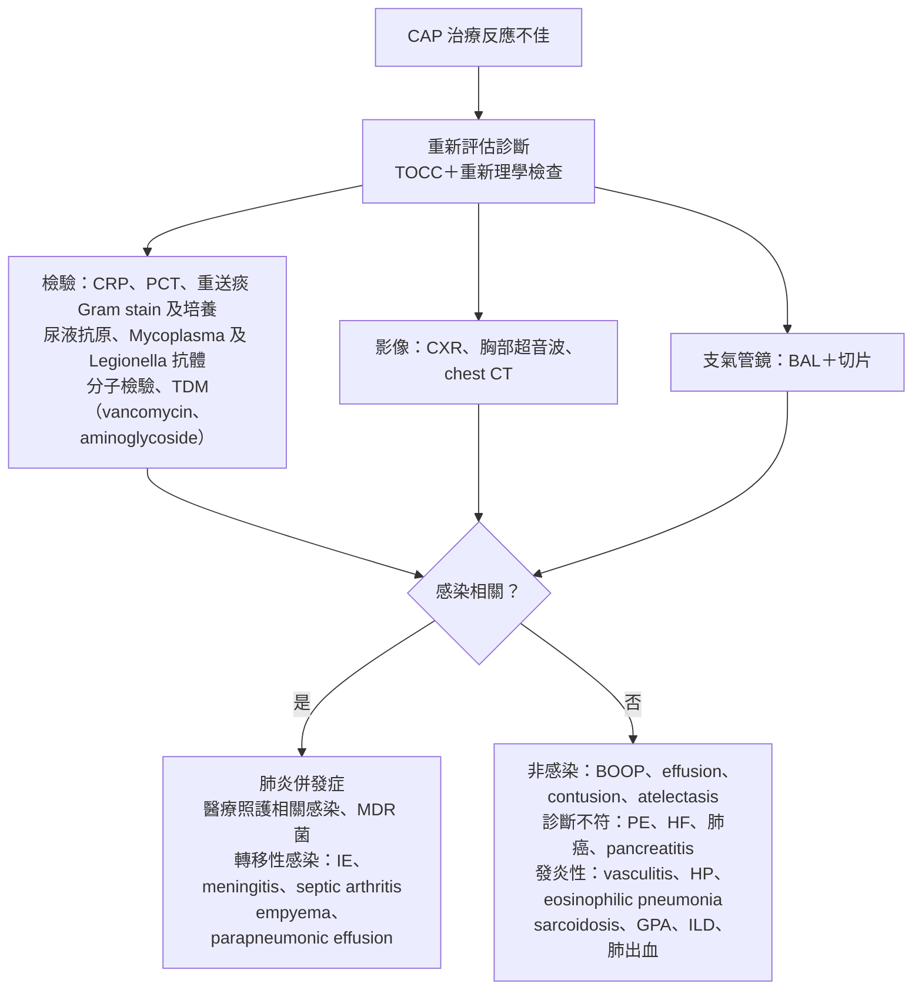
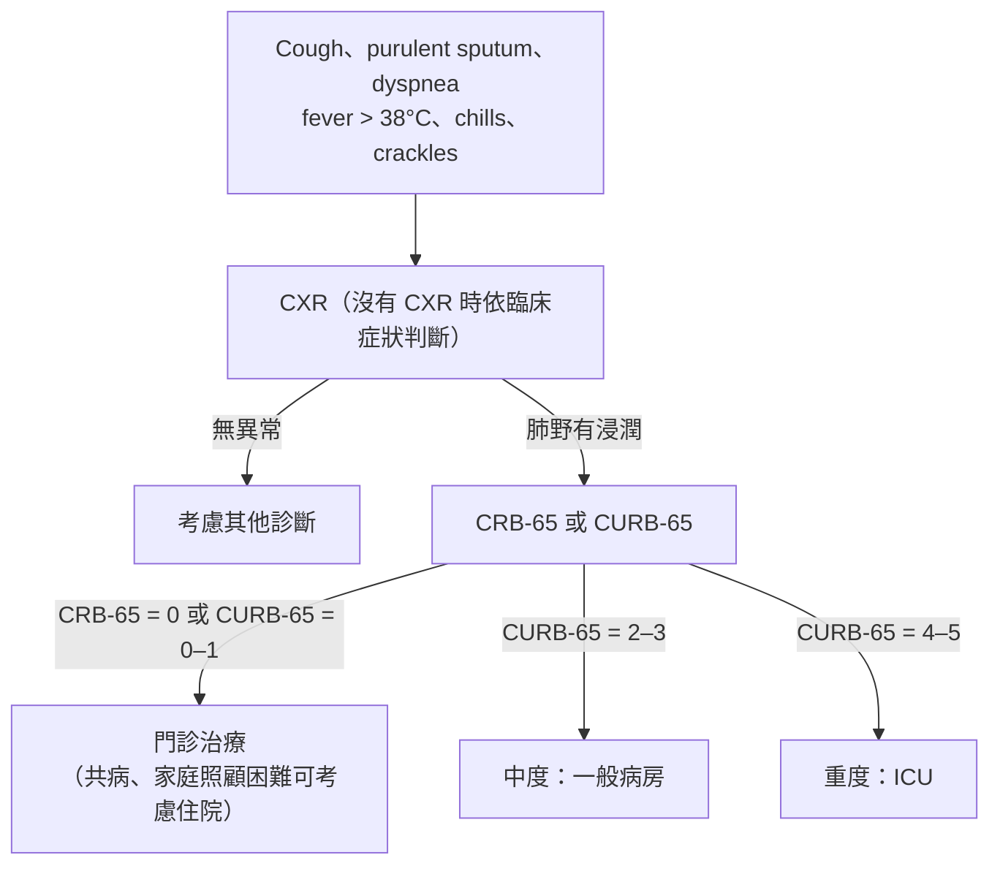

> [!abstract] 一句話重點
> 台灣 CAP 前五名：**S. pneumoniae（23%）、Mycoplasma（14%）、C. pneumoniae（8%）、K. pneumoniae（7%）、H. influenzae（5%）**；颱風後的 **melioidosis**、Q fever、scrub typhus 是台灣特色。臨床表現分不出病原，所以**經驗性治療要同時 cover 典型＋非典型**。嚴重度用 **CURB-65**（2B）：==0–1 門診、2–3 住院、4–5 考慮 ICU==。住院 CAP 抽 **2 套血液培養（每套 10 mL）**＋**痰 Gram stain／culture**；**嚴重 CAP 加做 pneumococcal 與 Legionella 尿液抗原**（1B）。治療失敗以 **72 h** 分早期與晚期，先問「**診斷對不對？有沒有併發症？**」

> [!info] 系列導覽
> ↑ 回到 [[infectious-disease/pneumonia/index|台灣肺炎診治指引總覽]]
>
> ① [[infectious-disease/pneumonia/pna-1-definition-prevention|定義、分類與預防]]｜② CAP 病原、診斷與嚴重度（本篇）｜③ [[infectious-disease/pneumonia/pna-3-cap-treatment|CAP 與 HCAP 治療]]｜④ [[infectious-disease/pneumonia/pna-4-special-pathogens|特殊病原與免疫不全]]｜⑤ [[infectious-disease/pneumonia/pna-5-hap-vap|HAP／VAP]]｜⑥ [[infectious-disease/pneumonia/pna-exam|內專考點]]
>
> 本篇來源：台灣肺炎診治指引 2018 第二章 2-1、2-3、2-4、2-5

## 台灣 CAP 的病原

- *S. pneumoniae* 仍最常見但比例下降（平均約 27%）；亞洲資料中它的角色比西方小
- 依年齡：**> 60 歲**以 *S. pneumoniae* 較多；**中壯年的重症肺炎要想到 *K. pneumoniae***；**年輕人**要想到 *Mycoplasma*
- **Mixed infection 約 13–16%**
- 重症合併呼吸衰竭：*S. pneumoniae*、*K. pneumoniae*、*P. aeruginosa*、*S. aureus*，偶有 MDR 菌

> [!tip] 台灣地域性病原
> - **Melioidosis（*Burkholderia pseudomallei*）**：每年約 50 例，**南台灣颱風、豪雨後**，約 70% 有肺炎，預後差 → ④ [[infectious-disease/pneumonia/pna-4-special-pathogens#類鼻疽 Melioidosis|類鼻疽]]
> - **Q fever（*Coxiella burnetii*）**：每年 50–100 例，13.5% 以肺炎表現；問動物接觸史
> - **Scrub typhus**：每年約 400 例，36% 以肺炎表現；未治療約 15% 進展為 ARDS

### 典型 vs 非典型：臨床線索

| | 典型細菌（含 *Legionella*） | 非典型（*Mycoplasma*、*Chlamydophila*） | 病毒 | 流感 |
| --- | --- | --- | --- | --- |
| **病程** | **急性**；可合併 septic shock；先 URI 後**急性惡化**（病毒＋細菌） | 咳嗽 **> 5 天**但沒有急性惡化；家庭群聚 | URI 症狀起頭；明顯接觸史 | 流行季節或地區；典型類流感症狀 |
| **症狀** | 缺乏 URI 症狀 | **乾咳**為主 | — | — |
| **WBC** | **> 15,000 或 ≤ 6,000＋left shift** | 正常或輕度上升 | 正常或輕度上升 | — |
| **影像** | **Lobar consolidation** | — | **Patchy infiltrates** | — |
| **PCT** | **≥ 0.25 µg/L** | ≤ 0.1 µg/L | ≤ 0.1 µg/L | 流感檢驗陽性 |

> [!warning] Pitfall
> 用臨床表現猜病原**不準**，治療上仍要**同時考慮典型與非典型**。Legionella 雖屬非典型菌，臨床表現卻像典型細菌肺炎（高燒、重症）。肺外表現：**Legionella**＝headache、意識改變、diarrhea、**hyponatremia**；**Mycoplasma**＝otitis、pharyngitis、SJS-like 皮疹、**hemolytic anemia**。

### CAP 的多重抗藥菌危險因子

MDR CAP 盛行率約 1.9–3.3%；痰培養陽性者中 MRSA 約 9.4%、*P. aeruginosa* 約 4.1%。一般危險因子：**90 天內用過抗生素**、**PPI 或 H2RA**、**管灌**、**長期臥床**。

| 菌種 | 危險因子 |
| --- | --- |
| ***P. aeruginosa*** | **結構性肺病**（COPD、**bronchiectasis**）、近期抗生素、長期類固醇 |
| ***A. baumannii*** | **酗酒**、抽菸、DM 或慢性肺病 |
| **MRSA** | 近期抗生素；**病情嚴重**（意識不清、急診就需升壓劑或呼吸器）；**CXR 多處浸潤或 cavitation**；DM、cirrhosis、CKD；長照機構；近期接觸皮膚感染者；MRSA 病史 |
| **ESBL Enterobacteriaceae** | 近期抗生素、長照機構、**氣切** |

> [!info] 🆕 新版指引（ATS/IDSA CAP 2019）
> 不再用 HCAP 的廣泛清單決定 cover MRSA／*Pseudomonas*。最強的兩個危險因子是：**==過去呼吸道曾培養出 MRSA 或 P. aeruginosa==**，以及**近 90 天住院並接受 IV 抗生素**；後者需要當地資料佐證。符合時才經驗性 cover，並**送培養（＋MRSA nasal PCR）以便 48 h 後降階**。

## 嚴重度評估

### CURB-65

| 字母 | 項目（各 1 分） |
| --- | --- |
| **C** | Confusion |
| **U** | **BUN > 20 mg/dL** |
| **R** | **RR ≥ 30/min** |
| **B** | **SBP < 90 或 DBP ≤ 60 mmHg** |
| **65** | **年齡 ≥ 65** |

| 分數 | 嚴重度 | 建議 |
| --- | --- | --- |
| **0–1** | 輕度 | **門診** |
| **2–3** | 中度 | **住院** |
| **4–5** | 重度（部分研究死亡率 > 40%） | **可能需要 ICU** |

- 門診沒有抽血可用 **CRB-65**（拿掉 BUN）：**≥ 1 項就建議住院**
- **PSI** 對低風險的預測較好，但分兩步驟、較複雜
- **==CPIS 不適合用在 CAP==**（研究族群幾乎都是 VAP／HAP）
- 建議：**用 CURB-65 評估 CAP 嚴重度（2B）**

> [!info] 🆕 新版指引（ATS/IDSA CAP 2019）：誰需要住 ICU？
> 原書只簡列部分 ATS 標準。ATS/IDSA 的 **severe CAP** 定義：**1 項 major 或 ≥ 3 項 minor**
> - **Major**：**septic shock 需升壓劑**、**呼吸衰竭需插管**
> - **Minor**：RR ≥ 30、**PaO₂/FiO₂ ≤ 250**、**multilobar infiltrates**、confusion、BUN ≥ 20 mg/dL、**WBC < 4,000**（感染造成）、**PLT < 100,000**、T < 36°C、需積極輸液的 hypotension
> - 符合 severe CAP → 建議入住 ICU；2019 指引決定門診或住院**優先用 PSI**、CURB-65 為輔，再加上臨床判斷

## 影像

| 檢查 | 角色 | GRADE |
| --- | --- | --- |
| **CXR** | **==建立肺炎診斷最重要的檢查==**；猜病原（細菌：lobar consolidation；Legionella、Mycoplasma、Chlamydophila、病毒：常為雙側浸潤；TB：上肺、cavity、calcified node）；看併發症（effusion、empyema）；追蹤治療反應 | 1C |
| **Chest CT** | **不是常規**（費用、輻射）；診斷不確定或有**免疫不全**時考慮；*Aspergillus*、TB、*Pneumocystis* 有特徵性影像；老人與免疫不全較有預後價值 | 2C |

> [!info] 🆕 新版指引（ATS CAP 2025）
> **Lung ultrasound** 可作為 CXR 或 CT 的替代，前提是**沒有方便的影像**且有受過 POCUS 訓練的人員（conditional recommendation）。

## 血液與尿液檢查

### 血液培養

| 建議 | GRADE |
| --- | --- |
| **輕到中度（門診）CAP：不常規抽** | 1C |
| **嚴重 CAP（需住院或免疫不全）：血液培養＋適當痰培養** | 1C |
| 高風險免疫不全（HIV、移植、血液腫瘤）：加做**黴菌與分枝桿菌**血液培養＋痰培養 | 1C |
| **==抗生素前抽；2 套、不同部位（每套 aerobic＋anaerobic 兩瓶）；每套 10 mL==** | 1B |

- 只有 < 20% 的肺炎能由血液培養確診，但**陽性者屬高危險群**，常合併其他部位感染
- 關鍵是**每套血量 10 mL**，不是抽血時間點；*S. pneumoniae* 等 GPC 在 anaerobic 瓶長得最好

> [!info] 🆕 新版指引（ATS/IDSA CAP 2019）
> 住院 CAP 的血液與痰培養只在以下情況**常規做**：**severe CAP**、**經驗性 cover MRSA 或 *P. aeruginosa***、**過去呼吸道曾培養出 MRSA／*P. aeruginosa***、**近 90 天住院並接受 IV 抗生素**。非嚴重且無上述因子者不需常規抽。

### 血清學與分子檢驗

- **血清學**：要急性期＋恢復期配對，無法早期診斷，臨床價值不高；只用在難培養的菌（*Mycoplasma*、*Legionella*、*C. pneumoniae*、*B. pertussis*）及 RSV、adenovirus
- **==嚴重（如 invasive pneumococcal disease）或罕見病原（Cryptococcus、PCP）造成的 CAP，要篩 HIV==**
- **PCR**：適合難培養或長得慢的菌；除 AFB 陽性的分枝桿菌、influenza、adenovirus 外**不建議常規做**；無法分辨 colonization，建議用**下呼吸道檢體**

### 生物標記

| 標記 | 特性 | 用法 |
| --- | --- | --- |
| **CRP** | 刺激後約 6 h 上升、48 h 達峰；敏感、不特異 | 只能輔助，不能單獨決定診斷或是否給抗生素；分辨嚴重度與典型或非典型的效果不一 |
| **PCT** | 2–4 h 上升，可追趨勢 | **PCT 輔助決策**：30 天死亡率 8.6% vs 10.0%、治療失敗率無差、**抗生素少用約 2.4 天**、副作用較少；**合併 CURB-65** 更能判斷嚴重度；低 PCT 暗示病毒，但仍需配合臨床 |
| **Pro-ADM** | 和 PCT 同基因 | 濃度高 → 死亡率與併發症高；合併 CURB-65 判斷嚴重度更好 |

| 建議 | GRADE |
| --- | --- |
| 評估嚴重度與治療反應時，**生物標記是輔助**臨床與影像的工具 | 1B |
| 決定是否給抗生素時，**PCT 可輔助**作為抗生素管理的參考 | 1B |

> [!info] 🆕 新版指引（ATS/IDSA CAP 2019）
> **==不要用 PCT 決定「要不要開始」抗生素==**（strong）：臨床與影像診斷 CAP 就給經驗性抗生素，不論 PCT 高低。PCT 的角色在**停藥與縮短療程**。

### 尿液抗原

| | *S. pneumoniae* | *Legionella* |
| --- | --- | --- |
| **敏感度** | **52–78%**（有菌血症較高，約 80–85%） | **56–99%**，隨病情嚴重度上升；serogroup 1 約 80–90% |
| **特異度** | > 90% | 約 99% |
| **速度** | 約 15 分鐘 | 約 30 分鐘 |
| **優點** | **用過抗生素後仍可能陽性** | 用過抗生素後仍有幫助；比其他方法便宜 |
| **限制** | 無藥敏；*S. mitis*、*S. oralis* 偽陽性；**前次感染後 4–6 週仍有 40–70% 陽性**；無法分型（Luminex 可分 13 型） | **==只能測 L. pneumophila serogroup 1==**；陽性可持續 1–2 個月，免疫低下可長達 10 個月以上 |

- 建議：**==嚴重 CAP 做 pneumococcal 與 Legionella 尿液抗原快篩==**（1B）
- Legionella：一般建議**痰培養＋尿液抗原**一起送；當地若多為非 serogroup 1，改送培養＋分子檢驗；臨床符合但院內只有 serogroup 1 試劑 → 可通報疾管署採檢

| 退伍軍人症診斷方法 | 檢體 | 敏感度 | 特異度 |
| --- | --- | --- | --- |
| **尿液抗原** | 尿液 | 56–99% | 99% |
| **培養** | 痰、下呼吸道檢體、組織、肋膜液、血液 | 20–95% | **100%** |
| 免疫螢光染色 | 同上 | 20–50% | 99% |
| PCR | 痰、下呼吸道檢體、尿液 | 70–95% | 90–95% |
| 抗體 | 配對血清 | 20–70% | 95–99% |

## 呼吸道檢體

### 痰液 Gram stain 與培養

- 建議：**==能取得好品質的檢體並快速送檢時，所有病人治療前都要做痰 Gram stain＋培養==**（1B）
- 檢體 **2 小時內**送到實驗室；來不及就 2–8°C 保存，**不超過 24 小時**
- 先用抗生素會降低陽性率，但菌血性肺炎鏈球菌肺炎在抗生素 10 h 內影響不大
- Gram stain 看到 *S. aureus* 或 GNB → 不是常見 CAP 菌，可以及早調整
- **==發炎的痰（很多 PMN）卻看不到細菌 → 想非典型病原==**（*Mycoplasma*、*Chlamydophila*、*Legionella*、病毒）

### 支氣管鏡

- **不是 CAP 的常規檢查**（1C）。適應症：**治療反應不佳**、**CXR 浸潤延遲吸收**、懷疑 **TB 或黴菌**、**懷疑腫瘤**、**異物**、**免疫不全**
- 定量培養閾值：**PSB ≥ 10³ CFU/mL**、**BAL ≥ 10⁴ CFU/mL**
- BAL 可以找出非感染原因（pulmonary hemorrhage、acute eosinophilic pneumonia）；lymphocyte 比例高 → 想病毒或 *Chlamydophila*

### 氣管內管抽吸（ETA）

嚴重 CAP 插管者要**盡快送 ETA 培養**；目前沒有證據顯示 BAL、PSB 能取代 ETA 當第一線。住院治療後才取的檢體可信度下降，GNB 尤其要小心 colonization。

### 經皮穿刺

- 對**較小或周邊（貼近肋膜）的病灶**，優先考慮**超音波或 CT 導引細針抽吸或切片**（1C）；瀰漫性病灶較適合支氣管鏡
- 特異度 80–100%、敏感度中等（切片優於細針）
- 併發症：**pneumothorax 5–30%**（需胸管 1–15%）、肺出血 4–27%（明顯咳血約 4%）

## 治療評估與治療失敗

### Clinical stability（以下全部符合）

**T < 37.8°C、HR < 100、RR < 24、SBP > 90、SpO₂ > 90%（room air）、能經口進食、意識正常**

### 治療失敗的定義

| 類型 | 定義 |
| --- | --- |
| 門診 | 因抗藥或療效不佳需要換抗生素或住院 |
| **早期失敗** | 住院治療 **72 h 內**臨床惡化（持續發燒、休克、呼吸衰竭、死亡） |
| **晚期失敗** | 住院治療 **≥ 72 h 後**才臨床惡化 |

> [!tip] 先觀察 3 天
> 肺炎改善需要幾天，**==前 72 h 改善不如預期，可能只是自然病程==**。約 12% 對抗生素沒反應的病人最後證實是**非感染**（心衰竭、vasculitis 等）。

### 治療失敗的原因

| 時間 | 類別 | 原因 |
| --- | --- | --- |
| **早期（< 72 h）** | 自然病程 | 抗生素需要數天才見效 |
| | 抗生素問題 | 沒 cover 到病原、抗藥菌、忽略藥敏或 PK |
| | 併發症 | **Parapneumonic effusion、empyema**；散佈性感染：endocarditis、meningitis、septic arthritis、pericarditis、cholecystitis |
| | 診斷錯誤 | **PE**、aspiration、**ARDS**、vasculitis（如 SLE） |
| **晚期（≥ 72 h）** | 抗生素問題 | 同上 |
| | 併發症 | Effusion、empyema |
| | **院內感染** | **醫療照護相關肺炎**、其他院內感染、肺外感染源 |
| | 非感染 | BOOP（organizing pneumonia）、atelectasis、支氣管阻塞、vasculitis、HP、eosinophilic pneumonia、sarcoidosis、GPA、ILD、肺出血 |
| | 診斷錯誤 | 肺梗塞、**心衰竭**、PE、**肺癌**、pancreatitis |
| | 共病惡化 | MI、腎衰竭 |
| | 其他 | **藥物熱**、異物 |

### 病史與病原的對應（內專愛考）

| 病史或暴露 | 要想到 |
| --- | --- |
| **吸入、嗆咳** | GNB（enteric）、**oral anaerobes** |
| **酗酒** | *S. pneumoniae*、oral anaerobes、***K. pneumoniae***、***Acinetobacter***、TB |
| **COPD、抽菸** | ***H. influenzae***、*P. aeruginosa*、*Legionella*、*S. pneumoniae*、***M. catarrhalis***、*C. pneumoniae* |
| **DM** | *S. pneumoniae*、influenza、TB、黴菌、***K. pneumoniae*** |
| 氣道阻塞 | Anaerobes、*S. pneumoniae*、*H. influenzae*、*S. aureus* |
| **鳥禽接觸** | ***C. psittaci***（家禽：avian influenza） |
| **其他動物接觸（牛羊、分娩物）** | ***Coxiella burnetii*（Q fever）** |
| HIV 早期 | *S. pneumoniae*、*H. influenzae*、TB |
| HIV 晚期 | 上述＋**PCP**、*Cryptococcus*、*Histoplasma*、*Aspergillus*、MAC、*M. kansasii*、*P. aeruginosa*、*H. influenzae* |
| **藥癮（IVDU）** | ***S. aureus***（含 CA-MRSA）、anaerobes、TB、*S. pneumoniae* |
| **Lung abscess** | CA-MRSA、oral anaerobes、endemic fungi、TB、NTM |
| **結構性肺病（bronchiectasis）** | ***P. aeruginosa***、*B. cepacia*、*S. aureus* |
| SLE | TB、*Nocardia*、*Aspergillus* |
| 東南亞旅遊 | ***B. pseudomallei***、influenza、avian influenza、SARS |
| 美國西南部 | *Coccidioides*、Hantavirus |
| **流感流行時** | Influenza、*S. pneumoniae*、***S. aureus***、*H. influenzae* |
| 咳 > 2 天＋whoop、咳後嘔吐 | *B. pertussis* |
| **冷卻水塔群聚** | ***Legionella*** |
| 生物恐攻 | Anthrax、plague、tularemia |

### 治療失敗怎麼查？

依原圖內容重新繪製（台灣肺炎指引圖 2.5.2）。

- **==CRP、PCT 不能單獨作為治療或追蹤的依據==**；治療失敗時若 **CRP 或 PCT 低 → 想其他鑑別診斷**；已確定是感染相關的失敗，不建議持續追 CRP／PCT 評估療效
- 宿主因素：黴菌最重要的是 **neutropenia**；非 neutropenia 的黴菌風險為長期大量類固醇、COPD、cirrhosis、**ICU > 1 週**、AIDS、肺移植
- 增加治療失敗的因素：年紀大、酗酒、抽菸、**一開始就 multilobar**、合併 **empyema** 或**菌血症**、asplenia、惡性腫瘤、神經疾病、免疫抑制

## 🌳 CAP 診斷流程

依原圖內容重新繪製（台灣肺炎指引圖 2.5.1）。

## 相關筆記

- [[infectious-disease/pneumonia/pna-3-cap-treatment|③ CAP 與 HCAP 治療]]
- [[infectious-disease/pneumonia/pna-4-special-pathogens|④ 特殊病原與免疫不全]]
- [[infectious-disease/pneumonia/pna-exam|⑥ 內專考點]]

## 參考資料

- 台灣感染症醫學會、台灣胸腔暨重症加護醫學會。台灣肺炎診治指引 2018。第二章 2-1 常見菌種（主編：柯文謙）、2-3 診斷措施（一）（主編：古世基）、2-4 診斷措施（二）（主編：陽光耀）、2-5 治療評估及診斷流程（主編：詹明澄）。（參考資料庫：感染科／台灣肺炎指引.pdf）
- Metlay JP, et al. Diagnosis and Treatment of Adults with Community-acquired Pneumonia. An Official Clinical Practice Guideline of the ATS and IDSA. *Am J Respir Crit Care Med* 2019;200:e45-e67.
- Jones BE, Ramirez JA, Oren E, et al. Diagnosis and Management of Community-acquired Pneumonia. An Official American Thoracic Society Clinical Practice Guideline. *Am J Respir Crit Care Med* 2025. doi:10.1164/rccm.202507-1692ST
- Mandell LA, et al. IDSA/ATS Consensus Guidelines on the Management of Community-Acquired Pneumonia in Adults. *Clin Infect Dis* 2007;44(Suppl 2):S27-72.（severe CAP major／minor criteria）
