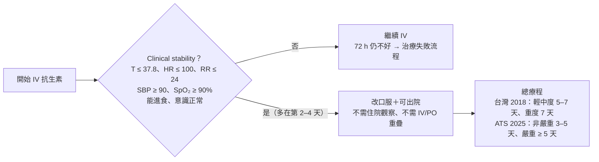

> [!abstract] 一句話重點
> - 經驗性治療依 **CURB-65** 分層：**門診**＝β-lactam（amoxicillin、amox/clav、cefuroxime）或 doxycycline／macrolide
>   - <strong>一般病房 CURB-65 ≥ 2</strong>＝<strong>β-lactam＋macrolide 優於 β-lactam 單用（1B）</strong>
>   - **ICU**＝**β-lactam＋macrolide 或＋respiratory FQ**
> - **==台灣肺炎鏈球菌對 azithromycin 已不可靠==**；**懷疑 TB 先別用 levofloxacin、moxifloxacin**（2C）
> - 療程：達 clinical stability 後輕中度 **5–7 天**（1B）、重度 **7 天**（2C）；**IV 2–4 天後可改口服**（1B）
> - 🆕 ATS 2025：非嚴重 CAP 可縮到 **3–5 天**；**嚴重 CAP 建議 corticosteroid**

> [!info] 系列導覽
> ↑ 回到 [[infectious-disease/pneumonia/index|台灣肺炎診治指引總覽]]
>
> ① [[infectious-disease/pneumonia/pna-1-definition-prevention|定義、分類與預防]]｜② [[infectious-disease/pneumonia/pna-2-cap-diagnosis|CAP 病原、診斷與嚴重度]]｜③ CAP 與 HCAP 治療（本篇）｜④ [[infectious-disease/pneumonia/pna-4-special-pathogens|特殊病原與免疫不全]]｜⑤ [[infectious-disease/pneumonia/pna-5-hap-vap|HAP／VAP]]｜⑥ [[infectious-disease/pneumonia/pna-exam|內專考點]]
>
> 本篇來源：台灣肺炎診治指引 2018 第二章 2-7-1、2-7-2、2-7-4

## 經驗性治療的邏輯

| 情境 | 原則 |
| --- | --- |
| **門診，無共病、3 個月內沒用抗生素**（CRB-65 0–1） | **單一藥物**：β-lactam 治典型，或非 β-lactam（macrolide、tetracycline）治非典型（*Mycoplasma*、*Chlamydophila*）——依症狀與病史選 |
| **門診，有共病或 3 個月內用過抗生素** | 單一藥物，或 **β-lactam＋macrolide** |
| **住院但低嚴重度**（CURB-65 0–1，因獨居、無法回診、共病不穩而住） | 同門診，可改針劑（腸胃不適或吸收有疑慮時） |
| **一般病房，中度**（CURB-65 2–3） | **==β-lactam＋macrolide==**；FQ、tigecycline 為另選 |
| **ICU，重度**（CURB-65 4–5） | **β-lactam＋macrolide** 或 **β-lactam＋FQ** |
| 特殊考量 | *P. aeruginosa*、MRSA 風險、吸入性肺炎 → 見下表「特殊考量」 |

### 為什麼中度以上要加 macrolide？

- 兩個 RCT 合計約 580 人：β-lactam 單用 vs BL＋macrolide，死亡率、轉 ICU 無差異，但**單用 β-lactam 30 天再住院較多**；**PSI IV 或 CURB-65 ≥ 2** 的次族群合併治療有較好的趨勢；**非典型菌（尤其 *Legionella*）感染**單用 β-lactam 會**延遲 clinical stability**
- 統合分析：**==只有在 PSI IV 或 CURB-65 ≥ 2 時，BL＋macrolide 比 β-lactam 單用降低死亡率==**
- 結論：**CURB-65 ≥ 2 用合併治療**；低嚴重度可考慮 β-lactam 單用

### ICU：BL＋macrolide 還是 BL＋FQ？

- 兩篇觀察性研究的統合分析：**BL＋FQ 死亡率較高**（RR 1.33；另一篇 19.4% vs 26.8%，OR 0.68 偏向 BL＋macrolide），但證據品質**非常低**
- 台灣的 macrolide **只有口服劑型**（重症吸收不穩），所以**兩種組合並列**

> [!danger] Fluoroquinolone 與 TB
> 台灣是 TB 中度負擔國家。診斷 TB 前使用 FQ：**==FQ 抗藥風險約 2.7–2.8 倍、診斷平均延遲約 19 天==**。臨床懷疑或有 TB 風險 → **避免 levofloxacin、moxifloxacin，直到排除 TB**（2C）。Gemifloxacin、nemonoxacin 對 TB 無效（但是否影響後續 TB 治療仍不明）。

## Table 2.7.1：CAP 經驗性抗生素（重新整理）

### 門診（CRB-65 0–1）

| 族群 | 首選 | 另選 |
| --- | --- | --- |
| **無共病、3 個月內沒用抗生素** | **典型**：Amoxicillin 500 mg–1 g PO q8h；Amox/clav 1–2 g PO q12h；Ampicillin/sulbactam（sultamicillin）375–750 mg PO q12h；Cefaclor 500 mg PO q8h；Cefuroxime 500 mg PO q12h **懷疑非典型**：Azithromycin 500 mg PO qd；Clarithromycin 500 mg PO q12h；Doxycycline 100 mg PO q12h；Minocycline 100 mg PO q12h | — |
| **有共病或 3 個月內用過抗生素** | 上述 β-lactam **± azithromycin 或 clarithromycin** | **Moxifloxacin 400 mg PO qd**；**Levofloxacin 500–750 mg PO qd**；Gemifloxacin 320 mg PO qd；Nemonoxacin 500 mg PO qd |

### 住院

| 嚴重度 | 首選 | 另選 |
| --- | --- | --- |
| **低（CURB-65 0–1），非嚴重度因素住院** | 上述口服 β-lactam，或 Penicillin G 1–2 MU IV q4–6h；Ampicillin 1–2 g IV q6h；Amox/clav 1.2 g IV q8h；Ampicillin/sulbactam 1.5–3 g IV q6h；Cefuroxime 1.5 g IV q8h **± azithromycin 或 clarithromycin** | Moxifloxacin 400 mg PO/IV qd；Levofloxacin 500–750 mg PO/IV qd；Gemifloxacin；Nemonoxacin |
| **中（CURB-65 2–3），一般病房** | Amox/clav 1.2 g IV q8h；Ampicillin/sulbactam 1.5–3 g IV q6h；Cefuroxime 1.5 g IV q8h；**Ceftriaxone 2 g IV qd**；Cefotaxime 1–2 g IV q8h；Ertapenem 1 g IV qd **＋ azithromycin 500 mg PO qd 或 clarithromycin 500 mg IV/PO q12h** | Moxifloxacin 400 mg IV qd；Levofloxacin 500–750 mg IV qd；Tigecycline 100 mg 一劑後 50 mg IV q12h（需照會感染科）；Ceftaroline 600 mg IV q12h |
| **重（CURB-65 4–5），ICU** | 上述 β-lactam 擇一 **＋ macrolide**（clarithromycin 500 mg IV/PO q12h、azithromycin 500 mg PO qd） **或＋ FQ**（moxifloxacin 400 mg IV qd、levofloxacin 500–750 mg IV qd） | — |

### 特殊考量

| 情境 | 建議藥物 |
| --- | --- |
| ***P. aeruginosa* 風險** | Piperacillin/tazobactam 4.5 g IV q6–8h；Cefoperazone/sulbactam 4 g IV q12h；**Cefepime 2 g IV q8h**；Imipenem 500 mg IV q6h–1 g q8h；Meropenem 1 g IV q8h；（原書另列 ticarcillin/clavulanate） **± ciprofloxacin 400 mg IV q8–12h、levofloxacin 750 mg IV qd 或 amikacin 15–20 mg/kg IV qd**（避免抗藥導致失敗；藥敏出來就降成單一有效藥） |
| **MRSA 風險** | **Vancomycin 15–20 mg/kg IV q8–12h**；Teicoplanin 6–12 mg/kg IV q12h × 3–5 劑後 qd；**Linezolid 600 mg PO/IV q12h** |
| **吸入性肺炎或厭氧菌風險** | **單方**：Amox/clav（PO 1–2 g q12h 或 IV 1.2 g q8h）、Ampicillin/sulbactam（PO 或 IV 1.5–3 g q6h）、**Moxifloxacin 400 mg qd**、Ertapenem 1 g IV qd **或合併**：cefaclor、cefuroxime、ceftriaxone、cefotaxime 擇一＋**metronidazole 500 mg PO/IV q8h**；選藥強度依嚴重度 |

表註重點：
- 門診用 **CRB-65**；療程「退燒 48 h 且臨床穩定」後 **5–7 天**（ICU **7 天**），**azithromycin 療程 3–5 天**
- **Ertapenem**：有腸內菌（尤其 ESBL）風險、但**沒有 *P. aeruginosa* 風險**時使用
- **Tigecycline**：FDA 警示 IV 使用死亡率較高 → 照會感染科

> [!warning] Pitfall：台灣的 macrolide 抗藥
> - **==台灣 S. pneumoniae 對 azithromycin 已不可靠==**，門診單用 macrolide 要謹慎
> - **Macrolide-resistant *Mycoplasma*** 在亞洲比例高（中國研究可達 95%）→ 改用 **doxycycline、minocycline 或 respiratory FQ**

> [!info] 🆕 新版指引（ATS/IDSA CAP 2019）：美國的經驗性處方
> | 族群 | 建議 |
> | --- | --- |
> | 門診、**無共病** | **Amoxicillin 1 g PO tid**，或 **doxycycline 100 mg PO bid**；macrolide 單用**只限當地 pneumococcal macrolide 抗藥 < 25%**（台灣不符合） |
> | 門診、**有共病**（慢性心肺肝腎病、DM、酒癮、惡性腫瘤、asplenia） | **Amox/clav 或 cephalosporin（cefuroxime、cefpodoxime）＋ macrolide 或 doxycycline**；或 **respiratory FQ 單用** |
> | 住院、非嚴重 | **β-lactam＋macrolide**，或 **respiratory FQ 單用** |
> | 住院、嚴重 | **β-lactam＋macrolide** 或 **β-lactam＋respiratory FQ** |
> | **吸入性肺炎** | **==不常規加 anaerobe coverage==**，除非懷疑 **lung abscess 或 empyema** |
> | MRSA／*Pseudomonas* | 只有**過去呼吸道曾培養出**，或**近 90 天住院＋IV 抗生素**（有當地資料）才 cover；同時送培養以便降階 |

## 療程、改口服與 clinical stability

| 建議 | GRADE |
| --- | --- |
| 達 clinical stability 後，**輕到中度 CAP 療程 5–7 天**安全有效 | 1B |
| 達 clinical stability 後，**重度 CAP 療程 7 天**安全有效 | 2C |
| 達 clinical stability 後，**IV 2–4 天改口服**安全有效（不論嚴重度） | 1B |
| **FQ 經驗性治療會延遲 TB 診斷並增加抗藥**，懷疑 TB 者審慎使用 | 2C |

- **Clinical stability**：T ≤ 37.8°C、HR ≤ 100、RR ≤ 24、SBP ≥ 90、room air SpO₂ ≥ 90% 或 PaO₂ ≥ 60 mmHg、**能經口進食**、**意識正常**（最後兩項是**出院或改口服**的條件，不是判斷治療失敗的標準）
- 原則：**至少 5 天**，且**退燒 48–72 h**、臨床穩定；多數病人 3–7 天內達穩定
- 支持證據：2016 年西班牙 RCT（312 人，38.8% 為 PSI IV–V）證實達穩定後 **5 天療程**安全；IV 2–4 天改口服可**縮短住院約 3.3 天**
- **要延長**的情況：初始抗生素無效、**MRSA**、**melioidosis**、黴菌等少見病原

> [!info] 🆕 新版指引（ATS CAP 2025）
> | 主題 | 新建議 |
> | --- | --- |
> | **療程** | 門診有共病者、住院**非嚴重** CAP 達 clinical stability → **==3–5 天（最少 3 天）==**（conditional）；**嚴重 CAP → ≥ 5 天**（strong）。不適合縮短：重症風險、需長療程的病原、併發症、MDR 風險 |
> | **Corticosteroid** | **==嚴重 CAP 建議給==**（conditional；**符合嚴重度標準 24 h 內開始**、ICU、呼吸衰竭、發炎指數高時更支持）；**非嚴重 CAP 不要給**（strong）；**流感肺炎不建議** |
> | **病毒檢驗陽性** | 住院 CAP（不論嚴重度）仍**給經驗性抗生素**；門診**無共病不給**、有共病給（IDSA 對後兩項病毒陽性族群的抗生素建議有不同意見） |
>
> Corticosteroid 的主要依據是 **CAPE COD 試驗**（ICU 嚴重 CAP，**hydrocortisone 200 mg/day × 4 或 7 天後減量**，28 天死亡 **6.2% vs 11.9%**）。2018 台灣指引未討論類固醇（原書未涵蓋）。

## 已知病原的治療

### Gram-positive 與非典型

| 菌種 | 首選 | 另選 | 療程 |
| --- | --- | --- | --- |
| ***S. pneumoniae*，penicillin MIC < 2** | **Penicillin G 2–3 MU IV q4h**；Amoxicillin 1 g PO q8h；Amox/clav 1.2 g IV/PO q12h；Ampicillin 2 g IV q6h；Ampicillin/sulbactam 1.5–3 g IV/PO q6h | Cefuroxime 1.5 g IV q8h；Ceftriaxone 1–2 g IV q12h；Cefotaxime 1–2 g IV q8h；Levofloxacin 750 mg qd；Moxifloxacin 400 mg qd；Doxycycline 100 mg q12h | **5–7 天**；**==合併菌血症 10–14 天==** |
| *S. pneumoniae*，**penicillin MIC ≥ 2** | Cefotaxime、ceftriaxone、vancomycin、linezolid、FQ（levofloxacin、moxifloxacin）、**高劑量 amoxicillin 3 g/day**（MIC ≤ 4 時） | — | 同上 |
| ***S. aureus*，MSSA** | **Oxacillin 2 g IV q4–6h**；**Cefazolin 2 g IV q8h**；Flucloxacillin 2 g IV q4h | Amox/clav 1.2 g q8h；Levofloxacin 750 mg qd；Moxifloxacin 400 mg qd；Vancomycin；Teicoplanin；Clindamycin 600 mg IV/PO q8h | **7–14 天**；**菌血症可延長到 4 週** |
| ***S. aureus*，MRSA** | **Vancomycin 15–20 mg/kg IV q8–12h**（免疫不全建議 q6h）± rifampicin；Teicoplanin 6–12 mg/kg q12h × 3–5 劑後 qd ± rifampicin；**Linezolid 600 mg PO/IV q12h** | TMP-SMX DS 1–2 # PO q12–24h，或 TMP 8–20 mg/kg/day IV 分 q6–12h | 7–14 天 |
| ***Mycoplasma*** | Doxycycline 100 mg q12h（7–14 天）；Minocycline 200 mg 一劑後 100 mg q12h（7–14 天）；Azithromycin 500 mg D1 後 250 mg qd（**5 天**）；Clarithromycin 500 mg q12h（10 天）；Levofloxacin 750 mg qd、Moxifloxacin 400 mg qd（7–14 天） | — | 見左 |
| ***C. pneumoniae*** | Azithromycin（5 天）；Clarithromycin、doxycycline、moxifloxacin（10 天）；Levofloxacin 500–750 mg qd（7–10 天） | — | 見左 |
| ***Legionella*** | **Levofloxacin 750 mg IV/PO qd**；**Moxifloxacin 400 mg qd**；**Azithromycin 1000 mg D1 後 500 mg qd**；Clarithromycin 500 mg q12h | Doxycycline 100 mg q12h | **7–10 天**；免疫不全或重症可到 **21 天** |

- ***S. pneumoniae***：觀察性研究顯示 penicillin、cephalosporin、macrolide、FQ、tetracycline 療效無顯著差異；**菌血症、休克、呼吸衰竭**時可考慮**合併兩種抗生素**（844 位菌血性肺炎研究：重症合併治療 14 天存活較好）；停藥前確認沒有 meningitis、endocarditis、septic arthritis、empyema
- **MRSA**：glycopeptide 與 linezolid 的臨床反應、死亡率無顯著差異；**==vancomycin MIC ≥ 2 µg/mL 時改 linezolid==**（linezolid 還可**抑制毒素**；副作用為骨髓抑制、腸胃；glycopeptide 則是腎毒性）
- ***Legionella***：**==β-lactam 無效（細胞內菌）==**；2014 統合分析：**FQ 比 macrolide 死亡率較低、住院較短**

### Gram-negative

| 菌種 | 首選 | 另選 | 療程 |
| --- | --- | --- | --- |
| ***H. influenzae***，不產 β-lactamase | Ampicillin 1 g IV q6h；Amox/clav 1.2 g IV/PO q8h；Ampicillin/sulbactam 1.5–3 g q6h；Cefuroxime 1.5 g IV q8h | Ceftriaxone 2 g qd；Levofloxacin 500 mg qd；Moxifloxacin 400 mg qd；Ciprofloxacin 400 mg q12h | 7–14 天 |
| *H. influenzae*，**產 β-lactamase** | Amox/clav 1.2 g q8h | **Ceftriaxone 2 g qd**；Levofloxacin；Moxifloxacin | 7–14 天 |
| ***M. catarrhalis*** | **Amox/clav**；Ampicillin/sulbactam | Moxifloxacin；Ciprofloxacin 或其他 FQ | 7–14 天 |
| **Enterobacteriaceae** | Cefotaxime 2 g q6–8h；**Ceftriaxone 2 g qd**；Ceftazidime 2 g q8h；Cefepime 2 g q8h；**Ertapenem 1 g qd**；Imipenem 500 mg q6h；Meropenem 1 g q8h | Piperacillin/tazobactam 4.5 g q6h；Ciprofloxacin、Levofloxacin、Moxifloxacin | 7–10 天 |
| ***P. aeruginosa*** | **Anti-pseudomonal β-lactam**（ceftazidime 2 g q8h、cefoperazone/sulbactam 4 g q12h、cefepime 2 g q8h、piperacillin/tazobactam 4.5 g q6h、imipenem 500 mg q6h 或 1 g q8h、meropenem 1 g q8h）**＋ ciprofloxacin 400 mg q8–12h、levofloxacin 750 mg qd 或 amikacin 20 mg/kg/day** | Amikacin＋cipro 或 levo | 7–10 天 |
| ***B. pseudomallei*** | 見 ④ [[infectious-disease/pneumonia/pna-4-special-pathogens#類鼻疽 Melioidosis|類鼻疽]] | | |

- ***H. influenzae***（台灣 TSAR 2004–2010）：**ampicillin 抗藥約 56%**（2003 年資料約 60%）、clarithromycin 約 48.5%、cefuroxime 16%、ceftriaxone 2.7%、amox/clav 4.2%；**levofloxacin 抗藥由 2.0% 升到 24.3%** → ==不建議經驗性用 ampicillin==；產 β-lactamase 者用二、三代 cephalosporin 或 FQ。德國研究：FQ 治療成功率最高（96.7%）、macrolide 單用最差（70%）
- ***M. catarrhalis***：台灣 **97.8% 產 β-lactamase**，不用 ampicillin，首選 **amox/clav**
- ***K. pneumoniae***：亞洲 GN CAP 最常見；==台灣 CAP 菌血症最常見的 GN 菌，死亡率高於肺炎鏈球菌==；ertapenem 與 ceftriaxone 療效相當
- ***P. aeruginosa* CAP 危險因子**：**近期住院**、**3 個月內抗生素**、**嚴重肺病（FEV₁ < 30%）**、**口服類固醇（近 2 週 > 10 mg/day）**→ 一開始兩種 anti-pseudomonal 藥，確定藥敏後**降階為單一**；加 macrolide 的免疫調節效果有爭議

## 健康照護相關肺炎（HCAP）

台灣**保留** HCAP 的概念（健保、長照普及、醫療利用頻繁），雖然 2016 IDSA/ATS 已移除。評分模組能辨識預後差的病人，但**不能準確預測 MDR 感染**。

**MDR 菌的危險因子（單一因子預測力低，多個因子累積風險上升）**：
- **90 天內**接受 IV 抗生素
- **90 天內**急性醫院住院 > 2 天
- 住在 **MDR 盛行率高**的安養或長照機構
- **吸入風險**，或口咽曾有 MDR 菌 colonization
- 長期門診**透析**

**台灣 HCAP 微生物**：*Pseudomonas* 約 **24–32%**；**MRSA 只約 7–8.5%**（< 1 成）

| HCAP 類別 | 要考慮的菌 | 經驗性治療 |
| --- | --- | --- |
| **90 天內 IV 抗生素或住院 > 2 天** | MRSA、*P. aeruginosa* | 照 HAP／VAP 經驗性治療 → ⑤ [[infectious-disease/pneumonia/pna-5-hap-vap#經驗性治療|HAP／VAP 經驗性治療]] |
| **血液透析相關（HDAP）** | MRSA、*P. aeruginosa* | 照 HAP／VAP；**==只有嚴重 HDAP 才建議經驗性 cover MRSA==** |
| **NHAP：住 MDR 高盛行機構** | MRSA、*P. aeruginosa* | 照 HAP／VAP |
| **NHAP：有吸入風險或曾有 MDR colonization** | Anaerobes、MRSA、*P. aeruginosa* | 照 HAP／VAP，**加 anaerobe coverage** |
| **NHAP：其他** | 非抗藥菌 | 照 **CAP** 經驗性治療 |
| **90 天內化療或傷口照護** | 多數非抗藥菌；**曾有 MDR colonization 或 septic shock → 想 MRSA、*P. aeruginosa*** | 前者照 CAP；後者照 HAP／VAP |

> [!tip] NHAP 不等於 HAP
> - NHAP 病人 MDR 比例**比 HAP 低**；死亡率較高主要是因為**病前身體狀況差**，和抗藥菌關係不大（依 PSI 或 CURB-65 校正後，死亡率和 CAP 相同）
> - 所以 NHAP 選藥看**當地抗藥率**，治療重點還包括**控制原本的共病**

> [!info] 🆕 新版指引（ATS/IDSA CAP 2019）
> HCAP 已被廢除：這些病人一律按 **CAP** 評估，**只有**過去呼吸道曾培養出 MRSA／*P. aeruginosa*，或近 90 天住院＋IV 抗生素（有當地資料佐證）才擴大 coverage，並送培養以便降階。上表的「照 HAP／VAP 治療」是台灣 2018 的建議（原書；已更新，見本框）。

## 相關筆記

- [[infectious-disease/pneumonia/pna-2-cap-diagnosis|② CAP 病原、診斷與嚴重度]]
- [[infectious-disease/pneumonia/pna-4-special-pathogens|④ 特殊病原與免疫不全]]（流感、PCP、CMV、melioidosis）
- [[infectious-disease/pneumonia/pna-5-hap-vap|⑤ HAP／VAP]]
- [[infectious-disease/pneumonia/pna-exam|⑥ 內專考點]]

## 參考資料

- 台灣感染症醫學會、台灣胸腔暨重症加護醫學會。台灣肺炎診治指引 2018。第二章 2-7-1 經驗性抗生素（主編：莊銀清、王復德）、2-7-2 已知病原菌治療、2-7-4 健康照護相關肺炎（主編：盛望徽）。（參考資料庫：感染科／台灣肺炎指引.pdf）
- Metlay JP, et al. Diagnosis and Treatment of Adults with Community-acquired Pneumonia. An Official Clinical Practice Guideline of the ATS and IDSA. *Am J Respir Crit Care Med* 2019;200:e45-e67.
- Jones BE, Ramirez JA, Oren E, et al. Diagnosis and Management of Community-acquired Pneumonia. An Official American Thoracic Society Clinical Practice Guideline. *Am J Respir Crit Care Med* 2025. doi:10.1164/rccm.202507-1692ST
- Dequin PF, et al. Hydrocortisone in Severe Community-Acquired Pneumonia (CAPE COD). *N Engl J Med* 2023;388:1931-41.
