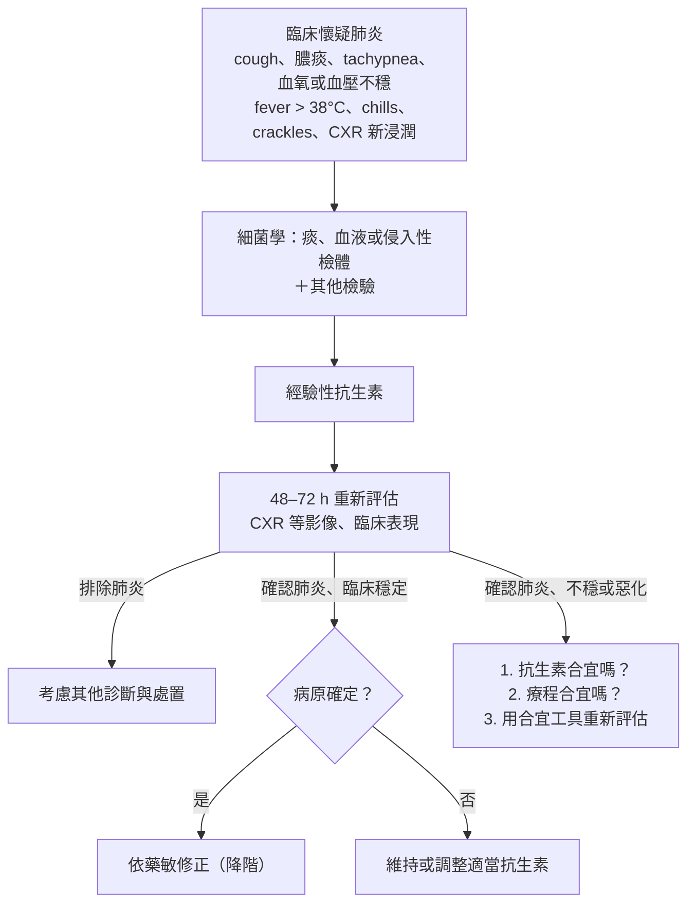

> [!abstract] 一句話重點
> 台灣 ICU 的 HAP／VAP 前三名是 **==P. aeruginosa、K. pneumoniae、A. baumannii==**，***S. aureus* 只約 1 成**（美國可到 3 成），而且 **CRKP、CRAB** 逐年上升。診斷：**CPIS 不當常規診斷**、**PCT／CRP 不用來決定開始抗生素**、**VAE 監測不能拿來診斷 VAP**（1A）；**血液培養要常規做**（1C）；VAP 先用 **ETA 半定量培養**（2C）。經驗性治療：低 MDR 風險 → **單一 anti-pseudomonal**；**休克或高 MDR 風險 → 兩種不同類別**；**台灣不常規 cover MRSA**、**colistin 不當常規經驗用藥**。療程 **7 天**，藥敏出來就降階。🆕 IDSA 2024：CRE、CRAB、DTR-PA 改用新一代 β-lactam 組合，**不建議吸入型抗生素**。

> [!info] 系列導覽
> ↑ 回到 [[infectious-disease/pneumonia/index|台灣肺炎診治指引總覽]]
>
> ① [[infectious-disease/pneumonia/pna-1-definition-prevention|定義、分類與預防]]｜② [[infectious-disease/pneumonia/pna-2-cap-diagnosis|CAP 病原、診斷與嚴重度]]｜③ [[infectious-disease/pneumonia/pna-3-cap-treatment|CAP 與 HCAP 治療]]｜④ [[infectious-disease/pneumonia/pna-4-special-pathogens|特殊病原與免疫不全]]｜⑤ HAP／VAP（本篇）｜⑥ [[infectious-disease/pneumonia/pna-exam|內專考點]]
>
> 本篇來源：台灣肺炎診治指引 2018 第三章（3-1 至 3-6）

**定義回顧**：**HAP**＝住院 ≥ 48 h 或出院 14 天內；**VAP**＝插管使用呼吸器 ≥ 48 h 後。

## 台灣的菌種與抗藥性

### TNIS 加護病房肺炎菌種排名

| 排名（2016） | 醫學中心 ICU | 區域醫院 ICU |
| --- | --- | --- |
| 1 | ***P. aeruginosa***（2013 起第 1） | ***P. aeruginosa*** |
| 2 | ***K. pneumoniae***（逐年上升） | ***A. baumannii*** |
| 3 | ***A. baumannii***（2007–2012 第 1，逐年下降） | ***K. pneumoniae***（2007 第 4 → 2016 第 2） |
| 4 | *S. aureus*、*S. maltophilia* | *S. aureus* |
| 之後 | *Enterobacter*、*E. coli*、*S. marcescens*（第 10 → 7）、*E. meningoseptica*、*C. indologenes*（第 16 → 10） | *Enterobacter*、*S. maltophilia*、*C. albicans*（第 9 → 7）、*E. coli*、*S. marcescens*、*H. influenzae* |

- *P. aeruginosa*、*A. baumannii*、*K. pneumoniae* 三者合計佔**一半以上**
- 與歐美的差別：**==台灣 S. aureus 約 10%（美國 NNIS、SENTRY 第一名、可達 30%；歐洲、拉美約 20–23%）==**，***Klebsiella* 比例較高**
- 用藥仍要以**各醫院自己的流行病學**為準

### 抗藥性趨勢（TNIS 醫學中心 ICU，2007 → 2017）

| 抗藥性 | 醫學中心 ICU | 區域醫院 ICU | 六家醫院 2016–2017 上半年（imipenem 抗藥） |
| --- | --- | --- | --- |
| **CRPA** | 16.5% → 19.8% | 15.9% → 15.1% | 18.2% |
| **CRKP** | **4.6% → 29.9%** | 2.8% → 22.3% | 7.1% |
| **CRAB** | **48.1% → 71.9%** | 56.9% → 70.7% | 37.8% |
| **CRE（Enterobacteriaceae）** | 3.1% → 16.1% | 2.1% → 14.1% | — |
| CR *E. coli* | 0.7% → 3.9% | 1.3% → 2.7% | 1.2% |
| **MRSA（oxacillin 抗藥）** | 83.7% → 64.8%（下降） | 81.8% → 64.4% | 48.9% |

六家醫院其他重點：*P. aeruginosa* 對 **amikacin 只 2.0%** 抗藥、cefepime 21.7%、pip/tazo 19.8%；*A. baumannii* 對 tigecycline 11%；*S. maltophilia* 對 **TMP-SMX 14.5%**、**levofloxacin 16.0%**。

### 菌種臨床特徵

| 菌種 | 重點 |
| --- | --- |
| ***P. aeruginosa*** | Biofilm；neutropenia、呼吸器病人；高齡、長期呼吸器、用過抗生素、從 ICU 轉出；影像無特異（雙側浸潤、multifocal consolidation、nodules、tree-in-bud、壞死） |
| ***K. pneumoniae*** | 莢膜多醣抗吞噬；**DM**；**currant jelly sputum**；**RUL posterior segment 的 lobar pneumonia**、**bulging fissure sign**；可多發 cavity、**lobar gangrene**；台灣**肺膿瘍約 25%、急性膿胸約 24%** 由它造成，都與 DM 相關 |
| ***A. baumannii*** | 乾燥表面存活很久；**健康人手上唯一會帶菌的 GNB**；常只是 colonization 但可致命；MDR、XDR 是感控大挑戰 |
| ***S. aureus*** | VAP 常見；流感後年輕人的 **MRSA 肺炎死亡率高**；IVDU 右心 IE → **septic emboli**：多發、偏下葉的結節、cavity，CT **feeding vessel sign** |
| ***S. marcescens*** | 潮濕醫材，可群突發；紅色色素造成 **pseudohemoptysis**（院內株多不紅） |
| ***S. maltophilia*** | ICU、呼吸器、惡性腫瘤、DM（台灣研究：平均住院 28 天才發病）；**天生對 carbapenem、aminoglycoside 無效**；台灣體外 **levofloxacin、moxifloxacin** 活性好，可經驗使用；TMP-SMX 抗藥率高時不適合經驗用 |
| ***Candida*** | *C. albicans* 佔 37.5–55%，其次 *C. tropicalis* |

## 多重抗藥菌的危險因子

### 經驗性選藥用：表 3.6.1.1

- **Septic shock**
- **ARDS**
- **發生肺炎前曾因 AKI 洗腎**
- **之前檢驗有 MDR 菌 colonization**
- **結構性肺病**（如 bronchiectasis）
- **==90 天內接受過 IV 抗生素==**

### 各菌種：表 3.1.3

| MDR 菌 | 危險因子 |
| --- | --- |
| **MDR／CR *P. aeruginosa*** | **90 天內 IV 抗生素**（2A）；**單位內 > 10% 對考慮使用的單一藥物抗藥**（2A）；90 天內 > 24 h 廣效抗生素（carbapenem、FQ、pip/tazo）、安養住民、慢性肝病、DM、ICU（2B）；住院久、之前用 carbapenem（2B）；之前用 aminoglycoside 或 FQ（2C） |
| **ESBL 或 carbapenem-nonsusceptible 腸桿菌** | 呼吸道已有 *K. pneumoniae* 或 *Enterobacter* colonization（2B）；**ICU 且嚴重度高**（1B）；**近期免疫抑制劑**（2A）；用過非 carbapenem 的廣效 β-lactam 或 FQ（2C）；待在 NDM 流行的醫院或接觸帶 blaNDM 的病人（2B） |
| **CR／XDR *A. baumannii*** | 單位內 XDR 高流行（2C）；**Charlson ≥ 4**（1B）；**住院 ≥ 14 天**（2B）；**ICU ≥ 10 天**（2B）；**APACHE II ≥ 16**（2B）；之前用 cefepime、pip/tazo、carbapenem（2C） |
| **MRSA** | 90 天內 IV 抗生素（2A）；**單位內 > 10–20% S. aureus 為 MRSA**（2A）；APACHE II 高、用過抗生素或手術（2B）；安養院、單位 MRSA > 20%、晚發性肺炎、鼻咽 MRSA colonization（2C） |
| ***S. maltophilia*** | ICU、呼吸器、惡性腫瘤、DM（2B） |

台灣 carbapenemase：**KPC-2**（ST11 *K. pneumoniae*，抗藥程度高）與 **IMP-8**；也要警惕 **NDM-1**（目前除接觸外沒有其他已知危險因子 → **接觸隔離**最重要）。*A. baumannii* 的 carbapenem 抗藥主要來自 **OXA 型（class D）**酵素。

## 診斷

### CPIS

| 項目 | 0 分 | 1 分 | 2 分 |
| --- | --- | --- | --- |
| 體溫（°C） | 36.5–38.4 | 38.5–38.9 | ≥ 39.0 或 ≤ 36.0 |
| WBC（/mm³） | 4,000–11,000 | < 4,000 或 > 11,000 | 再加 band ≥ 500 |
| 痰 | 少 | 多 | **膿痰** |
| PaO₂/FiO₂ | > 240 或有 ARDS | — | ≤ 240 且無 ARDS |
| CXR | 無浸潤 | 瀰漫 | **局部** |
| 痰培養 | 陰性或 ≤ 1+ | 致病菌 > 1+ | 再加 Gram stain 同菌 > 1+ |

- 原始研究 **CPIS > 6** 敏感度 93%、特異度 100%，但後續驗證不理想：統合分析敏感度 **65%**、特異度 **64%** → **==不建議常規用來診斷 HAP／VAP==**
- 已診斷者：**可作為監測預後與停抗生素的參考工具之一**（2C）

### 影像、血液、生物標記

| 主題 | 建議 | GRADE |
| --- | --- | --- |
| **Chest CT** | 比 CXR 提高診斷率（CAP 研究：CXR 判斷沒浸潤者 33% CT 有），幫助鑑別病原；依共病與臨床決定（重症運送風險） | 2C |
| **血液培養** | **==HAP／VAP 例行做==**：陽性率約 16.7–20%、致病菌敏感度僅約 26%，但**陽性代表預後差**（VAP 菌血症死亡風險約 2.86 倍）、常合併 MRSA、*A. baumannii*、**肺外感染**（22%） | 1C |
| **PCT** | **不用來決定開始抗生素**（敏感度約 67%、特異度約 83%；PCT 導向升階的 ICU 研究反而呼吸器天數變長） | — |
| **CRP** | 不用來診斷 HAP／VAP 或引導抗生素 | — |
| **VAE 監測** | **==不能精準預測傳統 VAP，不建議用來協助 VAP 診斷==** | **1A** |

**VAE 三層**：**VAC**（穩定 ≥ 2 天後，連續 2 天氧氣需求上升）→ **IVAC**（再加上發炎或感染的客觀證據）→ **possible／probable VAE-VAP**（再加上下呼吸道感染的實驗室證據）。

| 統合分析（2016，18 篇） | 敏感度 | 特異度 | PPV | NPV |
| --- | --- | --- | --- | --- |
| VAC | 42% | 85% | 23% | 96% |
| IVAC | 36% | 94% | 47% | 93% |
| Possible VAE-VAP | 14% | 97% | 7% | 99% |
| Probable VAE-VAP | 2% | 99% | 7% | 99% |

原因：VAE 監測所框到的病人群，本來就和傳統 VAP 不同。

### 黴菌、病毒、尿液抗原

- **黴菌**：ICU 中除了血液腫瘤，**大量類固醇、COPD、cirrhosis、器官移植、重症流感**也會發生；**BAL galactomannan 敏感度約 88%**，血清只約 40%；Aspergillus PCR 證據仍不足
- **PCP**：β-D-glucan 敏感度約 96%、特異度約 84%，**陰性可排除**（2016 歐洲指引）
- **CMV**：院內病毒性肺炎**最重要**；免疫正常的 ARDS、VAP 病人切片約 3 成有 CMV 病變；抗原血症陽性 ≠ CMV 疾病，**抽血結果不能單獨判斷**，要配合臨床
- **流感**：流行季常見院內病毒性肺炎；**鼻咽或 BAL 檢體**診斷率比鼻腔好
- **肺炎鏈球菌尿液抗原**：台灣分離株對 penicillin 與三代 cephalosporin 感受性 > 9 成，經驗用藥本來就 cover → **對 HAP／VAP 幫助不大**
- **Legionella 尿液抗原**：醫院有院內退伍軍人症病例、環境驗出、水質變化（如**含氯量下降**）時檢測；台灣疾管署：**同一供水系統 ≥ 30% 樣本陽性 → 所有醫療照護相關肺炎病人常規驗**

### 呼吸道檢體

| 建議 | GRADE |
| --- | --- |
| **Gram stain 對 Staphylococcus 有很高的 NPV**（沒看到 GPC 時，*S. aureus* 不太可能；外傷 ICU 研究 NPV 96%） | 2B |
| 疑似 VAP 若做支氣管鏡，**定量培養低於閾值（PSB < 10³、BAL < 10⁴ CFU/mL）可考慮停抗生素**，但仍要綜合判斷 | 2C |
| **==診斷 VAP 先用 ETA 半定量培養==**（與侵入性定量培養相比，呼吸器天數、ICU 天數、死亡率無差） | 2C |
| **不建議**每隔固定時間對插管病人做**例行 ETA 培養監測** | 2C |

- 統合分析：VAP 的 Gram stain **NPV 91%、PPV 只 40%** → 不能只憑 Gram stain 選藥，要等培養
- 支氣管鏡：**不建議**對疑似 VAP 常規做；PSB 敏感度 64–100%、BAL 70–90%；用過抗生素可降低閾值；**禁忌**：不合作、低血氧、出血傾向（血小板低、尿毒）、肺高壓；支氣管鏡抽吸檢體**不送厭氧培養**
- ETA：**所有插管的 HAP 病人在抗生素前都要送**；半定量（light、moderate、heavy）快速省資源、**敏感度最好但特異度最差**；定量閾值 **≥ 10⁵ CFU/mL**
- **==ETA 培養陽性的 ventilator-associated tracheobronchitis（VAT）不建議給全身抗生素==**；要區分 colonization、VAT 與肺炎
- 檢體處理：室溫 **2 h 內**，2–8°C **24 h 內**

## 治療評估與治療失敗

- **Clinical stability**：同 CAP（T < 37.8°C、HR < 100、RR < 24、SBP > 90、SpO₂ > 90%、能進食、意識正常）
- **治療失敗**：抗生素 **48–96 h 後**臨床惡化或 vital signs 不穩；或先進步再惡化

**治療失敗的三個面向**：
1. **抗生素合宜嗎？** MDR 風險（發病早晚、之前抗生素、共病、器官衰竭——全部成立風險最高）；培養陰性 → 重新採檢、找其他感染或共病（HF、PE）；**PK／PD 不足**（aminoglycoside、vancomycin 監測濃度）；**次發或合併感染**（黴菌、TB、病毒）
2. **療程合宜嗎？** 一般約 **1 週**；**延長**：neutropenia、HSCT、**empyema、lung abscess、cavity、necrotizing pneumonia**；MDR 菌（*P. aeruginosa*、CRAB、CRE）；需用 **colistin 或 tigecycline** 當二線時
3. **用合適的工具重新評估**：CXR → 需要時 CT；懷疑支氣管內病灶 → 支氣管鏡；重新採檢；**CRP、PCT 不單獨用來監測**

依原圖內容重新繪製（台灣肺炎指引圖 3.4.1）。

## 預防

### 一般通則

- **人員教育**與表現改進工具；高風險 ICU 病人（呼吸器、術後）做菌種與抗藥監測，回饋 **每 1000 呼吸器日**的肺炎率
- **不建議**沒有特殊理由時對病人或呼吸治療器材做常規培養
- 器材：直接或間接接觸呼吸道的器具要**滅菌或高層次消毒**，用無菌水沖洗；呼吸器內管**不用常規消毒**；有加濕器的管路**不常規更換**（台灣可 7 天一換，MDR 菌病人建議 7 天定期換）；**管路冷凝水要定期倒掉、別倒向病人**；人工鼻更換頻率不需 < 48 h；不建議大容量潮濕瓶
- 接觸呼吸道分泌物戴手套、換病人前換手套洗手；換氣切管無菌操作穿隔離衣；開放式抽痰用無菌單次抽痰管

### 防止嗆入：依證據分三層

**基本常規（好處明確）**
- **慎選 NIPPV**：COPD 或心因性肺水腫造成的急性呼吸衰竭可用，能減少 VAP、縮短呼吸器與住院、降低死亡；**意識不清、ARDS、嚴重低血氧或酸血症避免**，沒快速改善就盡早插管
- **鎮靜減到最低**：先用安撫、止痛、抗精神病藥；需要鎮靜時用 **dexmedetomidine、propofol**，避開 benzodiazepine；**每日中斷鎮靜（SAT）＋自發性呼吸測試（SBT）**
- **早期活動與運動**
- **聲門下分泌物引流（SSD）**：預期插管 **> 48–72 h** 者使用；可減少 VAP（RR 約 0.55）、縮短呼吸器與 ICU 天數，**但不影響死亡率**；沒有 SSD 的已插管病人**不要為此重插**
- **==床頭抬高 30–45°==**：簡單、免費、幾乎沒副作用（躺平灌食增加嗆入）

**特殊措施（基本常規做好仍不夠時）**
- **SDD／SOD**：荷蘭大型研究降低死亡（SOD 約 2.9%、SDD 約 3.5% 絕對值）；但擔心抗藥性，**高抗藥醫院建議等更多資料**
- **Chlorhexidine 口腔照護**（0.12%，每天 15 mL，到拔管後 24 h）：一篇統合分析降低 VAP 約 44%；效果最明顯的是**心臟手術**病人；**不降低呼吸器天數、住院天數、死亡率**
- **益生菌**：可能減少 VAP、不降死亡；**免疫不全或腸道疾病易 translocation 者不能用**（fungemia 病例）
- 超薄 polyurethane cuff、自動控制 cuff 壓力（cuff 壓力 < 20 cmH₂O 是 VAP 風險）、抽痰前滴生理食鹽水、刷牙：證據有限或不一致

**一般不建議**：銀包覆氣管內管、kinetic beds、**prone positioning**（為了預防 VAP）、**stress ulcer prophylaxis**、**early tracheostomy**、監測胃殘餘量、early parenteral nutrition

> [!warning] Pitfall：制酸劑不是 VAP 預防
> **==PPI、H2RA、制酸劑提高胃 pH → 胃內 GNB 增生 → HAP／VAP 增加==**；**低風險病人避免**為了 stress ulcer prophylaxis 而常規使用。

### 術後病人

高風險（**腹主動脈瘤修補**、**胸腔或急診手術**、全身麻醉、**> 60 歲**、完全依賴他人、體重減少 > 10%、慢性類固醇、近期飲酒、**COPD 或前一年抽菸**、中風殘障、**BUN < 8 或 > 22 mg/dL**、術前輸血 > 4 單位）→ 術後**盡早深呼吸與下床**、呼吸控制技巧、**incentive spirometry**；常規胸腔物理治療**無特別推薦**。

### VAP bundle

疾管署推動的組合式照護：**==每日評估拔管（SBT）、床頭抬高 30–45°、每日口腔照護、每日中斷鎮靜（SAT）==**（＋手部衛生、cuff 壓力監測等）。SAT＋SBT 合併可增加通過 SBT 的機率、縮短呼吸器 2–4 天；**減少肌肉鬆弛劑**也可減少 VAP。

## 經驗性治療

**選藥依據**：MDR 風險（表 3.6.1.1）、**醫院或單位最常見的菌與藥敏**、病情危急程度。

| 臨床狀況 | 建議 |
| --- | --- |
| **血行動力學穩定且 MDR 風險低** | **單一 anti-pseudomonal**：Piperacillin/tazobactam 4.5 g IV q6h；Ceftazidime 2 g IV q8h；Cefepime 2 g IV q8h；Imipenem 500 mg IV q6h；Meropenem 1 g IV q8h；Levofloxacin 750 mg IV qd；Ciprofloxacin 400 mg IV q8h；Cefoperazone/sulbactam 4 g q12h |
| **==血行動力學不穩定，或 MDR 風險高==** | **兩種不同類別** anti-pseudomonal：上述 β-lactam 擇一＋ Levofloxacin 750 mg IV q24h、Ciprofloxacin 400 mg IV q8h、**Amikacin 15–20 mg/kg IV q24h**、Gentamicin 5–7 mg/kg IV q24h，或 **Colistin**（負荷 5 mg/kg IV，之後 **2.5 mg × (1.5 × CrCl＋30) IV q12h**） |
| **MRSA 風險高**（之前培養出 MRSA、單位 MRSA 風險高） | 上述再加：**Vancomycin 25–30 mg/kg 負荷後 15 mg/kg IV q8–12h**；Teicoplanin 6–12 mg/kg IV q12h × 3 劑後 qd（重症、深部感染、單位 glycopeptide MIC 偏高時用高劑量 12 mg/kg/day）；**Linezolid 600 mg IV q12h** |

- 單一 vs 合併：2016 VAP RCT 系統性回顧顯示死亡率、治癒率、副作用**無差**，但那些試驗**排除了休克和高 MDR 風險**病人 → 這些人仍依臨床與當地資料考慮合併
- 該單位常見 *Legionella* → 加 macrolide 或 FQ
- **==避免廣泛用 colistin 當經驗治療==**：限 MDR 風險極高、曾培養出 **MDR *A. baumannii*** 或 **carbapenem 抗藥菌**的病人
- **==台灣 MRSA 比例不高 → 不建議例行 cover MRSA==**

## 已知病原的治療

| 病原 | 狀況 | 建議 |
| --- | --- | --- |
| ***P. aeruginosa*** | 穩定 | **依藥敏給單一有效藥** |
| | 不穩定 | 可考慮**兩種有效藥合併** |
| ***A. baumannii*** | 穩定且非 MDR | 依藥敏單一：**Ampicillin/sulbactam 3 g IV q6h**；Imipenem 500 mg q6h；Meropenem 1 g q8h |
| | **不穩定，或只對 polymyxin 有效** | **IV colistin＋吸入 colistin**，± imipenem、meropenem 或 ampicillin/sulbactam |
| **Carbapenem 抗藥菌** | 穩定 | **IV colistin＋吸入 colistin** ± imipenem、meropenem 或 ampicillin/sulbactam |
| | 不穩定 | IV colistin＋吸入 colistin ± imipenem 或 meropenem |

- **IV colistin**：5 mg/kg 負荷，之後 **2.5 mg × (1.5 × CrCl＋30) IV 分 q12h**
- **吸入 colistin**：每日 **1.25–15 MIU 分 q8–12h**，每劑以 5 mL 無菌生理食鹽水稀釋；**1 vial colimycin＝66.8 mg colistin base＝2 MIU**
- Carbapenem 可考慮 **extended infusion**
- 合併 carbapenem 的 RCT 沒有改善 carbapenem 抗藥菌的預後，但該研究菌種 MIC 偏高、不是專為肺炎設計，仍需更多資料

> [!info] 🆕 新版指引（IDSA 2024 Guidance on Antimicrobial-Resistant Gram-Negative Infections）
> 2018 台灣指引以 colistin 為 carbapenem 抗藥菌的主軸（原書；已更新，見本框）。2018 年後新藥上市，IDSA 2024 指引建議：
> | 病原 | 建議（非泌尿道感染） |
> | --- | --- |
> | **CRE，KPC 或未測出 carbapenemase** | **==Ceftazidime-avibactam、meropenem-vaborbactam、imipenem-cilastatin-relebactam==** |
> | **CRE，MBL（如 NDM）** | **Ceftazidime-avibactam＋aztreonam**，或 **cefiderocol** |
> | CRE 的 polymyxin | **==不建議用 polymyxin（含 colistin）治療泌尿道以外的 CRE==**；在 β-lactam 之外加 aminoglycoside、FQ、polymyxin 沒有額外好處 |
> | **DTR *P. aeruginosa*** | **Ceftolozane-tazobactam**、ceftazidime-avibactam、imipenem-relebactam、cefiderocol；藥敏有效時**不需合併** |
> | **CRAB** | 首選 **sulbactam-durlobactam＋imipenem 或 meropenem**；替代：**高劑量 ampicillin-sulbactam（sulbactam 6–9 g/day）合併** polymyxin B、minocycline、tigecycline 或 cefiderocol 其中之一；**polymyxin 不單用**（肺部穿透差、腎毒性），polymyxin B 優於 colistin |
> | ***S. maltophilia*** | **兩種合併**：TMP-SMX、minocycline、tigecycline、levofloxacin、cefiderocol 擇二；或 **ceftazidime-avibactam＋aztreonam** |
> | **吸入型抗生素** | **==不建議作為 CRAB 或 DTR-PA 肺炎的輔助治療==** |
>
> 台灣可取得的藥品依各院藥品目錄而定，使用新藥建議照會感染科。

## 療程與降階

| 肺炎類型 | 療程 |
| --- | --- |
| **HAP、VAP** | **==7 天==** |

- 兩篇統合分析：VAP **7 天 vs 更長**預後無差，**後續抗藥菌感染較少**；但**非發酵 GNB（*P. aeruginosa*、*A. baumannii*）**只治 7 天**復發率可能較高**
- 依菌種、免疫不全、結構性肺病、初始經驗用藥是否有效調整療程
- **降階**：對預後的影響有爭議（RCT 無差、回溯研究好壞都有），但依抗生素管理原則，**藥敏確定後要降階**

## 相關筆記

- [[infectious-disease/pneumonia/pna-1-definition-prevention|① 定義、分類與預防]]
- [[infectious-disease/pneumonia/pna-3-cap-treatment|③ CAP 與 HCAP 治療]]（HCAP 照 HAP／VAP 治療的族群）
- [[pulmonology/emergent-airway-management|緊急呼吸道處置]]
- [[infectious-disease/pneumonia/pna-exam|⑥ 內專考點]]

## 參考資料

- 台灣感染症醫學會、台灣胸腔暨重症加護醫學會。台灣肺炎診治指引 2018。第三章 3-1 常見菌種及流行病學（主編：薛博仁）、3-2 診斷措施（一）（主編：簡榮彥）、3-3 診斷措施（二）（主編：陽光耀）、3-4 治療評估及診斷流程（主編：詹明澄）、3-5 預防（主編：高國晉）、3-6 治療（主編：張峰義、陳垚生）。（參考資料庫：感染科／台灣肺炎指引.pdf）
- Kalil AC, et al. Management of Adults With Hospital-acquired and Ventilator-associated Pneumonia: 2016 Clinical Practice Guidelines by the IDSA and ATS. *Clin Infect Dis* 2016;63:e61-e111.
- Tamma PD, et al. Infectious Diseases Society of America 2024 Guidance on the Treatment of Antimicrobial-Resistant Gram-Negative Infections. *Clin Infect Dis* 2024.
