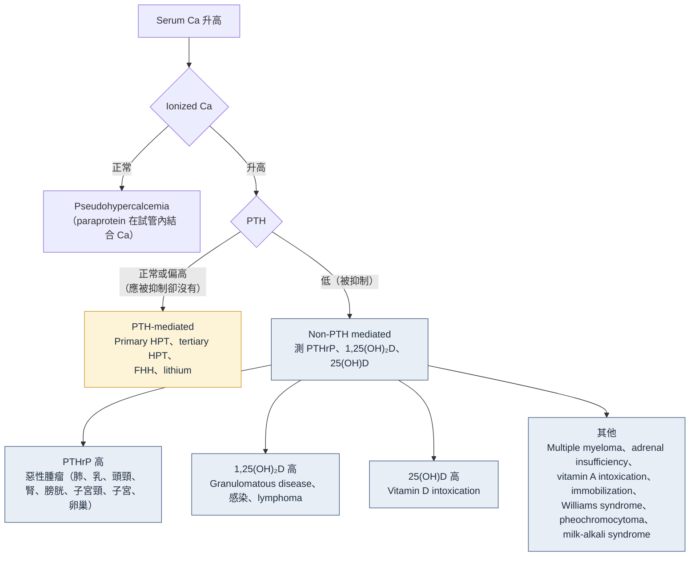
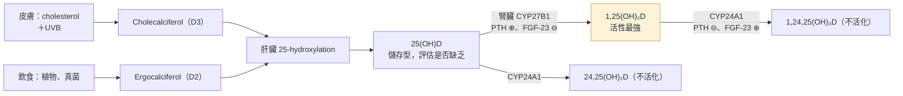

> [!abstract] 一句話重點
> 三個荷爾蒙分工：**PTH 管每分每秒的 ionized Ca**、**FGF-23 管磷**、**1,25(OH)₂D 管腸道吸收**。評估鈣異常 **==先測 ionized Ca（不要用 albumin 校正）==**，高血鈣第一步看 **PTH**；低血鈣先看 **Mg 與 PTH**；低血磷看 **腎臟有沒有在漏磷**（尿磷 > 100 mg/d 或 FEPO₄ > 20%）。

## 調控軸：PTH、FGF-23、1,25(OH)₂D

| | PTH | FGF-23 | 1,25(OH)₂D（calcitriol） |
| --- | --- | --- | --- |
| 主要調控 | **Ionized Ca**（分秒調控） | **磷** | **腸道吸收 Ca、磷** |
| 主要刺激 | **低血鈣** | 1,25(OH)₂D、**高磷飲食** | PTH |
| 主要抑制 | 高血鈣 | 未知 | FGF-23 |
| 對骨 | **促進骨吸收**（釋出 Ca、磷） | — | — |
| 對腎：Ca | 遠端**回收 Ca**（減少尿鈣） | — | — |
| 對腎：磷 | **排磷**（下調近端 NaPi-2a、2c） | **排磷**（同左） | — |
| 對 1,25(OH)₂D | **升高**（刺激 CYP27B1、抑制 CYP24A1） | **降低**（抑制 CYP27B1、刺激 CYP24A1） | 刺激 CYP24A1 → 加速自己分解 |
| 其他 | — | 輕度抑制 PTH | 抑制 PTH（直接＋經由 Ca）、刺激 FGF-23 |

> [!tip] Pearl：PTH 是油門，FGF-23 是煞車
> 把 25(OH)D 轉成 1,25(OH)₂D 的酵素 **CYP27B1（1α-hydroxylase）**：**PTH 踩油門、FGF-23 踩煞車**。分解酵素 **CYP24A1（24-hydroxylase）** 則剛好相反：PTH 抑制、FGF-23 刺激。

- PTH 排磷的意義：骨吸收同時釋出 Ca 和磷，靠尿排掉多餘的磷 → **血鈣上升但血磷不跟著上升**
- FGF-23 由骨頭分泌，作用在腎臟要和 **FGFR1＋α-klotho** 結合
- 嚴格限磷飲食 → FGF-23 下降、1,25(OH)₂D 上升，血磷仍維持正常

## 鈣

### 鈣的分布與吸收

- 體內鈣絕大多數在骨頭；血中鈣只佔約 1%，其中 **40% 與蛋白結合、10% 與陰離子結合、50% 為 ionized Ca**
- 十二指腸與空腸上段吸收：1,25(OH)₂D 依賴的 transcellular 途徑＋不依賴 vitamin D 的 paracellular 途徑；吸收效率不高，**1,25(OH)₂D 可大幅提升**

### 腎臟處理鈣

| 位置 | 回收比例 | 機制 | 調控 |
| --- | --- | --- | --- |
| PCT | 60% | Paracellular（**claudin-2、12**）；由 NHE3 回收 Na⁺ 驅動 | 不受荷爾蒙調控 |
| **TAL** | 25% | Paracellular（**claudin-16、19**）；NKCC2＋**ROMK** 讓 K⁺ 回漏管腔 → **管腔帶正電** → 推動 Ca²⁺、Mg²⁺ 回收 | **CaSR** |
| DCT | 15% | **Transcellular**：TRPV5 進入、calbindin-D28k 結合、基底側排出 | **PTH、1,25(OH)₂D**（微調） |

約 95% 過濾的鈣會被回收。

> [!important] 為什麼高血鈣會嚴重脫水？
> 高血鈣活化 TAL 間質側的 **CaSR → 抑制 ROMK** → K⁺ 無法回漏到管腔 → ① 管腔正電位消失，**Ca 回收減少**（尿鈣增加，負回饋）；② NKCC2 沒有 K⁺ 可用而停擺，**NaCl 回收減少** → 等於自己吃了 **furosemide**（類似 Bartter syndrome）→ ==嚴重 volume depletion==。

### 高血鈣

**症狀**：多渴多尿、骨痛、腹痛、volume depletion、**AKI**、情緒低落、**腎結石**；嚴重時 **QT shortening**、obtundation、昏迷。

#### 診斷流程（依原文 Figure 3 重新繪製）

> [!warning] Pitfall
> - **==不要用 albumin 校正鈣==**（不準確），直接測 ionized Ca。IgG、IgM、IgA 型 **multiple myeloma** 可造成 pseudohypercalcemia（Ca 在試管內和大量非 albumin 蛋白結合），但不影響 ionized Ca 測定
> - 高血鈣時 PTH 應該被抑制，所以 **==PTH「正常」就是不正常==**，代表 hyperparathyroidism

#### PTH-mediated

- 一般族群最常見：**primary hyperparathyroidism**（parathyroid adenoma），其次四腺增生（MEN）、parathyroid carcinoma（罕見）
- Adenoma 首選手術切除，但**轉手術前一定要排除 FHH**

| | Primary HPT | **FHH** |
| --- | --- | --- |
| 機轉 | Adenoma 分泌過多 PTH | **CaSR 異質接合失活突變**（AD）→ 鈣的設定點上移 |
| 血鈣 | 較高 | 輕度 |
| **尿鈣** | **Hypercalciuria**（過濾量大到回收不完） | **==Hypocalciuria==**（TAL 的 CaSR 失活，鈣持續被回收） |
| 其他 | — | 可有 hypermagnesemia、hypophosphatemia |
| 處置 | 手術 | 不需手術 |

**Secondary vs tertiary hyperparathyroidism**

- **Secondary**：CKD 幾乎都會出現 — FGF-23 抑制 1,25(OH)₂D → 血鈣受威脅 → PTH 上升；vitamin D deficiency（低 25(OH)D）也很常見。**==血鈣低或正常偏低==**，與 primary HPT 區分
- 長期 secondary HPT → 副甲狀腺明顯增生
- **Tertiary**：腎臟移植後 FGF-23 快速下降、1,25(OH)₂D 恢復，新腎臟對持續偏高的 PTH 有反應 → **高血鈣**；常自行緩解，部分需要 calcimimetic 或 parathyroidectomy

> [!example] 個案：腎移植後高血鈣
> ADPKD 透析 3 年，移植前用 **cinacalcet 60 mg/d** 和 sevelamer，移植後停藥。1 個月後 Cr 1.0、**Ca 11.2、磷 2.2**，PTH **766 pg/mL** → **tertiary hyperparathyroidism**（PTH excess）。

#### Non-PTH mediated

- 年長者最常見：**惡性腫瘤**（PTHrP、腫瘤產生 1,25(OH)₂D、multiple myeloma 造成骨吸收）

**Vitamin D 代謝**

（依原文 Figure 4 內容重新繪製）

- 1,25(OH)₂D 上調腸道 calbindin、**TRPV6**（吸收 Ca）與 **NaPi-2b**（吸收磷；但腸道吸收磷大多走不依賴 vitamin D 的 paracellular 途徑）
- 25(OH)D 濃度非常高時也能活化 VDR 造成高血鈣

| Vitamin D 過量 | 例子 | 特點 |
| --- | --- | --- |
| **外源性** | Cholecalciferol、ergocalciferol、25(OH)D、1,25(OH)₂D、外用 **calcipotriol**（psoriasis） | **1,25(OH)₂D 半衰期短 → 停藥後很快恢復**；D3、D2、25(OH)D 半衰期長 → 高血鈣持續較久 |
| **內源性** | **Lymphoma、granulomatous disease**：**macrophage 表現 CYP27B1**，自行製造 1,25(OH)₂D | 先是腸道吸收增加 → **hypercalciuria**；肉芽腫負擔超過腎臟排鈣能力，或腎功能變差（prerenal、肉芽腫侵犯間質）→ 才出現高血鈣 |

- 內源性病因：**sarcoidosis**、berylliosis、Sjögren syndrome、Crohn disease、**mycobacterial infection**、**disseminated fungal infection**（aspergillosis、candidiasis、coccidioidomycosis、paracoccidioidomycosis、histoplasmosis）

> [!example] 個案：HIV 病人高血鈣
> HIV 未規則服藥、CD4 200，發燒、體重減輕、夜間盜汗、全身淋巴結腫大與 hepatosplenomegaly；**ionized Ca 1.50、PTH < 10、1,25(OH)₂D 113 pg/mL（很高）** → **disseminated fungal infection**。HIV 本身或 HIVAN 不會直接造成高血鈣，而是透過肉芽腫性感染或 lymphoma。

#### 遺傳：CYP24A1 突變

- **CYP24A1 失活** → 1,25(OH)₂D 分解不了 → **1,25(OH)₂D 依賴的高血鈣、hypercalciuria、腎結石**
- 嬰兒：**infantile hypercalcemia**（嚴重高血鈣、嘔吐、生長遲滯）
- 帶因者平時可正常，遇到**懷孕**（腎臟與胎盤 CYP27B1 增加、腸道鈣吸收加倍）才被揭露
- 檢驗：1,25(OH)₂D、25(OH)D 不同程度升高，**==24,25(OH)₂D 與 24,25D／25(OH)D 比值極低==**

> [!example] 個案：懷孕 28 週高血鈣
> 年輕孕婦，2 次腎結石、父親與兄弟也有結石；Ca 12.2、PTH < 10、25(OH)D 正常、**1,25(OH)₂D 236（很高）** → **CYP24A1 突變**。
>
> | 錯誤選項 | 會造成什麼 |
> | --- | --- |
> | CYP27B1 失活 | 做不出 1,25(OH)₂D → **低血鈣**、vitamin D-dependent rickets |
> | NCC 失活（**Gitelman**） | Hypomagnesemia、hypokalemia、**hypocalciuria**，不會高血鈣 |
> | SLC34A3（NaPi-2c）失活 | Hereditary hypophosphatemic rickets with hypercalciuria：主要是**腎臟漏磷造成低血磷** |

#### 治療（補充）

> [!tip] 原文未討論高血鈣的急性處理，以下為一般原則（Walker & Shane, JAMA 2022）
> 先**大量補充 isotonic saline** 矯正脫水；中重度可加 **calcitonin**（快速但效果短暫）與 **bisphosphonate**（zoledronic acid；腎功能差時可考慮 denosumab）；**1,25(OH)₂D 造成的（肉芽腫、lymphoma）用 glucocorticoid**；嚴重腎衰竭可透析。並治療病因。

### 低血鈣

**症狀**

- 急性：**tetany**、**seizure**、**QT prolongation**、heart failure
- 慢性：骨質疏鬆、蛀牙、**basal ganglia calcification**、白內障等眼部表現

#### 病因

| 類別 | 例子 |
| --- | --- |
| **PTH 低或無效** | 甲狀腺／副甲狀腺切除後、放射治療後、**hungry bone syndrome**、自體免疫、遺傳、HIV、**PTH resistance**（pseudohypoparathyroidism） |
| Vitamin D 不足 | Vitamin D deficiency、vitamin D resistance |
| **鈣被隔離** | **Hyperphosphatemia**、**tumor lysis syndrome**、**acute pancreatitis**、rhabdomyolysis、**ethylene glycol**、急性 respiratory alkalosis、osteoblastic metastasis |
| **藥物** | **Bisphosphonate、denosumab**、calcitonin、**cinacalcet、etelcalcetide**、螯合劑（**EDTA、citrate**）、**foscarnet**、phenytoin、fluoride 中毒 |
| **Hypomagnesemia** | 見下方 |

#### 診斷步驟

1. **測 ionized Ca** 排除假性低血鈣：gadolinium 顯影劑（**gadodiamide、gadoversetamide**）會干擾比色法，造成假性偏低
2. **測 Mg 與 PTH**
   - 補 Mg 後低血鈣就矯正 → **hypomagnesemia**
   - PTH 低或「不適當地正常」→ **hypoparathyroidism**
   - PTH 高 → CKD、vitamin D deficiency、pseudohypoparathyroidism

#### Hungry bone syndrome

- **Parathyroidectomy 後**，主要見於**透析或腎移植後**的病人
- 長期嚴重 HPT → 骨頭長期脫礦；手術後 PTH 驟降 → **osteoblast 大量吸收 Ca、磷、Mg 進骨頭**，速度遠超過骨吸收
- 結果：**==低血鈣、低血磷、低血鎂==**（常合併高血鉀，機轉不明），可持續很久、症狀嚴重

#### 個案：第一次透析就抽搐 — 酸中毒矯正太快

> [!example] 個案
> 24 歲，從沒看過醫生，Cr 14.4、BUN 182、K 6.4、**磷 10.2、Ca 6.5、HCO₃⁻ 9**，腎臟小而有疤。第一次透析 3 小時後 **seizure**。最可能原因：**==矯正 metabolic acidosis==**。

- 未治療的腎衰竭：長期缺 1,25(OH)₂D＋嚴重高血磷 → 嚴重低血鈣
- 但**嚴重酸中毒時，H⁺ 佔住 albumin 的結合位**，albumin 能結合的 Ca 變少 → ionized Ca 被「撐住」
- 透析快速把 pH 拉高 → H⁺ 離開 albumin，空出的負電位置**大量結合 Ca** → ionized Ca 驟降（此例降到 0.49 mmol/L）→ seizure
- DDS 也可能一起造成抽搐（見 [[hemodialysis-emergencies|血液透析急症]]）
- 預防：第一次透析用**低效率**（低血流、短時間），並用**高鈣透析液 3.0–3.5 mEq/L**（約等於 ionized Ca 1.50–1.75 mmol/L），讓鈣從透析液流向病人

### 重症病人：Citrate 造成的低血鈣

- 原因：**大量輸血**（血品用 citrate 抗凝）或 **CRRT 的 regional citrate anticoagulation**（RCA）
- RCA 原理：濾器前輸 citrate，把管路內 ionized Ca 降到 **< 0.35 mmol/L** 達到抗凝；濾器後再補鈣，恢復體內 ionized Ca
- **Citrate accumulation**：給的 citrate 超過**肝臟**把它轉成 HCO₃⁻ 的能力（**肝病**最常見）

| 檢驗 | Citrate accumulation 時的變化 |
| --- | --- |
| **Ionized Ca** | **下降** |
| **Total Ca** | **==上升==**（total Ca 會測到和 citrate 結合的 Ca） |
| **Total／ionized Ca 比值** | **==> 10（total mg/dL、ionized mmol/L）或 > 2.5（兩者都用 mmol/L）==** |
| **AG** | **上升**（citrate 是沒算到的陰離子）→ 又出現 AG acidosis |

> [!example] 個案
> 車禍後肝撕裂傷、hemoperitoneum、休克、無尿 AKI，有酒精性肝病，因為出血改用 citrate 抗凝做 CRRT。第 3 天高血鉀已矯正、AG 也關閉後，**血行動力學惡化、AG acidosis 再度出現** → **total Ca 上升、ionized Ca 下降**。

## 磷

### 磷的分布、吸收與腎臟處理

- 80–85% 在骨、14% 在細胞內、1% 在細胞外液
- 每天攝取 800–1,200 mg，約吸收 2/3；**以 paracellular 為主**，血磷低時 1,25(OH)₂D 誘導 **NaPi-2b** 增加 transcellular 吸收
- 吸收率依來源不同：**食品添加物的無機磷最容易吸收** > 動物蛋白、乳製品 > 植物（phytate，人類缺 phytase，吸收差）→ 加工食品吃多，磷攝取遠超過需要
- 腎臟排磷能力很強：每天可排到 4,000 mg 而血磷幾乎不變；大部分在 **PCT** 回收（NaPi-2a、NaPi-2c、PiT-2），一般 **FEPO₄ < 15%**
- **PTH、FGF-23** 讓 NaPi-2a、2c 從管腔膜內化 → 排磷增加；**SGLT2 inhibitor** 增加近端回收磷，血磷輕度上升
- **CKD**：早期 FGF-23 上升維持血磷正常（FEPO₄ 增加）；FGF-23 抑制 1,25(OH)₂D → secondary HPT → PTH 進一步排磷 → ==GFR 降到很低、代償撐不住時才出現高血磷==

### 低血磷

**症狀**（細胞 ATP 耗竭）：全身肌肉無力、**呼吸肌無力 → 呼吸衰竭**、心肌無力 → heart failure、近端肌病、吞嚥困難、ileus、**rhabdomyolysis**、**hemolysis**、感覺異常、譫妄、seizure、昏迷；慢性：**rickets**（兒童）或 **osteomalacia**（成人）。

#### 病因

| 類別 | 例子 |
| --- | --- |
| 腸道 | 攝取不足、慢性腹瀉、脂肪瀉、**含鎂、鋁的制酸劑**、niacin（通常只是加重，很少單獨造成） |
| **移到細胞內** | **Refeeding syndrome**、**DKA 治療中**、nonketotic hyperglycemia 治療中、急性 respiratory alkalosis、**hungry bone syndrome** |
| **腎臟流失** | **Hyperparathyroidism**、**腎移植後**、**Fanconi syndrome**、**X-linked hypophosphatemic rickets**、**tumor-induced osteomalacia**、**IV iron**、NaPi-2a／2c 突變、acetazolamide、tyrosine kinase inhibitor、VEGF inhibitor、mTOR inhibitor、**intensive HD 與 CRRT** |

#### 診斷：腎臟有沒有在漏磷？

- 低血磷時腎臟應該幾乎全部回收
- **==24 小時尿磷 > 100 mg/d==** 或 **==FEPO₄ > 20%==** → 腎臟漏磷
- **FEPO₄（%）= 100 × (尿磷 × 血清 Cr) / (血清磷 × 尿 Cr)**

| 腎臟漏磷＋ | 想到 |
| --- | --- |
| **高血鈣** | **PTH** 過多 |
| **沒有高血鈣** | **FGF-23 過多**（遺傳或後天） |

#### FGF-23 過多造成的低血磷

**Tumor-induced osteomalacia（TIO）**

- 腫瘤異位分泌 FGF-23：低血磷、骨痛、骨折、肌肉無力
- 多是**小的良性間葉組織腫瘤**，很難找；癌症造成的報告增加中
- 找腫瘤：CT、MRI、功能性影像（**⁶⁸Ga-DOTATATE PET**、octreotide scintigraphy）、靜脈分段採血看 FGF-23 是否升高
- 切除後症狀很快改善；找不到或無法切除 → **burosumab**（anti-FGF-23 單株抗體，有效但昂貴）

**腎移植後**

- 早期功能良好的移植腎病人 **85–90% 有低血磷**：GFR 立刻恢復，但腎衰竭時期殘留的高 FGF-23 與 PTH 讓移植腎大量排磷
- FGF-23 數週內恢復；PTH 可能持續好幾年
- 補磷即可（CRRT、intensive HD 造成的低血磷也一樣）

**IV iron：Ferric carboxymaltose（FCM）**

- 機轉不明地**急性升高有活性的 FGF-23** → **超過 50%** 用藥者低血磷
- 其他 IV iron（**ferumoxytol、ferric derisomaltose、iron sucrose、iron dextran**）嚴重低血磷風險明顯較低
- 通常 1–3 個月恢復，有人持續 3–6 個月；**重複療程**可造成長期低血磷，甚至 osteomalacia、骨折

> [!example] 個案：IV iron 後全身無力
> 年輕女性月經過多、口服鐵無效，打 FCM 750 mg 兩次後全身無力、意識變差、抽筋，**磷 0.9 mg/dL**。補磷後恢復，但持續經血過多，半年後又缺鐵。
> 下一步：**==改用 FCM 以外的 IV iron==**（不是再打一次 FCM，也不是 ESA 或口服鐵）。

### 高血磷

#### 急性高血磷

- 主要危險：造成**嚴重低血鈣**；Ca-磷沉積在腎、心、關節、血管
- 腎小管與間質急性沉積 → 嚴重 AKI，又讓磷排不掉 → 例如 CKD 病人用**含磷灌腸劑**做大腸鏡準備 → **acute phosphate nephropathy**
- GFR 下降會讓所有機轉惡化

**Tumor lysis syndrome**：最常見的急診高血磷原因之一；高增殖腫瘤（高惡性度 lymphoma、leukemia）化療後大量細胞溶解 → **==高血鉀、高尿酸、高血磷＋續發低血鈣==**。Rhabdomyolysis（尤其合併 AKI）也會有類似變化。

#### 慢性高血磷

- **最常見：腎衰竭**（飲食吸收＋PTH 造成的骨吸收 > 腎排＋標準透析清除；每日密集透析才能移除大量磷）
- 沒有腎衰竭時：**hypoparathyroidism**（合併**低血鈣**）、pseudohypoparathyroidism、**FGF-23 不足或作用受阻** → 近端 NaPi 增加、回收磷增加
- **FGFR inhibitor**（erdafitinib：urothelial cancer；pemigatinib、infigratinib：cholangiocarcinoma）阻斷 FGF-23 的腎臟作用 → **高血磷是 class effect**；FGF-23 無法抑制 1,25(OH)₂D，也可能 hypercalciuria、甚至高血鈣

#### 病因

| 類別 | 例子 |
| --- | --- |
| 急性磷負荷 | **含磷瀉劑**、**fosphenytoin** |
| 從細胞釋出 | **Rhabdomyolysis**、**tumor lysis syndrome**、嚴重 lactic acidosis、嚴重 ketoacidosis |
| 腎臟排不出去 | **晚期腎衰竭**、hypoparathyroidism、vitamin D toxicity、familial tumoral calcinosis、acromegaly、bisphosphonate、FGFR inhibitor |

- 含磷瀉劑、fosphenytoin、bisphosphonate 用在 CKD 病人要非常小心

#### 診斷

- 高血磷時**測尿磷沒有意義**（不管多少都不夠）
- 重點是：腎臟**為什麼排不掉**、**磷從哪裡來**；通常病史、理學檢查、血鈣就夠，必要時加測 PTH、1,25(OH)₂D、FGF-23

> [!warning] Pitfall：Pseudohyperphosphatemia
> **Liposomal amphotericin B** 會干擾檢驗，造成**假性高血磷**；其他：**multiple myeloma**、**hemolysis**、**hyperlipidemia**、檢體被 **heparin 或 alteplase** 污染。懷疑時改用其他檢驗方法。
>
> 個案：AML 化療後第 21 天，用 vancomycin 與 liposomal amphotericin B，**磷 9.7**，但 K、尿酸、Ca 都正常 → ==沒有高血鉀、高尿酸、低血鈣，就不是 TLS== → liposomal amphotericin B 造成的假性高血磷。

## 鎂

### 鎂的吸收與腎臟處理

- 體內第四多的陽離子；與骨、蛋白、DNA 合成，神經肌肉功能，並調控 **PTH**、ACTH、cortisol
- 腸道經 paracellular 與 transcellular（**TRPM6、TRPM7**）吸收；主要存在骨頭

| 位置 | 回收比例 | 機制 |
| --- | --- | --- |
| PCT | 只有 20–25% | — |
| **TAL** | **大部分** | Paracellular（**claudin-16、19**），靠 NKCC2＋ROMK 產生的管腔正電位；高血鎂時 **claudin-14** 降低通透性 |
| DCT | 最後約 10% | **TRPM6** transcellular，決定最終尿鎂；**EGFR 活化增加 TRPM6** |

- **Loop diuretic** 抑制 NKCC2 → 鎂回收減少；claudin-16、19 突變 → 遺傳性鎂流失

### 低血鎂

- 非常常見：住院病人 12%、**ICU 60%**
- 症狀：肌肉無力、tetany、confusion、seizure、心律不整、heart failure（很多是合併的**低血鈣、低血鉀**造成）
- 很少因細胞內移動造成，**大多是腸道或腎臟流失**
  - 腸道：下消化道液含鎂較高 → **腹瀉**比嘔吐更常見
  - **==PPI==**：降低 TRPM6、TRPM7 吸收；因為使用太普遍，是**最常見原因之一**

| 類別 | 例子 |
| --- | --- |
| 腸道流失 | 腹瀉、嘔吐、**PPI** |
| **藥物（腎流失）** | **Aminoglycoside、amphotericin B、cisplatin、calcineurin inhibitor**、digoxin、pentamidine；**anti-EGFR 抗體（cetuximab、panitumumab）** |
| 遺傳 | **Gitelman**、Bartter、EAST syndrome、**FHHNC**、HNF1B、Na-K-ATPase、ROMK 突變 |
| 後天腎小管功能異常 | 腎移植後、**高血鈣**、**酗酒**、ATN 恢復期 |

- 影響 TAL paracellular 途徑的（例如 **FHHNC**：familial hypomagnesemia with hypercalciuria and nephrocalcinosis）→ 合併 **hypercalciuria**
- 影響 transcellular 的 → 單純低血鎂，或類似 Gitelman 的 **hypocalciuria**

### 低血鎂造成低血鈣

- 副甲狀腺**合成與分泌 PTH 需要 Mg**；PTH 在標靶器官的作用**也需要 Mg**
- → 低血鎂 = **hypoparathyroidism＋PTH resistance** → 低血鈣
- **==只補鈣或 vitamin D 矯正不了，一定要補鎂==**

> [!example] 個案：Cetuximab 後抽筋無力
> 轉移性大腸癌，FOLFOX 後改用 **cetuximab**，8 週後無力到不能走、**Chvostek、Trousseau sign** 陽性；Ca 6.0、ionized Ca 0.68、K 3.0。下一步最有用的檢查：**==血清 Mg==**。

## 🎯 內專考點

> [!example] 待補
> 這個主題的內專考古題重點卡尚未整理，之後補上。

## 相關筆記

- [[hemodialysis-emergencies|血液透析急症]]（DDS、透析液鈣與心律不整）
- [[skin-disorders-in-kidney-disease|腎臟病的皮膚疾病]]（calciphylaxis、calcinosis cutis）
- [[renal-tubular-acidosis|腎小管酸中毒 RTA]]（Fanconi syndrome）
- [[high-anion-gap-metabolic-acidosis|HAGMA]]（ethylene glycol、citrate 造成的 AG 升高）
- [[nejm-cases/endocrinology/parathyroid-crisis-aortic-occlusion|NEJM 個案：Parathyroid crisis]]
- [[nejm-cases/endocrinology/men1-syndrome|NEJM 個案：MEN1]]

## 參考資料

- Murray SL, Wolf M. Calcium and Phosphate Disorders: Core Curriculum 2024. *Am J Kidney Dis*. 2024;83(2):241-256. doi:10.1053/j.ajkd.2023.04.017（參考資料庫：`腎臟科/Calcium and Phosphate Disorders.pdf`）
- Walker MD, Shane E. Hypercalcemia: a review. *JAMA*. 2022;328(16):1624-1636.（高血鈣治療補充）
