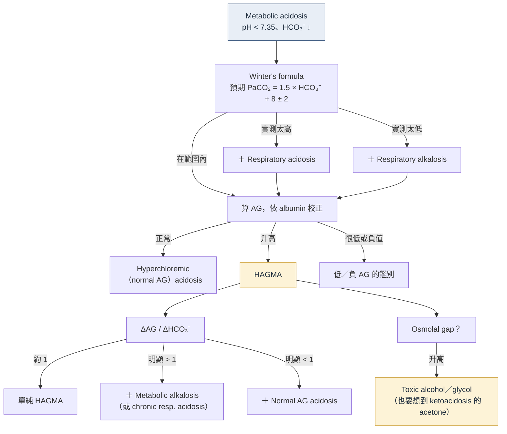
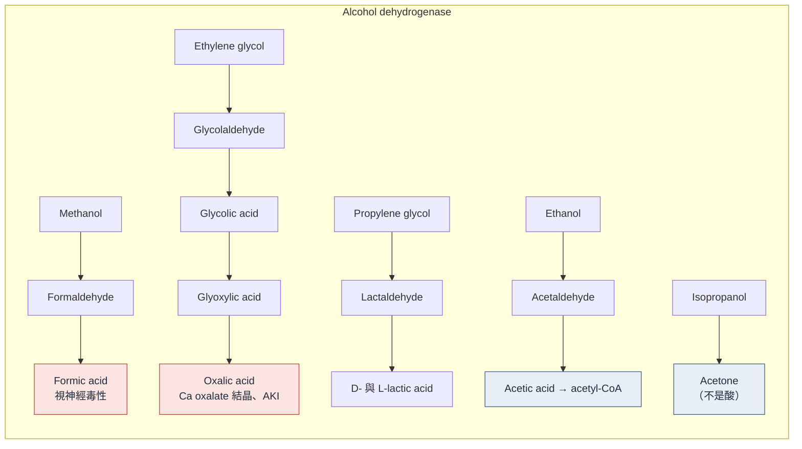

> [!abstract] 一句話重點
> - 每次看到電解質就算 AG：
>   - **==先用 albumin 校正 AG==**，再用 **Winter's formula** 看呼吸代償、用 **ΔAG/ΔHCO₃⁻** 找藏起來的第二、第三個酸鹼異常
>   - HAGMA 合併 **osmolal gap** 時要想到 toxic alcohol／glycol
> - AG 太低甚至是負的，也一定要找原因

## 🗺️ 總綱

🗺️ HAGMA：先算對 AG → 看呼吸代償 → ΔAG／ΔHCO₃⁻ → 找病因

1. 算對 AG
<ul><li>Na − Cl − HCO₃⁻，正常約 10</li><li>Albumin 每低 1 g/dL，AG 加 2.5</li><li>高血糖時用未校正 Na</li></ul>

2. 看呼吸代償
<ul><li>Winter：1.5 × HCO₃⁻ ＋ 8 ± 2</li><li>PaCO₂ 太高 → <b>合併呼吸性酸中毒</b></li><li>PaCO₂ 太低 → <b>合併呼吸性鹼中毒</b></li></ul>

3. ΔAG ／ ΔHCO₃⁻
<ul><li>約 1 → <b>單純 HAGMA</b></li><li>明顯&gt; 1 → <b>合併代謝性鹼中毒</b></li><li>明顯&lt; 1 → <b>合併 NAGMA</b></li></ul>

GOLDMARK
<ul><li>Glycols、5-oxoproline</li><li>L-lactate、D-lactate</li><li>Methanol、Aspirin</li><li>Renal failure、Ketoacidosis</li></ul>

Osmolal gap 高
<ul><li>Toxic alcohol 或 DKA 的 acetone</li><li>早期 gap 高 → <b>晚期 AG 高</b></li><li>Ca oxalate 結晶 → <b>ethylene glycol</b></li><li>Isopropanol 有 gap 沒有酸</li></ul>

找不到原因
<ul><li>長期 acetaminophen → <b>5-oxoproline</b></li><li>Short bowel＋ataxia → <b>D-lactate</b></li><li>Salicylate → <b>合併呼吸性鹼中毒</b></li><li>AG 比 −5 還負 → <b>檢驗干擾</b></li></ul>

## 基本工具

### 1. 代謝性酸中毒的呼吸代償：Winter's formula

- 代謝性酸中毒 → 過度換氣把 PaCO₂ 降下來，**12–24 小時內**代償完成，幅度和 HCO₃⁻ 下降成正比
- **預期 PaCO₂ = 1.5 × HCO₃⁻ + 8 ± 2**
  - 適用 HCO₃⁻ 約 7–22 mEq/L；HCO₃⁻ < 5–7 時，PaCO₂ 最低大約只能降到 **8–12 mmHg**
  - 快速估算：輕中度酸中毒時，**PaCO₂ ≈ HCO₃⁻ + 15**
- ==實測 PaCO₂ 不在預期範圍 → 合併呼吸性酸鹼異常==（太高 = 合併 respiratory acidosis；太低 = 合併 respiratory alkalosis）

### 2. Anion gap

> [!note] 看圖重點
> - 每根柱子左邊是陽離子（主要 Na⁺）、右邊是陰離子，**兩邊總和一定相等**
> - **A 正常**：AG＝沒測到的陰離子（主要是 albumin）
> - **B AG acidosis**：加入的酸把 **HCO₃⁻ 換成未測陰離子**，Cl⁻ 不變 → AG 上升
> - **C hyperchloremic（non-AG）acidosis**：**HCO₃⁻ 換成 Cl⁻** → AG 不變
> - **D、E 混合型**：AG 上升幅度和 HCO₃⁻ 下降幅度對不上 → 合併 non-AG acidosis 或 metabolic alkalosis（就是 delta ratio 的概念）

- **AG = Na⁺ − (Cl⁻ + HCO₃⁻)**，正常約 **8–12 mEq/L**（各實驗室不同；不知道病人自己的基準值時，用 **10** 當基準）
- 溶液一定電中性，AG 只是因為「沒量到的陰離子」比「沒量到的陽離子」多；**albumin 是 AG 最大的組成**
- 電解質報告上的「HCO₃⁻」通常是**靜脈 total CO₂**，比動脈 HCO₃⁻ 高約 2–4 mEq/L

#### Albumin 校正

- Albumin 每 g 約帶 2.5 mEq 負電 → **albumin 每低於 4.5 g/dL 1 g，AG 約下降 2.5**
- **校正 AG = 測得 AG + 2.5 × (4.5 − albumin)**

> [!warning] Pitfall：低白蛋白藏住 HAGMA
> Sepsis 病人 Na 138、Cl 111、HCO₃⁻ 17 → AG 只有 10，看起來是 normal AG acidosis；但 albumin 2.0 → **校正後 AG 約 16**，後來 lactate 6 → 其實是 ==lactic acidosis 造成的 HAGMA==。

上面帶入的是原文 Case 1（urosepsis、albumin 2.0）的數值，可以改成自己病人的數字。

#### 高血糖時 AG 怎麼算？

- 高血糖把細胞內的水拉到細胞外，Na⁺ 被稀釋（原文用：血糖每高 100 mg/dL，Na⁺ 約降 2）
- 但 Cl⁻、HCO₃⁻ 也被同樣稀釋 → **==算 AG 時用「未校正」的 Na==**，校正 Na 只用來評估水分狀態

### 3. ΔAG/ΔHCO₃⁻（delta ratio）

- 強酸（lactic acid、ketoacid）累積 → HCO₃⁻ 下降、AG **等量上升** → 比值約 **1**
- ΔAG 就代表累積的酸根濃度（例如 lactate、ketoacid anion）
- 不完全 1:1 的原因：酸根與 HCO₃⁻ 的分布空間不同、細胞內緩衝、腎臟排出速度不同，以及混合型酸鹼異常

| 情況 | 解讀 |
| --- | --- |
| ΔAG ≈ ΔHCO₃⁻ | 單純 HAGMA |
| **==ΔAG 明顯 > ΔHCO₃⁻==**（HCO₃⁻ 掉得太少） | 原本 HCO₃⁻ 就偏高 → **合併 metabolic alkalosis**（較少見：chronic respiratory acidosis 的代償，用 pH 區分） |
| ΔAG 明顯 < ΔHCO₃⁻（HCO₃⁻ 掉得太多） | 合併 hyperchloremic（normal AG）acidosis；例如 DKA 恢復期酮酸鹽從尿液流失 |

## HAGMA 的病因：GOLDMARK

下表是 Table 1 的中文整理。

| 字母 | 病因 | 累積的酸 |
| --- | --- | --- |
| **G** | **Glycols**（ethylene、propylene、diethylene glycol） | Glycolic、glyoxylic、oxalic acid；propylene glycol 產生 D- 與 L-lactate |
| **O** | **5-Oxoproline**（pyroglutamic acid） | 長期使用 acetaminophen |
| **L** | **L-Lactic acidosis** | Type A、type B |
| **D** | **D-Lactic acidosis** | Short bowel syndrome 吃大量醣類 |
| **M** | **Methanol** | Formic acid |
| **A** | **Aspirin**（salicylate） | 多種有機酸，包括 ketoacid、lactate |
| **R** | **Renal failure** | Sulfate、phosphate 等無機與有機酸 |
| **K** | **Ketoacidosis**（DKA、alcoholic、starvation） | β-hydroxybutyrate、acetoacetate |

> [!tip] Pearl
> HCl 累積或丟失 NaHCO₃⁻（或丟失可以變回 HCO₃⁻ 的有機酸鈉鹽，例如 butyrate、citrate、acetate）→ 造成的是 **normal AG（hyperchloremic）acidosis**，不是 HAGMA。

## Lactic acidosis

- 住院病人最常見的代謝性酸中毒；lactate 生成超過清除（兩者正常都約 1 mmol/min）就會累積
- Lactate 主要來自 glycolysis，少部分來自 alanine；**肝、腎、心臟**負責利用。肌肉產生 lactate、肝臟再轉回葡萄糖 = Cori cycle

| | Type A | Type B |
| --- | --- | --- |
| 機轉 | 明顯的**組織缺氧** | 沒有明顯全身性缺氧；細胞或粒線體代謝受損、局部缺血 |
| 例子 | Hypovolemia、sepsis、大量 GI bleeding、heart failure、cardiopulmonary arrest | **Metformin**（多在 AKI／CKD 時累積）、**thiamine deficiency**、malignancy（尤其 leukemia、lymphoma）、chronic alcohol use disorder、部分 HIV antiretroviral |
| 預後 | 灌流無法快速恢復時預後差 | 依病因 |

兩型有時會重疊。

## Ketoacidosis：DKA 的酸鹼分析

### 一次可以有三個酸鹼異常

T1D 病人腸胃炎後減少胰島素、嘔吐，血糖 800、Na 120、Cl 75、HCO₃⁻ 12、AG 32、K 3.0、pH 7.16、PaCO₂ 35：

1. **HAGMA（DKA）**：AG 32
2. **合併 metabolic alkalosis**：ΔAG ≈ 22–23，但 ΔHCO₃⁻ 只有 12 → ==ΔAG 遠大於 ΔHCO₃⁻==，代表發病前 HCO₃⁻ 已被**嘔吐**推高到約 34
3. **合併 respiratory acidosis**：Winter 預期 PaCO₂ ≈ 26，實測 35 太高 → 可能是 **hypokalemia 造成呼吸肌無力**

### DKA 的 osmolal gap 來自 acetone

- HAGMA 本身**不會**造成 osmolal gap：酸根增加多少，HCO₃⁻ 就少多少，2 × Na 已經包含它們
- 會造成 osmolal gap 的是**沒有帶電的小分子**：alcohol、glycol、**acetone**、glycerol
- DKA 與 **alcoholic ketoacidosis** 常因 acetone（及少量 glycerol）出現 osmolal gap → ==不要只憑 osmolal gap 高就診斷 toxic alcohol==
- Acetone 不是酸，不會降低 HCO₃⁻，也不會增加 AG

### DKA 恢復期變成 hyperchloremic acidosis

治療後隔天：AG 回到 12，但 HCO₃⁻ 還是 17、Cl 110 → HAGMA 轉成 **hyperchloremic acidosis**，這在 DKA 恢復期**很常見**。

- 累積的 ketoacid anion 是「潛在的 HCO₃⁻」：留在體內被代謝，就會等量產生 HCO₃⁻
- 但代謝要好幾個小時；這段期間補液讓 GFR 恢復，**==ketoacid 的 Na⁺／K⁺ 鹽從尿液大量流失==** → AG 下降，HCO₃⁻ 卻沒有回來
- ECF 在相對固定量的 Cl⁻ 周圍收縮 → Cl⁻ 上升；大量 normal saline 也有貢獻，但**通常是次要因素**
- 之後幾天腎臟排出 NH₄Cl，電解質會慢慢恢復正常

更多 DKA 處置見 [[dka-hhs|DKA 與 HHS]]。

### 同樣道理：Toluene（吸膠、噴漆）

- Toluene → benzoic acid → **hippuric acid**，理論上是 HAGMA
- 但 hippurate 被腎臟**非常有效率地分泌排出**（PAH clearance 就是用來量腎血漿流量）
  - 早期腎臟來不及增加 NH₄⁺ 排泄 → hippurate 和 **Na⁺** 一起排掉 → 低血容、續發性高醛固酮 → 遠端大量排 K⁺
  - 結果通常表現為 **hyperchloremic、嚴重 hypokalemic metabolic acidosis**
- 幾天後 NH₄⁺ 排泄大增 → 尿液 pH 偏高，很像 **distal RTA**；但 ==尿液 NH₄⁺ 很高就排除 distal RTA==
- 若有 CKD 或 AKI，hippurate 排不掉 → 才會表現為 HAGMA

見 [[renal-tubular-acidosis|腎小管酸中毒]]。

## Toxic alcohols／glycols 與 osmolal gap

### Osmolal gap

- **Calculated osmolality = 2 × Na + Glucose / 18 + BUN / 2.8**（Glucose、BUN 單位 mg/dL；Na 用**未校正**的值）
- **Osmolal gap = measured − calculated**
- **Ethanol 也會貢獻**：ethanol（mg/dL）÷ 4.6 ≈ 它造成的 osmolal gap

| 物質 | 分子量 | 每 100 mg/dL 造成的 osmolal gap（約） |
| --- | --- | --- |
| Methanol | 32 | 31 |
| Ethanol | 46 | 22 |
| Acetone | 58 | 17 |
| Isopropanol | 60 | 17 |
| Ethylene glycol | 62 | 16 |
| Propylene glycol | 76 | 13 |
| Diethylene glycol | 106 | 9 |

（依原文 Table 2 數值重新整理）

### 個案：喝酒後越來越糟的病人

> [!note] 看圖重點
> - **左（典型）**：**「信封背面」形狀**的 calcium oxalate **dihydrate** 結晶——看到就強烈指向 **ethylene glycol**，但不是每個病人都有
> - **右（較常見）**：**細長針狀**的 calcium oxalate **monohydrate**，比較不具特異性

- 到院：pH 7.40、HCO₃⁻ 24、AG 9（正常）、ethanol 110 mg/dL、**measured osmolality 350**
  - Calculated ≈ 293 → **osmolal gap 約 57**；ethanol 只能解釋約 24 → ==還有約 33 解釋不了 → 一定還有別的 alcohol／glycol==
  - 此時 ==沒有 HAGMA 不能排除 methanol／ethylene glycol==：toxic alcohol 本身不是酸，還沒被代謝前只造成 osmolal gap
- 3 小時後：HCO₃⁻ 16、AG 19、osmolality 降到 310、尿液出現 **calcium oxalate crystals** → **ethylene glycol**

> [!important] Osmolal gap 與 AG 的「交換」
> 一起喝下的 **ethanol 會佔住 alcohol dehydrogenase**，延緩 toxic alcohol 的代謝。Ethanol 濃度下降後，toxic alcohol 加速被氧化成有機酸 → ==osmolal gap 下降，同時 AG 上升==。所以兩者要**一起看、追蹤看**：早期 osmolal gap 高、AG 正常；晚期 osmolal gap 可能已經正常，但 HAGMA 很嚴重。

### 肝臟代謝路徑（依原圖內容重新繪製）

下方是依原圖重新繪製的中文流程圖。

| 物質 | Osmolal gap | HAGMA | 線索 |
| --- | --- | --- | --- |
| Methanol | ↑ | ↑（formic acid） | 視力模糊 |
| Ethylene glycol | ↑ | ↑（glycolic、oxalic acid） | **Calcium oxalate crystals**（典型「信封背面」形狀；較常見的是粗針狀）、AKI |
| Isopropanol（消毒酒精） | ↑ | **==不會==**（代謝成 acetone，不是酸） | 酮體陽性但沒有酸中毒 |
| Propylene glycol | ↑ | ↑（D- 與 L-lactate） | 大量 IV lorazepam 等藥物的溶劑 |

> [!tip] Pearl：治療原則（補充）
> 原文未討論 toxic alcohol 的治療。依 Kraut & Mullins（NEJM 2018）：懷疑 methanol 或 ethylene glycol 就**先給 fomepizole**（阻斷 alcohol dehydrogenase，不必等濃度報告）；嚴重 HAGMA、視力異常、AKI 或濃度很高時加做 **hemodialysis**，可同時移除原物質與有毒代謝物。Methanol 可加 folate／folinic acid，ethylene glycol 可加 thiamine 與 pyridoxine 幫助代謝成無毒產物。

## Salicylate 中毒

- 典型酸鹼表現：**==HAGMA + respiratory alkalosis==**
  - **Respiratory alkalosis**：salicylate 直接刺激延腦呼吸中樞（通常先出現）
  - **HAGMA**：uncoupling oxidative phosphorylation、抑制 citric acid cycle、加速 glycolysis（lactate）、促進脂肪分解與 ketogenesis；salicylic acid 本身只佔一小部分
- 症狀：tinnitus、呼吸深快、噁心嘔吐

### 個案：三重酸鹼異常

年輕女性吞大量 aspirin、嘔吐數次：Na 141、Cl 95、HCO₃⁻ 25、AG 21、pH 7.63、PaCO₂ 24、salicylate 71.8 mg/dL

1. **HAGMA**：AG 21（ΔAG ≈ 11）
2. **Metabolic alkalosis**：照理 HCO₃⁻ 應降約 11，卻幾乎正常 → **嘔吐**
3. **Respiratory alkalosis**：HCO₃⁻ 正常就不該有呼吸代償，PaCO₂ 卻只有 24 → salicylate 刺激呼吸

> [!tip] Pearl
> PaCO₂ 和 HCO₃⁻ 數字相等時，pH 一定是 **7.63**。

- 這位病人已經**嚴重鹼血症**，所以沒有給 bicarbonate 做 alkaline diuresis，只用 saline 與 KCl 支持治療就改善

### Salicylate 造成 pseudohyperchloremia → 負的 AG

3 小時後追蹤：Cl **135**、HCO₃⁻ 24、Na 140 → **AG −19**

- 現在 Cl⁻ 幾乎都用 **chloride ion-selective electrode（Cl-ISE）** 測量；某些異常陰離子會干擾電極，讓 Cl⁻ 假性升高
  - **Bromide**（過去最常見）、**thiocyanate**、**salicylate**
- Salicylate 的干擾程度取決於濃度、電極種類與**電極用多久**：新電極幾乎沒影響，越舊越嚴重 → 同一位病人換一台儀器，Cl⁻ 可能差很多

### 低或負 AG 的鑑別

| 原因 | 機轉 |
| --- | --- |
| **Hypoalbuminemia** | 沒量到的陰離子減少（最常見） |
| **Multiple myeloma**（IgG 型；IgA 型通常不會） | 帶正電的 paraprotein 增加 |
| 高血鈣、高血鎂等 | 沒量到的陽離子增加 |
| **==AG 比 −5 還負==** | 通常是**檢驗干擾**：pseudohyponatremia、**pseudohyperchloremia**（bromide、salicylate、thiocyanate）、pseudohyperbicarbonatemia |

## 少見但重要的酸：5-Oxoproline 與 D-lactate

### 5-Oxoproline（pyroglutamic acid）acidosis

- 典型病人：**營養不良、慢性病、女性**，長期使用**治療劑量** acetaminophen
- 機轉：acetaminophen 解毒需要 glutathione、cysteine 等含硫分子 → 營養不良時被耗盡 → glutathione 與 cysteine 缺乏加速 5-oxoproline 生成
- 線索：HAGMA 找不到原因 — ==lactate 正常、沒有酮體、osmolal gap 正常、沒有 salicylate、acetaminophen 濃度在治療範圍==
- 和**急性** acetaminophen 中毒不同：急性中毒是肝毒性、AKI，有時 lactic acidosis
- 其他原因：先天 5-oxoprolinase 或 glutathione synthetase 缺乏、**flucloxacillin**、netilmicin、vigabatrin
- 治療：**停 acetaminophen**＋支持治療，通常很快恢復；N-acetylcysteine 合理、副作用少，但沒有明確證據證實需要或能加速恢復

### D-Lactic acidosis

- 典型病人：**short bowel syndrome**（多次腸切除）或其他吸收不良，**吃大量醣類**後發作；腎功能變差也可能誘發
- 機轉：沒吸收的葡萄糖、澱粉到大腸被細菌發酵成 **D-lactate**，人體代謝 D-lactate 很慢
- 表現：HAGMA ＋ **神經症狀**：confusion、**cerebellar ataxia**、slurred speech、nystagmus、incontinence，常反覆發作
- **==一般的 lactate 檢驗只測 L-lactate==** → 懷疑時要**特別開 D-lactate**（血液或尿液）
- D-lactate 腎小管再吸收較差 → 大量從尿液流失時，可能轉成 hyperchloremic acidosis
- 其他會升高 D-lactate 的情況：大量 **propylene glycol**、**DKA**（由 methylglyoxal 產生，可達 8–10 mEq/L）
- 治療：嚴重酸中毒時給 **sodium bicarbonate**；口服抗生素（**neomycin、metronidazole**）減少產 D-lactate 的細菌；**低醣飲食**預防；反覆發作者有糞便移植成功的報告

> [!tip] Pearl：HAGMA 找不到原因時的檢查清單
> 1. L-lactate、β-hydroxybutyrate、腎功能
> 2. **Measured osmolality → osmolal gap**（toxic alcohol／glycol）
> 3. Salicylate 濃度
> 4. 長期 acetaminophen？營養不良？→ **5-oxoproline**（可測尿液有機酸）
> 5. Short bowel？→ **D-lactate**

## 鑑別診斷總整理

| 病因 | Osmolal gap | 關鍵線索 | 確認方式 |
| --- | --- | --- | --- |
| L-Lactic acidosis | 正常 | Shock、sepsis、metformin＋AKI | 血中 lactate |
| DKA／AKA | 可輕度升高（acetone） | 高血糖／酗酒、嘔吐 | β-hydroxybutyrate |
| Methanol | **明顯升高**（早期） | 視力症狀 | 濃度、formate |
| Ethylene glycol | **明顯升高**（早期） | **Calcium oxalate crystals**、AKI | 濃度 |
| Salicylate | 正常 | Tinnitus、**合併 respiratory alkalosis** | Salicylate 濃度 |
| 5-Oxoproline | 正常 | 營養不良女性、長期 acetaminophen | 尿液 5-oxoproline |
| D-Lactate | 正常 | Short bowel、ataxia、confusion | **D-lactate**（要特別開） |
| Renal failure | 正常 | eGFR 很低 | 腎功能 |

## 🎯 內專考點

> [!example] 出題規律
> 最常考**酸鹼判讀組合題**：算 AG（是否升高）＋ Winter's formula（呼吸代償是否適當、有沒有合併第二個異常）。其次是 **HAGMA＋高 osmolal gap → toxic alcohol** 與 **CKD 病人用 metformin 造成 lactic acidosis**。

題號格式為「年份-題號」，可到 [內專刷題網站](http://imboard.dirty-wolf.com/) 用「依年份練習」→「跳題」查看原題與詳解。每張卡片點開即可看到內容。

### 酸鹼判讀：AG＋Winter's formula

> [!note]- 114-61｜意識混亂、呼吸急促，HAGMA 合併 respiratory alkalosis
> **情境**：44 歲男性，意識混亂、呼吸急促
> - pH 7.32、PaCO₂ 20、HCO₃⁻ 13
> - Na 144、K 4.1、Cl 102；BUN 52、Cr 1.8、glucose 148
>
> **問**：下列組合何者正確？（單純代償的 metabolic acidosis／合併 respiratory alkalosis／合併 respiratory acidosis／normal AG／high AG）
>
> **答**：**合併 respiratory alkalosis＋high AG**
>
> **重點**：
> - AG = 144 − 102 − 13 = **29** → HAGMA
> - Winter 預期 PaCO₂ = 1.5 × 13 + 8 ± 2 = **25.5–29.5**；實測 20 **低於預期** → 不是單純代償，合併 **respiratory alkalosis**
> - Delta ratio ≈ (29 − 12)/(24 − 13) ≈ 1.5 → 沒有另外的 NAGMA 或 metabolic alkalosis
> - HAGMA＋respiratory alkalosis 的經典組合：**salicylate**、sepsis、肝衰竭
> - 「合併 respiratory acidosis」要 PaCO₂ **高於**預期才成立

> [!note]- 106-76｜結核病人用 INH 後抽搐，HAGMA 代償適當
> **情境**：44 歲男性，肺結核用 rifampin＋isoniazid；意識混亂、呼吸急促、四肢顫抖抽搐
> - pH 7.26、HCO₃⁻ 11、PaCO₂ 21
> - Na 133、K 6.1、Cl 94；BUN 34、Cr 1.8、glucose 160
>
> **問**：最符合的組合？（metabolic／respiratory acidosis；代償適當／不足；normal／high AG）
>
> **答**：**Metabolic acidosis＋代償適當＋high AG**
>
> **重點**：
> - AG = 133 − 94 − 11 = **28** → HAGMA；病因推測為 INH 造成抽搐後的 **lactic acidosis**
> - Winter 預期 22.5–26.5，實測 21 只略低於下限 → 官方判定**代償適當**（嚴格說略有過度換氣）
> - 選項的「代償不足」指 PaCO₂ **偏高**，本題 PaCO₂ 偏低，所以不選
> - 和 114-61 對照：PaCO₂ **明顯**低於預期（20 vs 25.5）才判定合併 respiratory alkalosis

> [!note]- 107-88｜ICU 病人 pH 正常但 PaCO₂ 67、HCO₃⁻ 42
> **情境**：ICU 病人
> - pH 7.42、PaO₂ 88、PaCO₂ 67、HCO₃⁻ 42
> - Na 140、K 3.5、Cl 88
>
> **問**：最符合哪種病人？（sepsis／尿毒症＋利尿劑／COPD＋利尿劑／methanol＋lactic acidosis／肺炎用呼吸器治肺水腫）
>
> **答**：**COPD with diuretics**
>
> **重點**：
> - pH 正常，但 PaCO₂ 與 HCO₃⁻ 都大幅升高 → 想到**混合型**
> - AG = 140 − 88 − 42 = 10（正常）
> - 若只是 chronic respiratory acidosis：HCO₃⁻ 每 10 mmHg PaCO₂ 上升 3.5–4 → 預期約 33–35；實測 **42 太高** → 合併 **metabolic alkalosis**
> - 低 Cl、偏低 K → 利尿劑造成的 chloride-depletion alkalosis
> - Sepsis、尿毒症、methanol 都是 HCO₃⁻ 下降的酸中毒，方向不符

### Toxic alcohol 與 osmolal gap

> [!note]- 106-86｜酒癮病人倒臥旅館，HAGMA＋osmolal gap 35
> **情境**：50 歲男性，酒精成癮，被發現躺在旅館地板
> - BP 120/66、HR 100、RR 30
> - Na 140、K 5.8、Cl 103、BUN 25、Cr 1.4、glucose 150
> - pH 7.16、PaCO₂ 23、HCO₃⁻ 8；**measured osmolality 332**；**血中酒精陰性**
>
> **問**：最可能的診斷？（DKA／starvation ketoacidosis／alcoholic ketoacidosis／methanol intoxication／salicylate）
>
> **答**：**Methanol intoxication**
>
> **重點**：
> - AG = 140 − 103 − 8 = **29**
> - Calculated osmolality ≈ 280 + 150/18 + 25/2.8 ≈ 297 → **osmolal gap ≈ 35**
> - **HAGMA＋高 osmolal gap＋ethanol 陰性** → toxic alcohol
> - DKA：血糖只有 150；starvation：酸中毒輕微；AKA：osmolal gap 不會這麼大；salicylate：典型合併 respiratory alkalosis，osmolal gap 不升高

### Lactic acidosis：Metformin

> [!note]- 110-64｜CKD G4 病人用口服降血糖藥，AG 26、補 bicarbonate 無效
> **情境**：74 歲女性，糖尿病合併 **CKD stage 4**，口服降血糖藥＋胰島素；意識不清，metabolic acidosis、**AG 26**，積極補 NaHCO₃ 仍矯正不了
>
> **問**：哪一種口服降血糖藥最可能是誘因？（DPP-4 inhibitor／TZD／α-glucosidase inhibitor／metformin／sulfonylurea）
>
> **答**：**Metformin**
>
> **重點**：
> - Metformin 經腎排除，CKD 時累積 → **metformin-associated lactic acidosis**（type B）
> - Sulfonylurea 也會意識不清，但是**低血糖**，不會有 AG 26
> - TZD：水腫、心衰竭、骨折；AGI：腸胃症狀；DPP-4i：不會造成乳酸中毒

### 模擬題

> [!question]- 模擬題 1（點開作答）
> 35 歲男性被發現意識不清，旁邊有空的汽車防凍劑瓶。Na 140、Cl 102、HCO₃⁻ 10、glucose 100、BUN 14、measured osmolality 330；尿液可見針狀與信封狀結晶。下列何者**錯誤**？
>
> (A) AG 約 28，屬於 HAGMA
> (B) Osmolal gap 約 40
> (C) 尿中結晶為 calcium oxalate
> (D) 應先等血中濃度報告確認後再給 fomepizole
> (E) 合併 AKI 或嚴重酸中毒時應考慮 hemodialysis
>
> > [!success]- 答案與詳解
> > **答案：(D)**
> >
> > Calculated osmolality ≈ 280 + 5.6 + 5 ≈ 290，osmolal gap ≈ 40；HAGMA＋高 osmolal gap＋calcium oxalate crystals → **ethylene glycol**。高度懷疑時應**立即給 fomepizole**，不必等濃度報告；嚴重酸中毒、AKI 時加做 hemodialysis。

> [!question]- 模擬題 2（點開作答）
> 70 歲營養不良女性，長期每天服用 acetaminophen 止痛。Na 138、Cl 104、HCO₃⁻ 12，lactate、β-hydroxybutyrate 正常，osmolal gap 正常，salicylate 測不到，acetaminophen 濃度在治療範圍。最可能的酸是？
>
> (A) D-lactate　(B) 5-oxoproline　(C) Formic acid　(D) Hippuric acid　(E) Glycolic acid
>
> > [!success]- 答案與詳解
> > **答案：(B)**
> >
> > AG = 22，HAGMA 但常見原因都排除；營養不良＋長期治療劑量 acetaminophen → glutathione 耗竭 → **5-oxoproline（pyroglutamic acid）**。處置是停藥＋支持治療。

## 相關筆記

- [[renal-tubular-acidosis|腎小管酸中毒 RTA]]（normal AG acidosis）
- [[dka-hhs|DKA 與 HHS]]
- [[hemodialysis-emergencies|血液透析急症]]
- [[hyponatremia|低血鈉]]（pseudohyponatremia）

## 參考資料

- Fenves AZ, Emmett M. Approach to Patients With High Anion Gap Metabolic Acidosis: Core Curriculum 2021. *Am J Kidney Dis*. 2021;78(4):590-600. doi:10.1053/j.ajkd.2021.02.341（參考資料庫：`腎臟科/HAGMA.pdf`）
- Kraut JA, Mullins ME. Toxic alcohols. *N Engl J Med*. 2018;378(3):270-280.（治療補充）
- Mehta AN, Emmett JB, Emmett M. GOLD MARK: an anion gap mnemonic for the 21st century. *Lancet*. 2008;372(9642):892.
