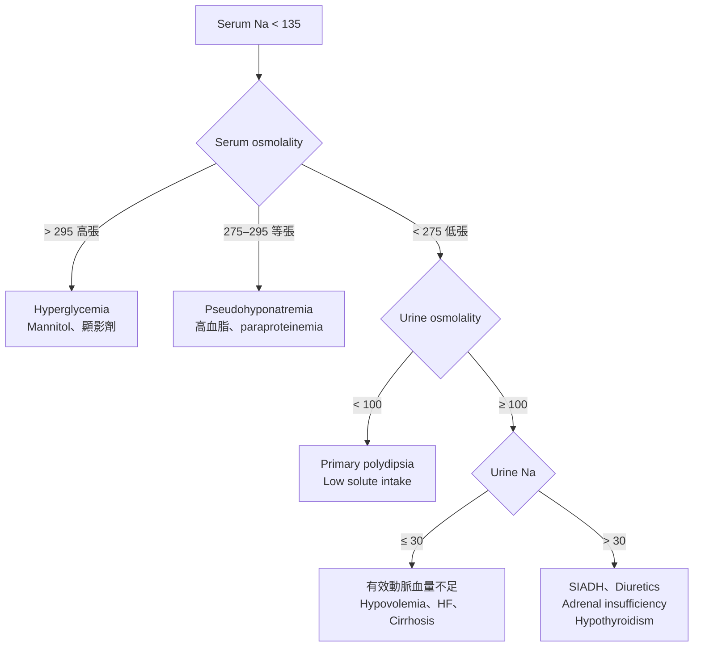

> [!abstract] 一句話重點
> 先確認是 **hypotonic hyponatremia**，再用 **urine osmolality → urine Na** 分流；治療的關鍵是**有沒有嚴重症狀**，以及**不要矯正太快**。

## 定義與嚴重度

- **Hyponatremia**：Serum Na < 135 mmol/L
- 依數值：mild 130–134、moderate 125–129、profound < 125
- 依時間：acute < 48 小時、chronic ≥ 48 小時（時間不明時，**當作 chronic 處理**）
- 臨床處置更看重**症狀**：嘔吐、意識改變、抽搐、昏迷屬於嚴重症狀

## 診斷流程

### 步驟說明

1. **確認是低張性**：Serum osmolality < 275 mOsm/kg
   - 高血糖時 Na 會被稀釋：血糖超過 100 mg/dL 的部分，每多 100 mg/dL，校正後 Na 約增加 1.6–2.4 mmol/L
2. **Urine osmolality**：判斷 ADH 有沒有在作用
   - < 100：ADH 被正常抑制，水喝太多或溶質攝取太少（beer potomania、tea and toast）
   - ≥ 100：ADH 有作用，繼續看 urine Na
3. **Urine Na**：判斷腎臟是否在保留鈉
   - ≤ 30：有效動脈血量不足，腎臟努力保鈉
   - > 30：[[SIADH]]、利尿劑、腎上腺功能低下等

> [!tip] Pearl
> 診斷 SIADH 前，一定要先排除 **adrenal insufficiency** 和 **hypothyroidism**，也要確認病人沒有使用 thiazide。

> [!warning] Pitfall
> Thiazide 引起的低血鈉，urine Na 可能很高，看起來很像 SIADH。停藥後追蹤 Na 的變化有助於鑑別。

## 治療

### 有嚴重症狀：先處理腦水腫

- **3% NaCl 100–150 mL IV bolus**，約 10–20 分鐘給完，可重複 2–3 次
- 目標：先讓 Na 上升 **4–6 mmol/L**，通常就足以改善症狀
- 期間密集追蹤 Na（約每 2–4 小時）

### 沒有嚴重症狀：找病因，慢慢矯正

| 病因 | 處置方向 |
| --- | --- |
| Hypovolemia | Isotonic saline |
| [[SIADH]] | Fluid restriction、urea、salt tablets、tolvaptan |
| HF、Cirrhosis | Fluid restriction、治療原疾病、利尿劑 |
| Primary polydipsia | 限制水分攝取 |
| 藥物引起 | 停用可疑藥物 |

### 矯正速度上限（避免 ODS）

> [!danger] 矯正上限
> - 一般病人：**24 小時內上升不超過 10–12 mmol/L**
> - **ODS 高風險**病人：**24 小時內不超過 8 mmol/L**
>   - Na ≤ 105、酗酒、營養不良、低血鉀、肝病
> - 矯正過快時，可考慮給 **D5W** 和／或 **desmopressin** 把 Na 拉回來

ODS（osmotic demyelination syndrome）通常在矯正過快後 **2–6 天**才出現，表現為構音困難、吞嚥困難、四肢無力，甚至 locked-in syndrome。

## 相關筆記

- [[SIADH]]

## 參考資料

- Spasovski G, et al. Clinical practice guideline on diagnosis and treatment of hyponatraemia. *Eur J Endocrinol*. 2014.
- Verbalis JG, et al. Diagnosis, evaluation, and treatment of hyponatremia: expert panel recommendations. *Am J Med*. 2013.
- Adrogué HJ, et al. Diagnosis and management of hyponatremia: a review. *JAMA*. 2022.
