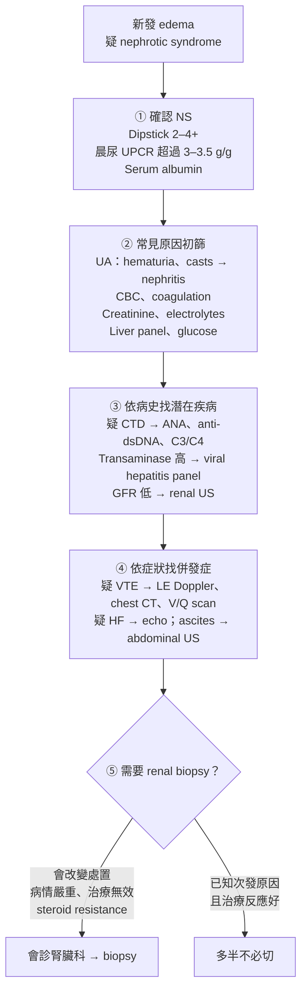

> [!abstract] 一句話重點
> - **Heavy proteinuria＋hypoalbuminemia＋edema**（常合併 hyperlipidemia），而且沒有 heart failure 或嚴重 liver disease
> - 診斷靠 ==spot UPCR > 3–3.5 g/g＋albumin < 2.5 g/dL==
>   - 接著做三件事：**找 secondary cause**（DM、SLE、藥物最重要）、**評估併發症**（VTE、感染、AKI、高血脂）、**決定要不要 biopsy**
> - 多數病人用 ==限鈉限水＋loop diuretic＋ACEI/ARB== 的支持療法；預防性抗凝、降血脂藥、免疫抑制劑都**不是每個人都要用**，要個別評估並會診腎臟科

## 🗺️ 總綱

🗺️ Nephrotic syndrome：確認 → 找原因 → 抓併發症 → 支持療法 → 切片／免疫治療

1. 確認診斷
<ul><li>Spot UPCR &gt; 3–3.5 g/g（或 24h &gt; 3–3.5 g）</li><li>Albumin &lt; 2.5 g/dL（有人用 &lt; 3.0）</li><li>Peripheral edema</li><li>Hyperlipidemia 常見但非必要</li></ul>

2. 原發 vs 次發
<ul><li>成人 80–90% idiopathic</li><li>MN、FSGS 各約 30–35%</li><li>MCD、IgAN 各約 15%</li><li>Secondary：DM、SLE 最常見；藥物（NSAID、lithium、pamidronate）</li></ul>

3. 併發症
<ul><li>VTE：MN 風險最高，含 renal vein thrombosis</li><li>感染（cellulitis）</li><li>AKI：少見，要找原因</li><li>Hyperlipidemia</li></ul>

4. 支持療法
<ul><li>Na &lt; 3 g/d、水 &lt; 1.5 L/d</li><li>Loop diuretic BID，每天減 1–2 kg</li><li>ACEI/ARB 降蛋白尿</li></ul>

5. 個別化
<ul><li>抗凝：albumin &lt; 2.0–2.5、MN、血栓病史</li><li>Biopsy：idiopathic 未知病理型、疑 SLE、治療無效</li><li>免疫抑制：會診腎臟科</li></ul>

6. 預後
<ul><li>MN：rule of thirds</li><li>FSGS 較差，蛋白尿越多越快到 ESKD</li></ul>

## 定義與流行病學

| 項目 | 標準 |
| --- | --- |
| **Heavy proteinuria** | Spot urine protein-to-creatinine ratio（UPCR）**> 3–3.5 mg/mg**（300–350 mg/mmol），或 24 小時尿蛋白 **> 3–3.5 g** |
| **Hypoalbuminemia** | Serum albumin **< 2.5 g/dL**（部分專家用 < 3.0 g/dL） |
| **Edema** | 臨床上有 peripheral edema |
| Hyperlipidemia（**非診斷必要**） | 可以很嚴重，total cholesterol 常 > 350 mg/dL |

- 成人年發生率約 **3／100,000**
- 成人 **80–90% 是 idiopathic（primary）**；原文的病理型分布：

| 病理型 | 約占成人 NS | 備註 |
| --- | --- | --- |
| Membranous nephropathy（MN） | 30–35% | 白人最常見 |
| Focal segmental glomerulosclerosis（FSGS） | 30–35% | 黑人最常見 |
| Minimal change disease（MCD） | ~15% | |
| IgA nephropathy | ~15% | |
| Secondary（有潛在疾病） | ~10% | DM、SLE 最常見 |

> [!info] 成人 ≠ 兒童
> 本篇講的是成人 NS；兒童以 MCD 為主、處理方式也不同，不要直接套用。

## 病生理

- **核心缺陷**：glomerular 對 albumin 與其他 plasma protein 的通透性增加
- **Edema 怎麼來**：機轉其實還不清楚，目前認為兩者都參與
  - **Primary renal Na retention**（overfill）
  - **Hypoalbuminemia → oncotic pressure 下降**，液體從血管滲到 interstitium（underfill）
- **為什麼容易血栓**：多因素——尿中流失凝血調節蛋白，加上肝臟代償性大量製造蛋白，使止血平衡偏向 **prothrombotic**；本身有 prothrombotic genetic mutation 的人風險更高
- 其他併發症（感染、高血脂）同樣被認為來自「**肝臟過度合成蛋白＋小分子量蛋白從尿中流失**」

## 臨床表現

- **最常見：新發生的下肢 edema**；嚴重時往上到大腿、下腹、**生殖器（scrotal／labial edema）**
- 其他：ascites、periorbital edema、hypertension、pleural effusion
- 病人常描述：**foamy urine**、活動喘或 fatigue、短時間內因水腫**體重明顯增加**

## 診斷

### 尿蛋白怎麼量

- 24 小時尿收集麻煩、常收錯 → ==一般用 spot UPCR 就足以診斷 nephrotic-range proteinuria==（SORT C）
- UPCR 的限制：**肌肉量異常或變化**（大量運動、增肌或肌肉流失）時，因為分母 creatinine 不準，估算會偏差

### 診斷流程

（依 Kodner 2016 Figure 1 內容重新繪製）

> [!tip] Pearl：UA 有 hematuria 或 casts → 不只是 nephrotic
> 純 nephrotic 的尿沉渣通常乾淨；==出現 dysmorphic RBC、RBC cast 要想到 nephritic 成分==（例如 lupus nephritis），這也是 biopsy 最有價值的族群。

### Renal biopsy 的角色

- **沒有實證指引**規定何時要切，常取決於腎臟科醫師的偏好
- **最有用**：idiopathic NS 但不知道病理型、**懷疑 SLE** 或其他腎臟疾病——結果會直接影響治療與預後
- **幫助有限**：已知 secondary cause 且治療反應良好

## 次發性原因（Secondary causes）

依原文 Table 1 內容重新整理：

| 類別 | 代表疾病 |
| --- | --- |
| **Metabolic** | ==Diabetes mellitus==、amyloidosis |
| **Immunologic** | ==SLE==、Sjögren、cryoglobulinemia、HSP（IgA vasculitis）、microscopic polyangiitis、PAN、erythema multiforme |
| **Neoplastic** | 實體癌（肺、乳、大腸、胃、腎）、leukemia／lymphoma、melanoma、**multiple myeloma** |
| **Medication／drug** | ==NSAIDs==、lithium、pamidronate、interferon-α、heroin |
| **Infection** | 細菌：infective endocarditis、syphilis、leprosy；病毒：**HBV、HCV、HIV**、EBV、herpes zoster；寄生蟲：malaria、schistosomiasis、filariasis、helminth |
| **Allergic** | 蜂螫、毒蛇咬傷、antitoxin、poison ivy／oak |
| **Genetic** | Congenital NS（Finnish type）、familial FSGS、Alport syndrome |
| **Other** | Preeclampsia、malignant hypertension、sarcoidosis、Castleman disease、chronic allograft nephropathy |

> [!warning] Pitfall：NS 不一定是「主診斷」
> 尤其在 SLE，NS 可能只是多重器官表現之一（例如懷孕婦女同時有 lupus nephritis、preeclampsia、hemolytic anemia）。看到 NS 要回頭把整個病人看完。

## 鑑別診斷：全身性 edema

| 鑑別 | 支持的線索 | 區分方式 |
| --- | --- | --- |
| **Nephrotic syndrome** | Foamy urine、albumin 很低、高血脂 | UPCR > 3–3.5 g/g |
| Heart failure | 喘、端坐呼吸、JVP 高 | Echo、BNP；尿蛋白不會到 nephrotic range |
| Cirrhosis／severe liver disease | Ascites、黃疸、門脈高壓 | Liver panel、影像；albumin 低但沒有大量蛋白尿 |
| Nephritic syndrome | Hematuria、RBC cast、高血壓、AKI | 尿沉渣；可與 NS 重疊 |

延伸個案：[[nejm-cases/nephrology/minimal-change-disease-chylothorax|NEJM 個案：MCD 合併 chylothorax]] 示範了怎麼用 JVP、BNP、albumin、尿蛋白一步步把 edema 定位到腎臟。

## 併發症

> [!note] 不必常規篩檢
> 沒有症狀的病人**不需要**例行篩檢 VTE 或感染；依病史與理學檢查做 focused testing。

### Venous thromboembolism（VTE）

- 最重要的併發症之一；最常見是 **lower limb DVT**，也可發生 **renal vein thrombosis**、PE；**arterial thrombosis 少見**
- 發生率：早期病例系列 DVT 8%、renal vein thrombosis 高達 25%；較新的回溯研究低很多（DVT 1.5%、RVT 0.5%）
- ==成人比兒童常見；MN 風險高於其他病理型（可達 7%）==

### 感染

- 細菌感染，尤其 **cellulitis**；成人 NS 感染率報告可達 20%，但分不清是 NS 本身還是住院、steroid 造成
- 沒有可靠發生率資料，也**沒有成人預防性抗生素的指引**

### Acute kidney injury

- **NS 自發性 AKI 很少見**；真的出現 AKI，要找原因（依原文 Table 3 重新整理）：

| 機轉 | 原因 |
| --- | --- |
| Prerenal | **過度利尿**造成 volume depletion |
| 藥物血流動力學 | NSAID、ACEI、ARB |
| Tubulointerstitial | ATN（volume depletion、sepsis）；**藥物（含 diuretics）引起的 acute allergic interstitial nephritis** |
| 血管 | ==Renal vein thrombosis== |
| 腎臟本身 | Intrarenal edema；**原本 GN 轉型**（例如 MN 上出現 crescentic GN） |

- 所以 NS 病人還是要測 **renal function、尿蛋白定量、chemistry、lipid profile**

### Hyperlipidemia

- 很常見，任何一種 lipoprotein 都可上升，可以很高
- 蛋白尿與原本疾病改善後，dyslipidemia 通常跟著改善或消失

## 治療

> [!abstract] 原文的保守治療組合（SORT C）
> ==限鈉＋限水＋loop diuretic＋ACEI/ARB==，適用大多數 NS 病人；同時治療可矯正的原因，並仔細評估併發症。

### 一般措施

- **Dietary Na < 3 g/day**、**fluid < 1,500 mL/day**（部分專家建議）

### Edema：loop diuretic

**為什麼 NS 會 diuretic resistance（即使 GFR 正常）**：loop diuretic 要**和蛋白結合**才能被送到腎小管作用，NS 血中蛋白少 → 效果差，常需要比平常高的劑量；嚴重 NS 時 **腸壁水腫** 也讓口服吸收不穩。

| 步驟 | 作法 |
| --- | --- |
| 起始 | ==Furosemide 40 mg PO BID== 或 bumetanide 1 mg PO BID（BID 是因為作用時間較長） |
| 目標 | 依每日體重，==每天減 1–2 kg（2–4 lb）==，不要太快 |
| 調整 | 反應不足 → 每 1–3 天劑量約加倍 |
| 上限 | Furosemide 約 **240 mg／次、600 mg／天**（原文註明這個上限沒有明確實證） |
| 仍不夠 | 改 **IV loop diuretic**；或加 **oral thiazide**（sequential nephron blockade）；或先給 **IV 20% albumin** 再打 IV diuretic bolus |

> [!warning] Pitfall：利尿太猛反而造成 AKI
> 過度利尿 → prerenal AKI；diuretic 本身也可能造成 allergic interstitial nephritis。體重掉太快、creatinine 上升時要回頭檢討。

### ACEI／ARB（antiproteinuric）

- 常規建議，因為有明確降蛋白尿效果；可能也降低 VTE 風險（未證實）
- 但對腎衰竭、水腫改善、需不需要洗腎等**硬終點的效益未證實**，證據互相矛盾

### 抗凝（VTE prevention）

- **沒有 RCT** 告訴我們要不要預防性抗凝、要多久 → ==不常規做 primary prevention==，個別決定（SORT C）
- 傾向抗凝的因素：
  - **NS 嚴重度**：serum albumin **< 2.0–2.5 g/dL**
  - 已知 thrombophilia、**曾有 VTE**
  - 同時評估**出血風險**
- 要不要抗凝，應與腎臟科討論

> [!info] 補充：KDIGO 2021 Glomerular Diseases Guideline（原文之後的指引）
> - **MN 的預防性抗凝門檻與 albumin 測法有關**：靜脈血栓高風險、albumin < 20 g/L（BCP 法）或 < 25 g/L（BCG 法）→ 評估出血風險後考慮 warfarin 或 LMWH（＋aspirin）；動脈風險高者可考慮 aspirin
>   - ==BCG 法在 NS 會高估 albumin==，要知道自己醫院用哪種方法
> - VTE 多發生在**發病前 6 個月**
> - 藥物：KDOQI 評論認為目前以 UFH、LMWH、warfarin 為主；**DOAC 因為和 albumin 結合、藥動資料少，暫不建議**
> - **Dihydropyridine CCB**（amlodipine、nifedipine）會加重 edema、可能增加蛋白尿，要先考慮停用或換藥

### 感染

- Cochrane review：**沒有足夠證據**推薦特定預防措施；不建議常規預防性抗生素

> [!info] 補充：KDIGO 2021
> - 所有 NS 病人建議打 **influenza、pneumococcal、varicella** 疫苗
> - Prednisone **≥ 20 mg/day** 或使用 cyclophosphamide、rituximab 等免疫抑制時，給 **PJP prophylaxis**（TMP-SMX 或同等藥物）
> - 免疫抑制前篩檢 TB、HBV、HCV、HIV、syphilis；高風險且 eosinophilia 者考慮 Strongyloides

### Dyslipidemia

- Cochrane review：沒有其他用藥適應症時，**降血脂藥對 NS 的高血脂沒有足夠證據**
- ==不要只因為 NS 的高血脂就開始降血脂藥==（SORT **A**，本篇證據等級最高的一條）；病人本來就有 statin 適應症則照常處理

### 免疫抑制治療

- Steroid 很常被使用，但**支持資料不足**；對多數 idiopathic NS 成人沒有證實的效益，風險可能大於好處（SORT B）
- 用不用、用什麼、用多久 → 取決於臨床因素與 **biopsy 病理型**，與腎臟科一起決定
- 有效的情境：
  - **Lupus nephritis**：免疫抑制治療**效果明確**、有多項研究支持
  - **MCD、primary FSGS**：可達部分或完全緩解
  - **Idiopathic MN**：Cochrane review 顯示 ==alkylating agent＋corticosteroid== 有短期與長期效益
- Steroid resistance 或沒改善 → 與腎臟科討論其他免疫抑制劑

**Idiopathic MN 可考慮的免疫抑制劑**（原文 Table 4 重新整理）：

| 類別 | 藥物 |
| --- | --- |
| Alkylating agents | Cyclophosphamide、chlorambucil |
| Calcineurin inhibitors | Cyclosporine、tacrolimus |
| Biologics | Rituximab、eculizumab |
| 其他 | Mycophenolate mofetil、azathioprine、ACTH、high-dose IVIG、雷公藤（*Tripterygium wilfordii*） |

> [!info] 補充：KDIGO 2021 對 MN 的更新
> - ==NS＋anti-PLA2R antibody 陽性 → 可診斷 MN，不一定要 biopsy==；但 **anti-PLA2R 陰性不能排除** PLA2R-associated MN
> - 仍要切的情況：病程不典型、eGFR 快速下降、ANA 等抗體陽性、免疫治療無效、抗體消失後仍持續 NS
> - 所有 MN 都要篩 secondary cause：感染、系統性疾病、**惡性腫瘤**、藥物（NSAID）、保健品
> - 依風險（creatinine、albumin、蛋白尿、PLA2R 抗體濃度）分層，選擇觀察、rituximab、CNI 或 cyclophosphamide＋steroid
> - 治療中追蹤 PLA2R 抗體：**免疫學緩解比臨床緩解早好幾個月**

## 預後

- 取決於**原因、病理型、病人狀況**；很多人只靠支持療法就改善，也有人積極治療仍惡化到洗腎
- 一項研究：常規 ACEI/ARB＋選擇性免疫抑制 → **緩解率 76%，12% 需要 hemodialysis**

| 病理型 | 預後 |
| --- | --- |
| **Idiopathic MN** | 整體較好，==rule of thirds==：約 1/3 良性、高緩解率；1/3 持續蛋白尿或水腫但腎功能正常；略少於 1/3 在 **10 年內**進展到 ESKD |
| **Primary FSGS** | 較差，**蛋白尿量是重要預後因子**：nephrotic-range 者約一半在 5–10 年進展到 ESKD；==蛋白尿 10–14 g/day 平均 2–3 年就到 ESKD== |

## 原文關鍵建議（SORT）

| 建議 | 證據等級 |
| --- | --- |
| 用 **spot UPCR** 取代 24 小時尿確認 nephrotic-range proteinuria | C |
| VTE 雖常見，但**不是每個 NS 病人都要抗凝** | C |
| 高血脂雖常見，但**不要只為了 NS 的表現就開始降血脂藥** | **A** |
| 限鈉、限水、loop diuretic、ACEI/ARB 是適合多數病人的保守治療 | C |
| Steroid 與其他免疫抑制劑可能有益，但風險大、沒有指引建議所有人都用 | B |

> [!tip] 什麼時候要會診腎臟科
> 抗凝與否、免疫抑制劑、是否 biopsy，以及其他不確定的地方，都應該和腎臟科一起決定。

## 🎯 內專考點

> [!example] 出題規律
> 腎臟科 GN-Nephrotic 共 12 題，集中在 **membranous nephropathy（MN）**：**① NS 的高凝血機轉與 renal vein thrombosis（MN 最容易）**；**② anti-PLA2R 抗體的用途**（診斷、預後、追蹤、預測自發緩解）；**③ MN 何時「不需要」立刻免疫抑制**（依風險分層，先 supportive care）；**④ 老年或抽菸者的 MN 要找惡性腫瘤**。另有從病理或臨床表現判斷 **MCD、FSGS** 的題目。

題號格式為「年份-題號」，來源為 [內專刷題網站](http://imboard.dirty-wolf.com/)（每題沒有獨立網址，請在網站選「依科目 → 腎臟 → GN-Nephrotic」查詢）。

### 高凝血狀態與 renal vein thrombosis

> [!note]- 104-078｜NS 病人水腫加劇、蛋白尿暴增，懷疑 VTE：何者不正確？
> **情境**：
> - 52 歲男性，NS 病史 3 年
> - 近一個月雙下肢水腫、體重增加 4 kg
> - 尿蛋白 **2.8 → 10.6 g/day**，懷疑 VTE
>
> **問**：何者不正確？
> - 可能是 DVT 或 renal vein thrombosis → 對
> - **原因通常是血小板增加或 antithrombin III 活性增加 → 錯**
> - 可能和 protein C 或 protein S 減少有關 → 對
> - 先用超音波篩檢，必要時 CT 或 MRI → 對
> - 用 heparin 或 warfarin 治療 → 對
>
> **答**：**「antithrombin III 活性增加」那一項**
>
> **重點**：
> - 機轉口訣：**==抗凝因子從尿中流失、促凝因子由肝臟增加==**
> - 流失：**antithrombin III**、free protein S、plasminogen（分子量小）
> - 增加：fibrinogen、factor V、VIII；再加上 diuretic 造成的血液濃縮、血小板凝集增加、活動減少
> - 📖 對照：[[nephrology/nephrotic-syndrome#Venous thromboembolism（VTE）|VTE]]

> [!note]- 105-078／108-074｜MN 病人突發腰痛、血尿、腎功能惡化；哪種 GN 最容易 renal vein thrombosis？
> **情境**：
> - 105-078：38 歲女性，MN，蛋白尿 4.5 g/day；突然 **flank pain、tenderness、hematuria、腎功能快速下降**
> - 108-074：直接問哪一種原發性腎病造成的 NS 最容易合併 renal vein thrombosis
>
> **問**：最可能的診斷？（renal stone 合併 UTI／**renal vein thrombosis**／renal artery stenosis／malignant hypertension／TMA）；最容易 RVT 的 GN？（FSGS／IgAN／**MN**／MCD／MPGN type I）
>
> **答**：**Renal vein thrombosis**；**membranous nephropathy**
>
> **重點**：
> - **==MN 是 NS 中 VTE、RVT 風險最高的病理型==**（以 IgAN 為參考，校正蛋白尿與 albumin 後 MN HR 約 10.8，FSGS 約 5.9）
> - 風險在**診斷後頭 2 年**最高；**albumin 越低風險越高**（< 2.8 g/dL 最高）
> - 急性 RVT 的典型表現：腰痛、血尿、腎功能惡化
> - 📖 對照：[[nephrology/nephrotic-syndrome#Venous thromboembolism（VTE）|VTE]]、[[nephrology/nephrotic-syndrome#抗凝（VTE prevention）|抗凝（VTE prevention）]]

### Membranous nephropathy：anti-PLA2R 與治療時機

> [!note]- 108-081｜Stage II MN、蛋白尿 5 g：anti-PLA2R 的用途哪些正確？
> **情境**：
> - 男性，高血壓，下肢水腫 6 個月
> - 24 小時尿蛋白 **5 g**、albumin 3 g/dL、Cr 1.7 mg/dL
> - 切片：**stage II membranous nephropathy**
>
> **問**：哪些正確？
> - (1) 應檢測血清 anti-PLA2R 抗體 → 對
> - (2) 可由切片 GBM 增厚與發炎細胞多寡判斷預後 → 錯
> - (3) 抗體不高就表示會自行緩解 → 錯
> - (4) 抗體高就應建議免疫抑制治療 → 對
> - (5) 抗體高且開始治療後，仍要持續追蹤抗體 → 對
>
> **答**：**(1)＋(4)＋(5)**
>
> **重點**：
> - **Anti-PLA2R** 用於**診斷、風險分層、追蹤治療反應與復發**；抗體下降或轉陰常**早於**蛋白尿緩解
> - 預後看**蛋白尿、eGFR、albumin、抗體濃度**，不是看病理 GBM 增厚程度
> - 抗體低不代表「一定」會自行緩解（說法過度絕對）
> - 📖 對照：[[nephrology/nephrotic-syndrome#免疫抑制治療|免疫抑制治療（KDIGO 2021 補充）]]

> [!note]- 113-067｜Primary MN、腎功能正常：哪種組合最可能自發緩解？
> **問**：哪一種血清與腎組織 PLA2R 的組合，最可能預測**自發性緩解**？
> - **血清 anti-PLA2R 陰性＋腎絲球 PLA2R1 抗原陽性 → 對**
> - 血清陰性＋組織陰性 → 錯
> - 血清陽性＋組織陽性 → 錯
> - 血清陽性＋組織陰性 → 錯
> - 與 anti-PLA2R 無關 → 錯
>
> **答**：**血清抗體陰性、組織抗原陽性**
>
> **重點**：
> - 組織 PLA2R1 陽性 → 確實是 PLA2R-associated MN；血清抗體已經陰性 → **==循環抗體已清除（immunologic remission）==** → 最可能自發緩解
> - 抗體**低或下降**預測自發緩解；**高或上升**預測不緩解、需要免疫抑制
> - 📖 對照：[[nephrology/nephrotic-syndrome#免疫抑制治療|免疫抑制治療（KDIGO 2021 補充）]]

> [!note]- 104-082｜MN 追蹤一年，蛋白尿 1.6 g/day、albumin 正常：怎麼處理？
> **情境**：
> - 54 歲，一年前切片診斷 MN，門診追蹤
> - 最近（和一年前類似）：**albumin 3.8 g/dL、Cr 1.2 mg/dL、蛋白尿 1.6 g/day**
> - 輕度高血壓，**沒有水腫**
>
> **問**：最合適的處置？（低劑量 prednisolone／cyclosporine 或 tacrolimus／單用 MMF／**不需免疫抑制，用 ACEI 控制血壓**／再切片一次）
>
> **答**：**暫不需要 prednisolone 或其他免疫抑制劑，用 ACEI 控制血壓**
>
> **重點**：
> - MN 依**進展風險**決定治療：**eGFR 正常、蛋白尿 < 3.5 g/day、albumin > 3.0 g/dL → ==低風險，只做 supportive care==**（最大耐受 ACEI／ARB、控制血壓、限鹽），觀察是否自發緩解
> - 中、高風險（持續 nephrotic-range 蛋白尿、低 albumin、eGFR 下降、高 anti-PLA2R）才加免疫抑制（rituximab、cyclophosphamide＋steroid、CNI）
> - 📖 對照：[[nephrology/nephrotic-syndrome#ACEI／ARB（antiproteinuric）|ACEI／ARB]]、[[nephrology/nephrotic-syndrome#免疫抑制治療|免疫抑制治療]]

> [!note]- 110-069｜68 歲 MN、PLA2R 血清與組織都陰性：何者錯誤？
> **情境**：
> - 68 歲女性，NS：蛋白尿 3.5 g/day、**albumin 2.2 g/dL**、腎功能正常
> - 切片 MN；**血清 PLA2R 與腎組織染色都陰性**
>
> **問**：何者錯誤？
> - 應進一步檢查惡性腫瘤 → 對
> - **應開始交替使用 cyclophosphamide 和類固醇 → 錯**
> - 血栓風險高，出血風險低者可考慮預防性抗凝 → 對
> - 應篩檢 B 型肝炎 → 對
> - 6 個月後蛋白尿仍持續，可能有進行性腎病風險 → 對
>
> **答**：**「應開始 cyclophosphamide＋類固醇」那一項**
>
> **重點**：
> - **PLA2R 陰性＋年長 → ==積極找 secondary cause==**：惡性腫瘤、HBV／HCV、藥物（NSAID 等）、SLE
> - albumin 低 → 血栓風險高，出血風險低者考慮預防性抗凝
> - eGFR 正常、沒有危及生命的併發症 → 先 supportive care 並做風險分層，**不是一確診就上 cyclophosphamide**
> - 📖 對照：[[nephrology/nephrotic-syndrome#次發性原因（Secondary causes）|次發性原因]]、[[nephrology/nephrotic-syndrome#抗凝（VTE prevention）|抗凝]]

> [!note]- 112-069｜50 年菸齡、體重減輕、右上肺腫塊合併 NS：最可能的病理？
> **情境**：
> - 66 歲男性，疲倦、下肢水腫 2 週；6 個月體重減輕 3.8 kg
> - 抽菸近 50 年（每天一包）；看起來很瘦，脛前水腫 2+
> - Hb 11.2、PLT 13 萬；Cr 1.6、**albumin 1.8**、**膽固醇 475**
> - 尿液：潛血陰性、**蛋白 4+**、**fatty cast 多量**
> - CT：**右上葉 2.5 × 3.5 × 2 cm 腫塊**
>
> **問**：最可能的診斷？（FSGS／IgAN／MPGN／RPGN／**MN**）
>
> **答**：**Membranous nephropathy**
>
> **重點**：
> - **==成人 NS＋實體腫瘤（肺癌等）→ malignancy-associated MN==**；年紀越大、抽菸者越要想到
> - 潛血陰性、fatty cast → 典型 nephrotic 而非 nephritic，排除 IgAN、RPGN
> - 📖 對照：[[nephrology/nephrotic-syndrome#次發性原因（Secondary causes）|次發性原因：Neoplastic]]

### 從臨床與病理判斷 MCD、FSGS

> [!note]- 107-092｜24 歲女性 2 個月水腫、UPCR 9、尿潛血陰性：最可能診斷？
> **情境**：
> - 24 歲女性，無病史；2 個月內水腫、體重增加 8 kg
> - **albumin 2.8**、Cr 0.8、TC 280、LDL 163
> - **UPCR 約 9 mg/mg**、**尿潛血陰性**；K、Ca、Hb 正常
>
> **問**：最可能的診斷？（IgAN／**MCD**／multiple myeloma／lupus nephritis／MPGN）
>
> **答**：**Minimal change disease**
>
> **重點**：
> - **==年輕、急性發作的「純」nephrotic、沉渣乾淨（無血尿）、腎功能正常 → MCD==**
> - IgAN、lupus、MPGN 常有血尿（nephritic 成分）；myeloma 年紀大、常有貧血、高鈣或腎功能不良
> - 📖 對照：[[nephrology/nephrotic-syndrome#診斷流程|診斷流程]]

> [!note]- 111-071｜肥胖女性、UPCR 5.9、切片 60% 腎絲球節段性瘢痕：診斷？
> **情境**：
> - 48 歲肥胖女性（167.6 cm、91 kg，BMI 約 32），輕度高血壓 5 年，CCB 控制
> - BP 130/80、JVP 升高、S4、輕微足部水腫
> - Cr 0.9、eGFR 79；尿蛋白 3+、hyaline cast、**UPCR 5.9 g/g**
> - 切片：**60% 腎絲球有節段性瘢痕**，其餘看起來正常
>
> **問**：最可能的診斷？（高血壓性腎硬化／**FSGS**／MCD／MN／crescentic GN）
>
> **答**：**Focal segmental glomerulosclerosis**
>
> **重點**：
> - **Focal**（部分腎絲球）＋**segmental**（腎絲球的部分區段）硬化 = FSGS
> - **肥胖**是 secondary（adaptive）FSGS 的常見原因：glomerulomegaly、hyperfiltration
> - 📖 對照：[[nephrology/nephrotic-syndrome#Renal biopsy 的角色|Renal biopsy 的角色]]

> [!note]- 113-059｜肥胖相關腎病：哪一種治療「沒有」減少蛋白尿或改善預後的證據？
> **問**：何者除外？
> - GLP-1 RA（如 semaglutide）→ 有證據
> - **傳統減重藥（orlistat、bupropion-naltrexone）→ 沒有腎臟證據**
> - Bariatric surgery → 有證據
> - 生活型態介入（低熱量飲食、運動）→ 有證據
> - RAAS blocker → 有證據
>
> **答**：**傳統減重藥（orlistat、bupropion-naltrexone）**
>
> **重點**：
> - Obesity-related glomerulopathy：glomerulomegaly ± perihilar FSGS，機轉為 hyperfiltration、RAAS 與 leptin 活化、lipotoxicity
> - 有證據的：**減重（生活型態、手術）、RAAS blockade、GLP-1 RA**（FLOW：T2DM＋CKD 腎臟複合終點降 24%）
> - **Orlistat** 還可能造成 enteric hyperoxaluria → **oxalate nephropathy**

> [!note]- 105-077｜哪個全身性疾病「不會」造成腎臟 TMA（慢性期呈 secondary FSGS）？
> **問**：何者不屬於造成腎臟 thrombotic microangiopathy 的全身性疾病？
> - HUS → 屬於
> - **Hepatitis B virus infection → 不屬於**
> - Malignant hypertension → 屬於
> - Antiphospholipid syndrome → 屬於
> - 骨髓移植後 radiation nephropathy → 屬於
>
> **答**：**HBV infection**
>
> **重點**：
> - TMA 是**內皮損傷 → 微血管血栓**；慢性化後腎絲球缺血、hyperfiltration 可呈 secondary FSGS
> - 其他 TMA 原因：scleroderma renal crisis、藥物（CNI、VEGF inhibitor、gemcitabine）
> - **HBV 腎病以 MN 為主**（immune complex），也可 MPGN 或 PAN，**不是 TMA**
> - 📖 對照：[[nephrology/nephrotic-syndrome#次發性原因（Secondary causes）|次發性原因：Infection（HBV）]]

### 模擬題

> [!question]- 模擬題 1｜MN 合併低 albumin：要不要預防性抗凝？
> 45 歲男性，切片證實 primary MN，anti-PLA2R 高效價，蛋白尿 8 g/day，**albumin 2.1 g/dL**，eGFR 85，無出血病史。下列敘述何者最正確？
>
> (A) MN 的 VTE 風險和 MCD 相近，不需考慮抗凝　(B) Albumin 越低 VTE 風險越高，出血風險低者可考慮預防性抗凝　(C) 高凝血是因為 antithrombin III 合成增加　(D) 抗體高效價代表會自行緩解，只需觀察　(E) 一旦開始免疫抑制治療，就不需要再追蹤 anti-PLA2R
>
> > [!success]- 答案與詳解
> > **答：(B)**
> >
> > - (A) 錯：**MN 是 NS 中 VTE 風險最高**的病理型
> > - (B) 對：albumin 低（尤其 < 2.5–2.8 g/dL）風險最高，出血風險低者可考慮預防性抗凝
> > - (C) 錯：antithrombin III 是**從尿中流失**而下降
> > - (D) 錯：**高**抗體效價預測**不會**自行緩解，屬中高風險，需要免疫抑制
> > - (E) 錯：要持續追蹤，**免疫學緩解比臨床緩解早**

> [!question]- 模擬題 2｜NS 病理型與臨床線索配對
> 下列「臨床線索 → 最可能病理型」的配對，何者**錯誤**？
>
> (A) 20 歲、急性 NS、沉渣乾淨、腎功能正常 → MCD　(B) 70 歲、重度抽菸、肺部腫塊合併 NS → MN　(C) BMI 35、緩慢出現 nephrotic-range 蛋白尿、albumin 接近正常 → secondary FSGS　(D) NS 合併 HBV 感染 → TMA　(E) 突發腰痛、血尿、腎功能惡化的 MN 病人 → renal vein thrombosis
>
> > [!success]- 答案與詳解
> > **答：(D)**
> >
> > - (A) → 對：年輕、純 nephrotic、無血尿是 MCD 的典型
> > - (B) → 對：malignancy-associated MN
> > - (C) → 對：肥胖造成 adaptive FSGS，常是 nephrotic-range 蛋白尿但不一定有完整 NS
> > - (D) → **錯**：HBV 相關腎病以 **MN** 為主，也可 MPGN、PAN，**不是 TMA**
> > - (E) → 對：MN 最容易 RVT

## 相關筆記

- [[cardiology/dyslipidemia-esc/index|血脂異常 ESC/EAS 指引]]（降血脂藥物、LDL-C 目標）

- [[nejm-cases/nephrology/minimal-change-disease-chylothorax|NEJM 個案：微小變化腎病合併乳糜胸]]（edema 的鑑別推理、MCD）
- [[nejm-cases/nephrology/infective-endocarditis-associated-glomerulonephritis|NEJM 個案：IE 相關腎絲球腎炎]]（nephritic 的對照；IE 也是 NS 的次發原因）

## 參考資料

- Kodner C. Diagnosis and Management of Nephrotic Syndrome in Adults. *Am Fam Physician*. 2016;93(6):479-485.（參考資料庫：`腎臟科/Diagnosis and Management of Nephrotic.pdf`）
- Kidney Disease: Improving Global Outcomes (KDIGO) Glomerular Diseases Work Group. KDIGO 2021 Clinical Practice Guideline for the Management of Glomerular Diseases. *Kidney Int*. 2021;100(4S):S1-S276.
- KDIGO. Top 10 Takeaways for Clinicians from the KDIGO 2021 Glomerular Diseases Guideline: Membranous Nephropathy.
- KDOQI US Commentary on the 2021 KDIGO Clinical Practice Guideline for the Management of Glomerular Diseases. *Am J Kidney Dis*. 2023.
