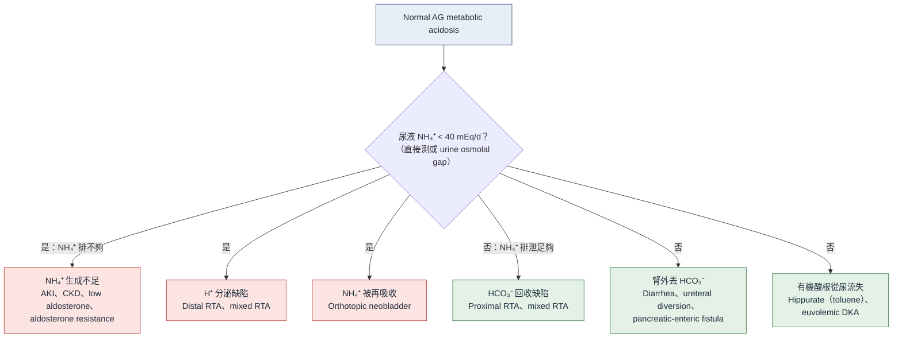
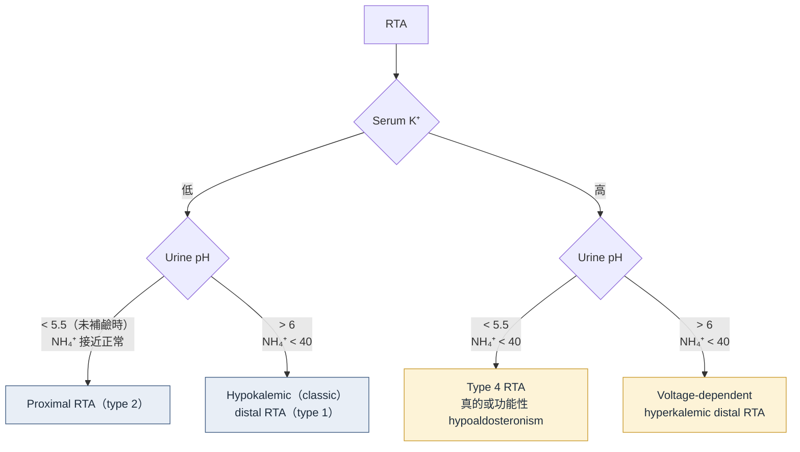

> [!abstract] 一句話重點
> Normal AG acidosis 先問「**腎臟有沒有在排 NH₄⁺**」：==尿液 NH₄⁺ 夠（> 40 mEq/d、urine osmolal gap 高）→ 腸胃道丟 HCO₃⁻；不夠 → RTA==。再用 **serum K⁺** 分低鉀（proximal、classic distal）與高鉀（type 4、voltage-dependent），最後用 **urine pH** 定型。

## 腎臟怎麼排酸

- 肺每天排掉約 15,000 mmol CO₂（揮發性酸），但**排不掉固定酸**
- 腎臟每天要排出約 **1 mmol/kg** 的固定酸（主要是含硫胺基酸代謝出的 sulfuric acid）
  - 不能以游離 H⁺ 排：就算尿液 pH 4.5，也要約 1,750 L 尿
  - 所以 H⁺ 要靠尿中的兩種緩衝排出：**HPO₄²⁻（titratable acid）** 和 **NH₃ → NH₄⁺**
- 另外每天還要回收約 4,000 mmol 過濾出的 HCO₃⁻

**Net acid excretion（NAE）= H₂PO₄⁻ + NH₄⁺ − HCO₃⁻ −（有機酸根）**

| 機制 | 位置 | 重點 |
| --- | --- | --- |
| **HCO₃⁻ 回收** | 75–80% 在 **proximal tubule** | 管腔 H⁺ + HCO₃⁻ → H₂CO₃ → CO₂ + H₂O（brush border 的 **CA IV** 催化），細胞內再生 HCO₃⁻ 經 **NBC1** 回到血液 |
| **Titratable acid**（HPO₄²⁻） | Proximal、distal | pKa 6.8，每天過濾 30–40 mEq，約負責一半固定酸；**量固定，不太能增加** |
| **NH₄⁺** | Proximal 生成，collecting duct 捕捉 | Glutamine 去胺生成 NH₄⁺；在 TAL 取代 K⁺ 走 NKCC 進入間質，變成 NH₃ 擴散到 collecting duct，被酸性尿「困住」成 NH₄⁺ 排出 |

> [!tip] Pearl：NH₄⁺ 才是腎臟真正能「加碼」的部分
> 平常每天排 30–40 mEq NH₄⁺；==慢性酸中毒時可增加到約 200（–300）mmol/d==（需要好幾天）。所以「酸中毒時腎臟有沒有把 NH₄⁺ 衝上去」就是判斷腎臟功能是否正常的關鍵。

## 第一步：確認是 normal AG（non-AG）metabolic acidosis

- **AG = Na − Cl − HCO₃⁻**；albumin 校正：AG + 2.5 × (4 − albumin)（本篇用 4 g/dL 當基準）
- **靜脈血氣通常就夠了**：靜脈 PCO₂ 只比動脈高約 5–6 mmHg（嚴重循環衰竭時差距才會很大），不必為了確認酸鹼而抽 ABG
- 血氣機的 HCO₃⁻ 是用 Henderson-Hasselbalch **算出來的**；生化的 total CO₂ 包含 HCO₃⁻ 以外的 CO₂ → ==兩者差一點是預期的==，不用重抽
- NAGMA 和 HAGMA 可以同時存在 → 用 delta-delta 估計，但 AG 本身誤差大，**不能取代直接測 lactate、β-hydroxybutyrate**（見 [[high-anion-gap-metabolic-acidosis|HAGMA]]）

## 第二步：腎臟有沒有在排 NH₄⁺？

### 直接測：24 小時尿液 NH₄⁺（首選）

- 酸中毒時正常反應：**> 40 mEq/d**，可升到 200 mEq/d
- RTA 與 CKD：反應鈍化

### 間接估算：Urine osmolal gap（UOG）

- **UOG = 實測 urine osmolality − [2 × (Na + K) + urea (mg/dL) / 2.8 + glucose (mg/dL) / 18]**
- NH₄⁺ 鹽是 UOG 的主要來源 → **尿 NH₄⁺（mmol/L）≈ UOG ÷ 2**

| UOG（酸中毒時） | 意義 |
| --- | --- |
| **> 200 mOsm/kg** | NH₄⁺ 排泄適當 → 腎外丟 HCO₃⁻（例如 diarrhea） |
| **==< 150 mOsm/kg==** | NH₄⁺ 排泄不足 → **RTA** |

- 優點：NH₄⁺ 跟著非 Cl⁻ 的陰離子（ketone、hippurate、HCO₃⁻）排時也能反映
- 假性升高：產 urease 的細菌、其他不帶電的溶質（mannitol、alcohol、glucose）

### 為什麼本篇**不建議** urine anion gap（UAG）

UAG = 尿 Na + K − Cl，理論上排 NH₄⁺ 多時 UAG 為負，但：

- NH₄⁺ 跟著 **HCO₃⁻、ketone、hippurate、penicillin 代謝物**排出時，UAG 反映不出來
- **低血容**時近端 NaCl 回收增加，也會讓 UAG 偏高 → ==評估 RTA 前要先矯正低血容==
- 研究顯示 UAG 可能比較反映飲食攝取，而不是 NH₄⁺
- Proximal RTA 的 NH₄⁺ 排泄也會上升到接近正常 → UAG／UOG **都無法區分 proximal RTA 與 diarrhea**

> [!warning] Pitfall：只看 urine pH
> Urine pH 只代表**游離 H⁺ 濃度**，不是總排酸量。Diarrhea 時大量 NH₄⁺ 排出（NH₃ 是鹼），尿液 pH 可能 > 6，看起來很像 distal RTA；反過來 type 4 RTA 尿液 pH 卻 < 5.5。所以要先看 **NH₄⁺**，urine pH 用來分 RTA 的型別。

## 診斷流程

### Normal AG acidosis 的病因（依原文 Figure 2 重新繪製）

Mixed RTA 兩邊都有：CA 缺乏或被抑制（**topiramate、zonisamide、acetazolamide**，原文也列 zoledronic acid）。

### RTA 分型（依原文 Figure 1 重新繪製）

## 各型比較

| | Proximal（type 2） | Classic distal（type 1） | Type 4 | Voltage-dependent distal |
| --- | --- | --- | --- | --- |
| 缺陷 | **HCO₃⁻ 回收閾值下降**（26 → 16–18） | α-intercalated cell **H⁺ 分泌**不能 | Aldosterone 不足或阻抗 | 管腔**負電位**建立不起來（ENaC 被阻斷） |
| Serum K⁺ | **低**（補鹼時更低） | **低** | **高** | **高** |
| Urine pH | **< 5.5**（未補鹼）；補鹼後 > 6 | **> 6**（> 5.5） | **< 5.5** | **> 6** |
| 尿液 NH₄⁺ | 接近正常（> 40） | **低** | **低** | **低** |
| HCO₃⁻ | 通常 16–18（新閾值） | 可以很低 | 通常輕度降低 | — |
| 結石／鈣化 | 少（Fanconi 時 citrate 回收也差） | **Nephrocalcinosis、calcium phosphate 結石** | 無 | — |
| 補鹼量 | **很大，最多約 20 mEq/kg/d** | 約 **1 mmol/kg/d** | 主要治療 hyperkalemia | 治療病因 |

> [!tip] Pearl：Hyperkalemic RTA 怎麼分 type 4 和 voltage-dependent？
> 兩者都高鉀、NH₄⁺ 都低。差別在 **==遠端 H⁺ 分泌還在不在==**：type 4 還在 → urine pH **< 5.5**；voltage-dependent 不在 → urine pH **> 6**。

## Proximal RTA（type 2）

### 病生理：閾值下降，不是完全不能回收

- 近端 HCO₃⁻ 回收最大量（Tmax）從約 26 降到 **16–18 mmol/L**（完全不能回收會致命）
- **病程三個階段**：
  1. 剛發生：HCO₃⁻ 大量從尿流失 → **urine pH 高**、遠端 Na⁺ 與流量增加 → **排 K⁺**
  2. 穩定期：血中 HCO₃⁻ 降到新閾值以下 → 過濾的 HCO₃⁻ 又能全部回收 → **urine pH < 5.5、K⁺ 正常化**
  3. **補鹼後（或飯後 alkaline tide）**：HCO₃⁻ 又超過閾值 → ==bicarbonaturia、尿 pH > 6、hypokalemia 惡化==（續發高醛固酮＋遠端大量 NaHCO₃ → 管腔更負 → 排 K⁺）

### 個案：多發性骨髓瘤病人用 zoledronic acid

- 骨髓瘤治療反應很好，但用 zoledronic acid 後出現 AKI、NAGMA、K 3.5、**尿糖 2+**（血糖正常）、urine pH 5.0
- 開始口服 NaHCO₃ 後：HCO₃⁻ 只升到 18，**K 掉到 2.5、urine pH 升到 7.0** → 典型 proximal RTA
- 兇手是 **zoledronic acid**（近端腎小管損傷、Fanconi syndrome）；骨髓瘤治療反應好，不太會在這時出現 light chain tubulopathy

### 病因

| 類別 | 例子 |
| --- | --- |
| **藥物** | **Topiramate、acetazolamide、zonisamide、tenofovir disoproxil fumarate、aminoglycoside、valproic acid、ifosfamide、zoledronic acid** |
| 全身性疾病 | **Paraproteinemia**（multiple myeloma、amyloidosis、light chain deposition disease）、heavy metal、aristolochic acid、Sjögren syndrome、hypocalcemia |
| 遺傳 | **Cystinosis**、Wilson disease、NBC1 variant、Lowe syndrome、Fanconi-Bickel syndrome、Dent disease |

- 常合併 **Fanconi syndrome**（廣泛近端功能異常）：**尿糖（血糖正常）、aminoaciduria、phosphaturia、uricosuria**
- **Carbonic anhydrase II deficiency**：proximal＋distal 都受影響（過去的「type 3」），合併 osteopetrosis、腦鈣化，非常罕見；topiramate、zonisamide、acetazolamide 抑制 CA II 也會造成後天 mixed RTA
- 慢性酸中毒：骨頭釋放鈣與磷來緩衝 → **osteomalacia**；近端受損也會減少 1,25(OH)₂D 生成

### 診斷與治療

- 通常不需要確診檢查（補鹼量明顯比 distal 或 type 4 大，本身就是線索）
- 有疑問時：補鹼後 **FE_HCO₃ > 15%** 確診
- 治療：補充流失的 HCO₃⁻，**最多可達 20 mEq/kg/d**（NaHCO₃ 錠、sodium／potassium citrate、小蘇打）
- **==補鹼前先矯正 hypokalemia==**：補鹼會造成 bicarbonaturia 與 kaliuresis，K⁺ 會更低
- 口服補鹼常常效果有限

## Classic distal RTA（type 1）

### 病生理

- 遠端排 H⁺ 需要：principal cell 經 **ENaC** 回收 Na⁺ → 管腔帶負電 → α-intercalated cell 用 **H⁺-ATPase**（及 H⁺/K⁺-ATPase）把 H⁺ 打出去
- **Classic distal RTA**：H⁺-ATPase 功能異常或被破壞（例如自體免疫）
- **Membrane failure（back-leak）**：管壁對陽離子的通透性增加，H⁺ 漏回來 — **amphotericin B、lithium**
- 結果：NH₃ 夠，但 H⁺ 打不出去 → **NH₄⁺ 排不出來、尿 pH 偏高**

**Hypokalemia 的原因**：遠端用分泌 K⁺ 取代 H⁺ 維持電中性、TAL 的 K⁺ 回收受影響、Na⁺ 流失導致續發高醛固酮。

### 病因

| 類別 | 例子 |
| --- | --- |
| Classic distal RTA | **Sjögren syndrome**、**SLE**、nephrocalcinosis、primary biliary cholangitis、sarcoidosis |
| Membrane failure | **Amphotericin B、lithium** |

### 臨床表現

- **Nephrocalcinosis**：鈣再吸收增加、間質鹼化、**hypocitraturia**
- **==腎結石以 calcium phosphate 為主==**：高尿 pH ＋ 酸中毒使近端加強回收 citrate
- 骨質流失（骨頭緩衝酸）

### 個案：Ulcerative colitis 合併反覆腎結石

- 每天 2–3 次軟便、反覆腎結石；K 3.2、Cl 100、total CO₂ 19；**urine pH 6.8**；不像低血容，尿 Na 80
- UOG = 372 − [2 × (80 + 42) + 275/2.8] ≈ 372 − 342 = **30 mOsm/kg** → 尿 NH₄⁺ ≈ 15 mEq/L，約 20–30 mEq/d，==遠低於酸中毒時應有的 > 40==
- 因此：**不是 diarrhea**（diarrhea 時 NH₄⁺ 應大幅上升）、**不是 proximal RTA**（未補鹼時 urine pH 應 < 5.5、NH₄⁺ 會 > 40）、**不是低血容**（沒有低血容表現、尿 Na > 40，且低血容造成的遠端酸化障礙會是高鉀）→ **distal RTA**
- 下一步：**24 小時代謝結石檢查**（NH₄⁺、citrate 都會偏低）
- 結石成分：**calcium phosphate**

### Incomplete distal RTA

- 尿 pH 高、反覆 calcium phosphate 結石，但**沒有 NAGMA**，NH₄⁺ 排泄通常也還可以
- 酸負荷或 furosemide／fludrocortisone 試驗會和 complete distal RTA 一樣異常

### 確診試驗（診斷不確定時）

| 試驗 | 方法 | 判讀 |
| --- | --- | --- |
| **Ammonium chloride loading** | 口服 NH₄Cl **0.1 g/kg**，6 小時後用 pH meter 測尿 | **尿 pH 無法降到 < 5.3** → distal RTA；常噁心嘔吐，少用 |
| **Furosemide＋fludrocortisone** | 口服 furosemide 40 mg＋fludrocortisone 1 mg，追蹤 8 小時 | 尿 pH 無法降到 < 5.3；驗證不足 |
| **==24 小時尿 NH₄⁺ 與 citrate==** | — | **兩者都低**；本篇**首選** |

### 治療

- 補鹼量足以中和每日固定酸：約 **1 mmol/kg/d**
- **==合併 hypokalemia 時選含鉀的鹼==**；**potassium citrate** 比 potassium bicarbonate 少在胃中產生 CO₂，較好耐受

## Type 4 RTA

### 病生理

- **Aldosterone 不足或阻抗** → ENaC 與 Na/K-ATPase 活性下降 → 管腔負電位下降、H⁺-ATPase 活性也下降 → **hyperkalemia**
- **==慢性 hyperkalemia 會抑制近端 NH₃ 生成==** → NAE 下降，但遠端還能酸化 → **尿 pH < 5.5**

### 病因

| 類別 | 例子 |
| --- | --- |
| **藥物** | RAAS 阻斷：**ACEI、ARB、MRA**、direct renin inhibitor、β-blocker；**NSAID**；**calcineurin inhibitor**；**heparin**（含類似物） |
| 全身性疾病 | **CKD**、**diabetes mellitus**（hyporeninemic hypoaldosteronism）、primary adrenal insufficiency |
| 遺傳 | Congenital hypoaldosteronism（21-hydroxylase deficiency、isolated hypoaldosteronism）、pseudohypoaldosteronism type 2（Gordon syndrome） |
| 其他 | Urinary tract obstruction（也可造成 voltage-dependent RTA） |

### 個案：糖尿病腎病變用 lisinopril

- T2D、蛋白尿（UACR 434）、高血壓；用 lisinopril、empagliflozin、semaglutide、metformin
- K **5.6**、Cl 106、HCO₃⁻ 19（normal AG）、**urine pH 4.8**、renin 輕度升高、aldosterone 偏低；超音波無 hydronephrosis
- 診斷：**type 4 RTA，最可能是 lisinopril 造成**（ACEI 降低 aldosterone，失去 angiotensin II 的負回饋 → renin 稍升高）
  - 停藥後仍高鉀 → 再考慮糖尿病腎病變造成的 **hyporeninemic hypoaldosteronism**
  - Voltage-dependent RTA：沒有阻塞，且 urine pH 應 > 6
  - Euglycemic DKA（empagliflozin）：AG 正常、沒症狀 → 不像
- 處置（加上限鉀飲食）：**==加 chlorthalidone==**
  - 同時降血壓、排 K⁺，ECF 收縮也增加近端 HCO₃⁻ 回收
  - **==有蛋白尿 CKD＋高血壓，lisinopril 應繼續==**
  - 血糖不夠高，不需加強降糖；高鉀程度與 thiazide 可望矯正 → 暫不需要 patiromer、SZC

## Voltage-dependent distal RTA

- **ENaC 被阻斷或 Na⁺ 到不了遠端** → 管腔建立不起負電位 → **H⁺ 和 K⁺ 都排不出去**
- 病因：**amiloride、triamterene、pentamidine、trimethoprim**；**urinary tract obstruction**、**sickle cell nephropathy**、chronic pyelonephritis、tubulointerstitial injury
- 嚴重**低血容**時遠端 Na⁺ 送達減少，也可能出現類似的高鉀酸中毒

## 🎯 內專考點

> [!example] 出題規律
> 兩大題型反覆出現：**糖尿病 → type 4 RTA（高血鉀）**（考了 3 次），以及 **Sjögren＋低血鉀 normal AG acidosis＋尿液無法酸化 → distal RTA**（考了 2 次）。另外常用「低血鉀但其實是**鹼中毒**」的 Bartter／Gitelman 來混淆。

題號格式為「年份-題號」，可到 [內專刷題網站](http://imboard.dirty-wolf.com/) 用「依年份練習」→「跳題」查看原題與詳解。每張卡片點開即可看到內容。

> [!tip] 考題用 UAG，本篇參考資料建議 UOG
> 考古題詳解都用 **urine anion gap（UAG）** 判斷 NH₄⁺ 排泄（正值 → RTA；負值 → 腸胃道流失）。本篇的 Core Curriculum 2025 則建議改用**直接測 NH₄⁺ 或 urine osmolal gap**，因為 UAG 在低血容、尿中有其他陰離子時不準。考試照題目給的數據算即可。

### Type 4 RTA：糖尿病

> [!note]- 106-69／109-78｜糖尿病造成的 RTA，何者正確
> **情境**：長期糖尿病造成的腎小管酸中毒
>
> **問**：何者正確？
> - 常出現 hyperkalemia → **對**
> - 最常是 type 2 RTA → 錯（DM 造成的是 type 4）
> - 酸中毒很嚴重，需要 IV bicarbonate → 錯（通常輕度）
> - 因為 aldosterone（106 年）／renin 與 aldosterone（109 年）很高 → 錯（兩者都**低**）
> - Collecting tubule 無法排 H⁺（106 年）／尿液無法酸化、urine pH > 6.5（109 年）→ 錯（這是 **type 1** 的特徵）
>
> **答**：**常出現 hyperkalemia**
>
> **重點**：DM nephropathy → **hyporeninemic hypoaldosteronism** → K⁺ 與 H⁺ 排不出去；高血鉀又抑制近端 NH₃ 生成。遠端還能酸化，**urine pH < 5.5**。

> [!note]- 104-90｜DM 20 年、renin 與 aldosterone 都低，預測酸鹼
> **情境**：72 歲男性，糖尿病 20 年，BUN 32、Cr 1.8，**renin 與 aldosterone 都偏低**
>
> **問**：預測酸鹼與鉀？（完全正常／低鉀＋代謝性酸中毒／低鉀＋代謝性鹼中毒／高鉀＋代謝性鹼中毒／高鉀＋代謝性酸中毒）
>
> **答**：**高鉀＋代謝性酸中毒**
>
> **重點**：Aldosterone 不足 → 留 K⁺、少排酸 → **type 4 RTA**（normal AG）。低鉀＋鹼中毒是 aldosterone **過多**的表現，方向剛好相反。

### Distal RTA：Sjögren syndrome

> [!note]- 107-68｜關節痛＋乾眼的女性，低血鉀 normal AG acidosis
> **情境**：55 歲女性，長期關節痛、**乾眼**、常用 NSAID；疲倦無力
> - Cr 1.0、Na 139、**K 3.3**、Cl 115；pH 7.26、HCO₃⁻ 14
> - 尿液：**pH 7.0**、glucose (−)、protein (−)；Na 35、K 40、Cl 18
>
> **問**：酸中毒最符合？（chronic diarrhea／type 1／type 2／type 4 RTA／DKA）
>
> **答**：**Type 1（distal）RTA**
>
> **重點**：
> - AG = 139 − 115 − 14 = 10 → normal AG acidosis＋低血鉀
> - UAG = 35 + 40 − 18 = **+57** → NH₄⁺ 排不夠 → 腎臟問題，不是 diarrhea
> - 酸中毒時尿 pH 仍 7.0 → 遠端無法酸化；Sjögren 是典型病因
> - Type 2：常合併 Fanconi（尿糖），穩定期尿 pH < 5.5；type 4：高血鉀；DKA：high AG

> [!note]- 112-71｜Sjögren 病人，尿 pH 6.0、UAG 正值
> **情境**：Sjögren syndrome 病史
> - Na 139、Cl 115、HCO₃⁻ 15、**K 3.0**
> - 尿液：**pH 6.0**、Na 35、K 20、Cl 42
>
> **問**：最可能的診斷？（chronic diarrhea／type I／type II／type III／type IV RTA）
>
> **答**：**Type I RTA**
>
> **重點**：AG = 9；UAG = 35 + 20 − 42 = **+13**（正值）；低鉀＋尿 pH > 5.5 → distal RTA。Type III 是 carbonic anhydrase II 缺乏的混合型（合併 osteopetrosis），非常罕見。

### 鑑別：低血鉀但是鹼中毒

> [!note]- 114-59｜血壓正常、低血鉀、代謝性鹼中毒、高尿鈣
> **情境**：36 歲女性倦怠，**血壓正常、無水腫**；低血鉀、**metabolic alkalosis**；尿蛋白 (−)、尿糖 (−)、**hypercalciuria**
>
> **問**：最可能的診斷？（Bartter／Gitelman／Liddle／Fanconi／Sjögren syndrome）
>
> **答**：**Bartter syndrome**
>
> **重點**：
> - **鹼中毒** → 排除 Fanconi（proximal RTA）與 Sjögren（distal RTA），兩者都是**酸中毒**
> - **血壓正常** → 排除 Liddle（高血壓、低 renin）
> - **高尿鈣** → Bartter（像 loop diuretic）；Gitelman 是低尿鈣＋低血鎂（像 thiazide）

> [!note]- 104-66｜年輕女性抽筋、低血鉀鹼中毒、血鎂正常
> **情境**：24 歲女性，肌肉抽筋、全身無力；BP 112/70
> - K 2.6、Cl 85、HCO₃⁻ 41、pH 7.53；**Mg 0.9 mmol/L（正常）**、Ca 2.38 mmol/L
> - 尿 K 33 mmol/d、TTKG 11.7；renin、aldosterone 都升高；附腎臟超音波
>
> **問**：哪一組診斷正確？（Fanconi、Bartter、Gitelman、長期用 thiazide、長期用 loop diuretic 的組合）
>
> **答**：**Bartter syndrome＋長期用 loop diuretic**
>
> **重點**：血壓正常的低血鉀鹼中毒＋renin、aldosterone 高 → 像利尿劑的表現型。**血鎂正常** → 不支持 Gitelman／thiazide 那一組；Fanconi 是酸中毒。機轉相同的配對才是答案（Bartter ≈ loop、Gitelman ≈ thiazide）。

### Normal AG acidosis 的下一步

> [!note]- 109-73｜腹瀉＋自行吃瀉劑與利尿劑，下一步檢查
> **情境**：39 歲女性，多日腹瀉、無力、喘；常用瀉劑、自行服用利尿劑；BP 85/55、皮膚張力差
> - Na 125、K 2.8、Cl 101、glucose 94、BUN 34、Cr 1.6
> - pH 7.29、pCO₂ 25.6、HCO₃⁻ 14
>
> **問**：何者正確？（應為 HAGMA／HAGMA＋metabolic alkalosis／明顯是 lactic acidosis／應檢測 urine anion gap／應檢測 osmolar gap 與 delta ratio）
>
> **答**：**應繼續檢測 urine anion gap**
>
> **重點**：
> - AG = 125 − 101 − 14 = **10** → **normal AG acidosis**，不是 HAGMA，也不是 lactic acidosis（陷阱：看到低血壓就想 lactate）
> - Normal AG acidosis 下一步要分**腸胃道流失 vs RTA** → 看腎臟 NH₄⁺ 排泄（UAG）
> - Osmolal gap、delta ratio 是 HAGMA 才用的工具
> - 注意：嚴重低血容時 UAG 可能不準（見上方 UOG 說明）

### 模擬題

> [!question]- 模擬題 1（點開作答）
> 60 歲男性 multiple myeloma，治療中出現 normal AG acidosis，K 3.1，血糖 95 但尿糖 2+，尿 pH 5.2。開始口服 NaHCO₃ 後 K 降到 2.6、尿 pH 升到 7.2。下列何者正確？
>
> (A) 最可能是 distal RTA
> (B) 補鹼前應先矯正低血鉀
> (C) 補鹼所需劑量通常只要 1 mmol/kg/d
> (D) 尿液 NH₄⁺ 排泄應明顯偏低
> (E) 常合併 calcium phosphate 結石
>
> > [!success]- 答案與詳解
> > **答案：(B)**
> >
> > 血糖正常的尿糖＋穩定期尿 pH < 5.5、補鹼後 bicarbonaturia 與 K 下降 → **proximal RTA（Fanconi）**。補鹼會加重排 K，所以要**先補鉀**。Proximal RTA 補鹼量很大（可達 20 mEq/kg/d）、NH₄⁺ 排泄接近正常；calcium phosphate 結石是 distal RTA 的特徵。

> [!question]- 模擬題 2（點開作答）
> 腎移植後用 tacrolimus 的病人，K 6.0、HCO₃⁻ 18、AG 正常、尿 pH 5.0。最可能的診斷？
>
> (A) Type 1 RTA　(B) Type 2 RTA　(C) Type 4 RTA　(D) Voltage-dependent distal RTA　(E) Diarrhea
>
> > [!success]- 答案與詳解
> > **答案：(C)**
> >
> > 高血鉀＋normal AG acidosis＋**尿 pH < 5.5（遠端還能酸化）** → **type 4 RTA**；calcineurin inhibitor 是常見原因。若尿 pH > 6，才考慮 voltage-dependent distal RTA。

## 相關筆記

- [[high-anion-gap-metabolic-acidosis|高陰離子間隙代謝性酸中毒 HAGMA]]
- [[calcium-phosphate-disorders|鈣磷異常]]（Fanconi syndrome 的 phosphaturia、結石）
- [[dka-hhs|DKA 與 HHS]]（恢復期 hyperchloremic acidosis）
- [[nejm-cases/nephrology/renal-fanconi-syndrome-cystinosis|NEJM 個案：Cystinosis 造成的 renal Fanconi syndrome]]

## 參考資料

- Bonner R, Hladik G. Renal Tubular Acidosis: Core Curriculum 2025. *Am J Kidney Dis*. 2025;85(4):501-512. doi:10.1053/j.ajkd.2024.08.014（參考資料庫：`腎臟科/RTA.pdf`）
- Palmer BF, Kelepouris E, Clegg DJ. Renal tubular acidosis and management strategies: a narrative review. *Adv Ther*. 2020;38(2):949-968.
