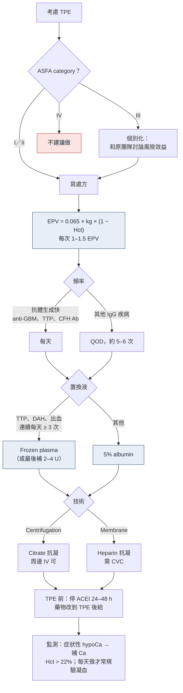
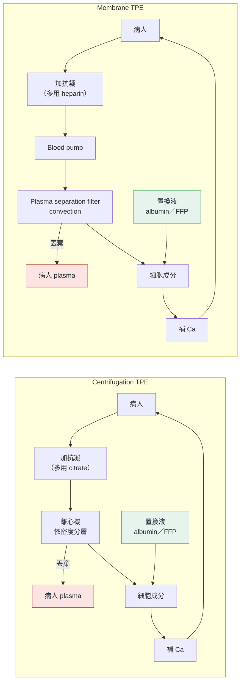

> [!abstract] 一句話重點
> - TPE = 把病人的 plasma 拿掉、換成 **albumin 或 frozen plasma**；適合移除**大分子（> 15,000 Da）、留在血管內、半衰期長**的致病物質（自體抗體、免疫複合體）
> - 處方三步驟：
>   1. **EPV = 0.065 × 體重 × (1 − Hct)**
>   2. 每次換 **==1–1.5 個 EPV==**（1 個 EPV 約移除 63%；超過 1.5 幾乎沒有額外效益）
>   3. 置換液：大多用 **5% albumin**；**==TTP、DAH、出血風險高 → frozen plasma==**
> - **TTP 是 category I 的代表**：疑似就每天 TPE＋frozen plasma，不必等 ADAMTS13
> - 腎臟科最重要的適應症：**anti-GBM disease**（KDIGO 唯一正式建議，每天做、至少 10–20 天）；AAV 在 PEXIVAS 後**只保留給重症**（Cr > 3.4 mg/dL、洗腎、DAH 合併 hypoxemia）
> - **最常見併發症是 citrate 造成的 hypocalcemia**（口周、手指麻、抽筋）；TPE 前 24–48 小時停 **ACEI**；每日藥物在 **TPE 後**給

## 🗺️ 總綱

🗺️ 值班要開 TPE：先確定有沒有適應症，再寫處方、選置換液與抗凝

該不該做
<ul><li>查 ASFA category：<b>I 一線</b>、II 二線、III 個別化、IV 無效</li><li>腎科 category I：anti-GBM、TTP、CAPS、移植後 FSGS 復發、anti-CFH TMA、移植 AMR／desensitization</li></ul>

處方
<ul><li>EPV = 0.065 × kg × (1 − Hct)</li><li>每次 1–1.5 EPV</li><li><b>IgG 疾病：QOD 約 5–6 次</b></li><li>抗體生成快（anti-GBM、TTP）→ 每天</li></ul>

置換液
<ul><li>預設 <b>5% albumin</b></li><li><b>Frozen plasma</b>：TTP（補 ADAMTS13）、DAH／出血、連續每天做 ≥ 3 次</li><li>Saline 混合：只用在 hyperviscosity</li></ul>

抗凝
<ul><li>Centrifugation → <b>citrate</b>（80% 隨廢棄 plasma 丟掉）</li><li>Membrane → <b>heparin</b>（citrate 只清掉 20–30%）</li><li>ECMO 中：用 ECMO 的 heparin，不加 citrate</li></ul>

Access
<ul><li>Centrifugation 血流低 → 周邊 17–19G 可</li><li>Membrane 需 150–200 mL/min → <b>CVC</b></li><li>長期、HD 病人 → AVF／AVG</li></ul>

TPE 前要做
<ul><li><b>ACEI 停 24–48 小時</b></li><li>每日藥物改到 TPE 後給</li><li><b>Rituximab 給完隔 24–48 小時</b>再做</li><li>同日要 HD → <b>先 TPE 再 HD</b></li></ul>

併發症
<ul><li>最常見：<b>hypocalcemia</b>（FFP 20%、albumin 9%）</li><li>Albumin → hypoK、凝血因子被稀釋</li><li>FFP → 過敏、TRALI、metabolic alkalosis</li><li>低血壓：albumin–saline 混合較多</li></ul>

### 值班決策流程

## 名詞：Apheresis 家族

- **Apheresis**：體外移除血液中某一成分的總稱
- **Plasmapheresis**：只**移除** plasma
- **Therapeutic plasma exchange（TPE）**：移除 plasma，同時用**置換液**補回同樣或更多的體積
- 臨床上常把 TPE 叫 plasmapheresis，但嚴格來說不同

| 類型 | 移除目標 | 例子 |
| --- | --- | --- |
| **TPE** | 整個 plasma（換成置換液） | 自體抗體、免疫複合體、毒物 |
| Double filtration plasmapheresis（DFPP） | 先分出 plasma，再用第二個 filter 留下大分子 | 自體抗體、免疫複合體、lipoprotein |
| Immunoadsorption | Immunoglobulin | 自體抗體疾病 |
| Lipoprotein apheresis | Lipoprotein 顆粒 | Familial hypercholesterolemia |
| Rheopheresis | 高分子量 plasma 成分（fibrinogen、α2-macroglobulin、LDL、IgM） | Dry AMD |
| β2-microglobulin column | β2-microglobulin | Dialysis-related amyloidosis |
| Red cell exchange／erythrocytapheresis | RBC | Sickle cell、hemochromatosis、polycythemia |
| Leukocytapheresis／thrombocytapheresis | WBC／platelet | Hyperleukocytosis、thrombocytosis |
| Extracorporeal photopheresis（ECP） | Buffy coat（WBC＋platelet） | GVHD、cutaneous T-cell lymphoma |
| Adsorptive cytapheresis | Monocyte、granulocyte | IBD |

## 兩種技術：Centrifugation vs Membrane filtration

依原圖內容重新繪製：

- **Centrifugation**（美國主流、臨床試驗多用這種）
  - 每分鐘 2,000–2,500 轉，依密度分層：最內層 **plasma** → buffy coat（granulocyte、monocyte、lymphocyte）→ platelet → 最外層 **RBC**
  - 可以分離**任何**血球成分（所以 cytapheresis 一定用這種）
  - RBC 可壓到 Hct ≥ 80% → 每單位時間抽出的 plasma 多（約 80%）、時間短、**血流低 → 周邊靜脈就能做**
- **Membrane filtration**（原理像 CKRT 的 isolated UF）
  - Plasma 經半透膜**非選擇性**濾出；部分 CKRT 與 HD 機器可接上專用 filter
  - 效率取決於 plasma filtration rate、膜孔大小與面積、**sieving coefficient**（溶質在濾液與血液間平衡的程度：1 = 完全通過、0 = 完全過不去）
  - Filtration fraction 超過 30–35% → Hct 太高 → **溶血、filter 凝固** → 只能抽約 30% → 時間較長、血流要高 → **需要 CVC**
  - 蛋白吸附在膜上會讓 filter 塞住、效率下降

| | Centrifugation TPE | Membrane TPE | Hemodialysis |
| --- | --- | --- | --- |
| 機轉 | 離心力 | Convection | Diffusion ± convection |
| 血流（mL/min） | 10–150 | 150–200 | CKRT 100–300；IHD 200 到 > 400 |
| 管路內血量（mL） | 180 | 125 | 160–280 |
| Plasma 抽取率 | **80%** | **30%** | — |
| 分子量 | **> 15,000 Da** | **> 15,000 Da** | < 15,000 Da |
| 適合的 Vd | 低（< 0.3 L/kg） | 低（< 0.3 L/kg） | 中等（≤ 1.5–2 L/kg） |
| 適合的蛋白結合率 | > 80% | > 80% | < 80% |
| 常用抗凝 | **Citrate** | **Heparin** | Heparin |

> [!tip] Pearl：TPE 和 HD 是互補的
> HD 清的是**小分子、蛋白結合低**的東西；TPE 清的是**大分子、高度蛋白結合、Vd 小**的東西。中毒時先看分子量、蛋白結合率與 Vd，就知道該選哪一種。

## 什麼東西適合用 TPE 移除

理想的目標物質：

- **分子量大**（> 15,000 Da）
- **生成慢、半衰期長、每日 turnover 低**
- **主要分布在血管內**

但即使符合這些條件，很多疾病仍沒有臨床效益的證據 → 只在有證據的疾病積極考慮。

| 蛋白 | 分子量（kDa） | 血管內比例 | 每日 turnover | 半衰期 | TPE 的意義 |
| --- | --- | --- | --- | --- | --- |
| **IgG** | 150 | **45%** | 6.7% | **22 天** | 一半以上在血管外 → 要**多次、間隔 24–48 小時**讓它回到血管內再移除 |
| **IgM** | 950 | **78%** | 19% | 5 天 | 大多在血管內 → **一次就移除很多**，但停止後回升也快 |
| IgA | 160 | 42% | 25% | 6 天 | |
| Albumin | 65 | 40% | 10% | 17 天 | |
| Fibrinogen | 340 | 80% | 25% | 4.2 天 | 一次 TPE 降很多 |
| C3 | 240 | 63% | 56% | 2 天 | 回升快 |

## Vascular access

| Access | 重點 |
| --- | --- |
| **周邊大口徑 IV** | 成人 17–19G（約 60 到 > 80 mL/min）；從 basilic／cephalic vein 抽，從手背小靜脈回輸；只適用 centrifugation |
| **透析用 CVC** | 成人 11.5 Fr，放 IJ 或 femoral；血流穩定；membrane TPE 必須用 |
| **Port** | 單腔 9 Fr port 抽血＋周邊 IV 回輸；感染率低、舒適 |
| **AVF／AVG** | **長期反覆 TPE、本身在 HD 的病人首選**（血流快、感染少、通暢度好）；需要時間成熟，急性病人不適用 |

- **Continuous**：抽、回各一條路；**discontinuous**：單一 access 抽回交替，時間較長
- CVC 和 port 的 lock 常用 heparin 1,000 U/mL

## 抗凝

| | Citrate | Heparin |
| --- | --- | --- |
| 機轉 | 在管路中 chelate ionized Ca，**regional** 抗凝 | 全身抗凝 |
| 半衰期 | 30–60 分鐘 | 23 分鐘–2.5 小時 |
| 適用 | **==Centrifugation 首選==**（80% 隨丟掉的 plasma 移除） | **==Membrane 首選==**（citrate 只清掉 20–30% → 肝腎病人易 citrate toxicity） |
| 劑量 | 全血：抗凝劑 = 10:1 到 14:1（mL）；platelet clumping 時可提高比例，但注意 citrate 反應 | Bolus 3,000–5,000 U，必要時 1,000 U/h；新型 membrane 機器可先試不抗凝 |
| 注意 | 需口服或 IV 補 Ca；**ACD-A 是高張（Na 252 mmol/L）**、ACD-B 是等張 | HIT |

**已經在吃／打抗凝劑的病人**（各院做法差很多）

- Heparin drip＋centrifugation TPE：可在 TPE 前 1 小時停 drip，改用 citrate
- Warfarin、LMWH、DOAC：半衰期長、反轉劑少、難監測出血風險，較麻煩
  - Warfarin 病人用 albumin 置換是安全的，但凝血因子被移除 → **抗凝效果會增強**
- 許多醫院對已抗凝的病人仍照常規用 citrate 或 heparin
- 小體重（兒童）：ACD-A 加 heparin 混合，減少 citrate 用量（全血：抗凝劑至少 26:1）

## 置換液

| | 5% Albumin | Frozen plasma（FFP、24 小時冷凍 plasma） |
| --- | --- | --- |
| 何時用 | **預設選擇**（oncotic pressure 好） | **==TTP（補 ADAMTS13）==**、**DAH 或出血**（補凝血因子）、某些毒物與蛇毒 |
| 組成 | Na 約 145、K < 2 mmol/L | 每單位約 7 mmol citrate |
| 優點 | 加熱滅活 → 過敏、TRALI、傳染風險都比 plasma 低 | 有凝血因子、ADAMTS13 |
| 缺點 | 凝血因子（促凝與抗凝）**下降 50–60%**；IgG 也被移除 | 一次 3 L 要 10–15 個捐血者；**citrate 負荷大** → hypoCa、metabolic alkalosis；過敏、TRALI、傳染 |

- **Albumin 後的凝血因子回升**是雙相的：4 小時先上升一些，**48 小時幾乎恢復** → ==albumin 置換後 8–12 小時內不要驗凝血==（會假性異常）
- **連續每天 ≥ 3 次**：可在最後補 2–4 U FFP（500–1,000 mL）降低出血風險，最好依凝血檢查決定
- **Albumin–saline 混合**（80:20，最少 70:30）：省錢，但**低血壓較多**，通常只用在 hyperviscosity；用 80:20 時可補到移除量的 110%
- 單純 crystalloid：基本上只用在 hyperviscosity syndrome
- FFP 過敏預防
  - 常規給 diphenhydramine，但**沒有證據有效**
  - 曾對 FFP 過敏：改用 solvent detergent plasma（病原滅活產品），或預防性給 steroid＋diphenhydramine＋ephedrine

## 寫處方

### 估計 plasma volume（EPV）

- 成人血量約體重的 6.5%（約 5 L），其中約 60% 是 plasma（約 3 L）
- **EPV（L）= 0.065 × 體重（kg）× (1 − Hct)**
- 機器內建公式還會考慮性別、身高

### 換多少：1–1.5 個 EPV

依原圖內容重新繪製（殘留濃度 ≈ e^(−Ve/EPV)）：

<svg viewBox="0 0 360 215" width="100%" style="max-width:520px;font-size:11px" role="img" aria-label="置換體積與殘留濃度的關係">
  <g stroke="var(--lightgray)" stroke-width="1">
    <line x1="48" y1="20" x2="328" y2="20"/><line x1="48" y1="60" x2="328" y2="60"/><line x1="48" y1="100" x2="328" y2="100"/><line x1="48" y1="140" x2="328" y2="140"/>
  </g>
  <line x1="48" y1="180" x2="328" y2="180" stroke="var(--darkgray)"/><line x1="48" y1="20" x2="48" y2="180" stroke="var(--darkgray)"/>
  <g fill="var(--darkgray)" text-anchor="end"><text x="43" y="24">100%</text><text x="43" y="64">75%</text><text x="43" y="104">50%</text><text x="43" y="144">25%</text><text x="43" y="184">0</text></g>
  <g fill="var(--darkgray)" text-anchor="middle"><text x="48" y="196">0</text><text x="118" y="196">0.5</text><text x="188" y="196">1.0</text><text x="258" y="196">1.5</text><text x="328" y="196">2.0</text><text x="188" y="211">置換體積 ÷ EPV</text></g>
  <rect x="188" y="20" width="70" height="160" fill="#2e9e6b" opacity="0.12"/>
  <path d="M48.0,20.0 L55.0,27.8 L62.0,35.2 L69.0,42.3 L76.0,49.0 L83.0,55.4 L90.0,61.5 L97.0,67.2 L104.0,72.7 L111.0,78.0 L118.0,83.0 L125.0,87.7 L132.0,92.2 L139.0,96.5 L146.0,100.5 L153.0,104.4 L160.0,108.1 L167.0,111.6 L174.0,114.9 L181.0,118.1 L188.0,121.1 L195.0,124.0 L202.0,126.7 L209.0,129.3 L216.0,131.8 L223.0,134.2 L230.0,136.4 L237.0,138.5 L244.0,140.5 L251.0,142.5 L258.0,144.3 L265.0,146.0 L272.0,147.7 L279.0,149.3 L286.0,150.8 L293.0,152.2 L300.0,153.6 L307.0,154.8 L314.0,156.1 L321.0,157.2 L328.0,158.3" fill="none" stroke="var(--secondary)" stroke-width="2.5"/>
  <circle cx="188" cy="121.1" r="4" fill="var(--secondary)"/><text x="194" y="116" fill="var(--dark)">1 EPV → 剩 37%</text>
  <circle cx="244" cy="140.5" r="4" fill="var(--secondary)"/><text x="250" y="134" fill="var(--dark)">1.4 EPV → 剩 25%</text>
  <text x="223" y="34" fill="#2e9e6b" text-anchor="middle">常用範圍 1–1.5</text>
</svg>

- 1 個 EPV 移除約 **63%**（原文寫 65–70%）的血管內目標物質；1.4 個 EPV 約 75%
- 換越多、每多換一公升的效益越小（越換越稀釋）→ ==通常 1 個 EPV、幾乎不超過 1.5==
  - 原文的公式排版有誤；正確的單室模型是 **X₁ = X₀ × e^(−Ve/EPV)**（X₀、X₁ 為前後濃度，Ve 為置換體積），與圖形一致
- **體外管路血量要 < 總血量的 15%**，避免低血容；不夠時用血液 prime 或輸血
- 70 kg、Hct 34% 約換 3 L：centrifugation 約 1.5–2 小時、membrane 約 3 小時

### 做幾次、多久做一次

決定次數與頻率的四個因素：

| 因素 | 影響 |
| --- | --- |
| Sieving coefficient | 越接近 1 越容易通過膜 → 需要的次數少 |
| 半衰期 | 內生物質半衰期短 → 合成快、回升快 → 要更頻繁；外來毒物半衰期短 → 不做也會自己清掉 |
| 血管外分布 | 大量在血管外 → 要等它回到血管內 → 移除慢 |
| 合成速度 | 合成快 → 要更頻繁，並加上抑制生成的治療（免疫抑制） |

依原圖內容重新繪製（每天 1 EPV、連做 3 天的 IgG 變化）：

<svg viewBox="0 0 330 215" width="100%" style="max-width:480px;font-size:11px" role="img" aria-label="連續三天 TPE 後 IgG 的鋸齒狀變化">
  <g stroke="var(--lightgray)" stroke-width="1"><line x1="40" y1="20" x2="320" y2="20"/><line x1="40" y1="60" x2="320" y2="60"/><line x1="40" y1="100" x2="320" y2="100"/><line x1="40" y1="140" x2="320" y2="140"/></g>
  <line x1="40" y1="180" x2="320" y2="180" stroke="var(--darkgray)"/><line x1="40" y1="20" x2="40" y2="180" stroke="var(--darkgray)"/>
  <g fill="var(--darkgray)" text-anchor="end"><text x="35" y="24">100%</text><text x="35" y="64">75%</text><text x="35" y="104">50%</text><text x="35" y="144">25%</text><text x="35" y="184">0</text></g>
  <g fill="var(--darkgray)" text-anchor="middle"><text x="96" y="196">Day 1</text><text x="152" y="196">Day 2</text><text x="208" y="196">Day 3</text><text x="264" y="196">Day 4</text><text x="180" y="211">IgG（% 初始濃度）</text></g>
  <polyline points="96,20 96,119.2 152,93.6 152,144.8 208,117.6 208,156 264,128.8" fill="none" stroke="var(--secondary)" stroke-width="2.5"/>
  <g fill="var(--secondary)"><circle cx="96" cy="20" r="4"/><circle cx="152" cy="93.6" r="4"/><circle cx="208" cy="117.6" r="4"/><circle cx="264" cy="128.8" r="4"/></g>
  <g fill="var(--light)" stroke="var(--secondary)" stroke-width="2"><circle cx="96" cy="119.2" r="4"/><circle cx="152" cy="144.8" r="4"/><circle cx="208" cy="156" r="4"/></g>
  <g fill="var(--dark)"><text x="102" y="24">100</text><text x="102" y="123">38</text><text x="158" y="91">54</text><text x="158" y="149">22</text><text x="214" y="115">39</text><text x="214" y="160">15</text><text x="270" y="127">32</text></g>
  <g fill="var(--darkgray)"><circle cx="230" cy="30" r="4" fill="var(--secondary)"/><text x="238" y="34">TPE 前</text><circle cx="230" cy="46" r="4" fill="var(--light)" stroke="var(--secondary)" stroke-width="2"/><text x="238" y="50">TPE 後</text></g>
</svg>

- 每次做完會**回升**：血管外的 IgG 重新分布回血管內＋新合成
- 大多數免疫複合體疾病是 **IgG**（大部分在血管外、半衰期 22 天、turnover 低）→ ==隔 24–48 小時做一次，QOD 共 6 次可把 IgG 降到基線的 16–20%==
- **抗體生成很快的疾病（例如 anti-GBM）→ 每天做，並同時免疫抑制**
- **IgM**（約 80% 在血管內、半衰期 5 天）：一次就清很多，但停止後回升比 IgG 快

### 檢驗監測

- ASFA 與 Choosing Wisely：**不需常規驗凝血**，除非每天做（albumin 置換也一樣）
- Hct 維持 **> 22%**（必要時輸 RBC）
- 有 **hypocalcemia 症狀**才驗 ionized Ca
- Choosing Wisely 另外提醒：周邊 IV 可以安全做就**不要放 CVC**、FFP 只用在明確需要時、**事先訂好療程長度**

| 成分（1 EPV、albumin／crystalloid 置換） | 下降 | 48 小時後回升到基線的 |
| --- | --- | --- |
| Antithrombin III | 70% | 100% |
| Fibrinogen | 67% | 46–63% |
| C3 | 63% | 60–100% |
| Immunoglobulins | 60% | **44%**（回升最慢之一） |
| Factor VIII | 50–82% | 90–100% |
| Prothrombin | 49% | 48% |
| Liver enzymes | 55–60% | 100% |
| Platelets | 25–30% | 75–100% |

> [!example] 原文 Case 1（TTP）
> 50 kg、42 歲女性，頭痛、倦怠 2 週；HR 115、petechiae；Hct 18%、platelet 12K、Cr 1.3（基線 0.8）、LDH 2,100、haptoglobin < 6、schistocytes 15%。等 ADAMTS13 結果時先開始 TPE。
> - **Q1 EPV？** 0.065 × 50 × (1 − 0.18) = **2.7 L**
> - **Q2 處方？** **每天 1 個 EPV**（TTP 要積極：先每天、每次 1–1.5 EPV）
> - **Q3 置換液？** **Frozen plasma**：移除 anti-ADAMTS13 抗體的同時補回有功能的 ADAMTS13
> - TPE 讓 TTP 死亡率從 > 90% 降到 5–10%

## 適應症：ASFA category 與 grade

| Category | 意義 |
| --- | --- |
| **I** | Apheresis 是**一線**治療（單獨或合併其他治療） |
| **II** | **二線**治療：證據支持，但先試傳統治療 |
| **III** | 角色**未確立** → 個別化決定 |
| **IV** | 證據顯示**無效或有害** |

- Grade：**1 = 強建議、2 = 弱建議**；**A／B／C = 證據品質高／中／低**
- 原文用的是 ASFA 2019（第 8 版）＋2020 AAV 更新；KDIGO 2021 腎絲球疾病指引中，**TPE 唯一的正式建議是 anti-GBM disease**（1C），其他都是 practice point

> [!info] 🆕 新版指引（ASFA 第 9 版 2023）
> - 目前最新是 **ASFA 2023（Connelly-Smith et al.，第 9 版）**：91 個 fact sheets、166 個適應症
> - 和 2019 比較的類別變動（非腎臟為主）：dry AMD、severe babesiosis、hyperleukocytosis 由 II 降為 III；erythropoietic protoporphyria 肝病、ulcerative colitis 由 III 升為 II
> - 腎臟相關的 anti-GBM、TTP、移植後 FSGS 復發、CAPS、anti-CFH TMA、腎移植 AMR／desensitization 的類別**沒有變**
> - **AAV 有改**：見下方 ANCA 段落

**腎臟科與內科高頻適應症整理**（依 Table 5，ASFA 2019；🆕 標示 2023 有變動者）

| 疾病 | 情境 | Category（grade） |
| --- | --- | --- |
| **TTP** | — | **I（1A）** |
| **Anti-GBM disease** | DAH | **I（1C）** |
| | 診斷時**不需**透析 | **I（1B）** |
| | 診斷時**已需透析、沒有 DAH** | ==III（2B）== |
| **AAV**（MPA／GPA／RLV） | RPGN，Cr ≥ 5.7 mg/dL | II（1A）（原書；已更新，見 ANCA 段落 🆕） |
| | RPGN，Cr < 5.7 | III（2C） |
| | DAH | I（1C）（原書；已更新，見 ANCA 段落 🆕） |
| | EGPA | III（2C） |
| **FSGS** | **移植後復發** | **I（1B）** |
| | 原生腎 steroid-resistant | III（2C） |
| **CAPS** | — | I（2C） |
| **Complement-mediated TMA** | **Anti-CFH 抗體** | **I（2C）** |
| | Complement 基因變異 | III（2C） |
| Drug-associated TMA | Ticlopidine | I（2B） |
| | Clopidogrel | III（2B） |
| | Gemcitabine、quinine | **IV（2C）** |
| Infection-associated TMA | 嚴重 STEC-HUS | III（2C） |
| Transplant-associated TMA | — | III（2C） |
| 腎移植 ABO-compatible | AMR | I（1B） |
| | 活體 desensitization | I（1B） |
| | 屍腎 desensitization | III（2C） |
| 腎移植 ABO-incompatible | 活體 desensitization | I（1B） |
| | AMR | II（1B） |
| Myeloma cast nephropathy | — | II（2B） |
| IgA nephropathy／IgA vasculitis | Crescentic | III（2B／2C） |
| Cryoglobulinemia | 嚴重／有症狀 | II（2A） |
| SLE | 嚴重併發症 | II（2C） |
| Hyperviscosity（hypergammaglobulinemia） | 有症狀 | I（1B） |
| | Rituximab 前預防 | I（1C） |
| **Guillain-Barré syndrome** | 一線治療 | **I（1A）** |
| **Myasthenia gravis** | 短期治療（crisis、術前） | **I（1B）** |
| CIDP | — | I（1B） |
| NMDA receptor encephalitis | — | I（1C） |
| Acute liver failure | High-volume TPE | I（1A） |
| Wilson disease，fulminant | — | I（1C） |
| Thyroid storm | — | II（2C） |
| Hypertriglyceridemic pancreatitis | 嚴重 | III（1C） |
| Sepsis with MOF | — | III（2B） |
| 藥物過量／中毒 | — | III（2C）；香菇中毒 II（2C） |
| HELLP | 產前 | IV（2C） |
| 特發性 PAN | — | IV（1B） |

## 腎臟科 category I 疾病

### Anti-GBM disease（Goodpasture）

- **IgG 抗體**攻擊 **type IV collagen α3 chain** → GN 及／或 alveolar hemorrhage；常是 RPGN，治療後仍約 **55% 進展到腎衰竭**
- 證據：一個 17 人的 RCT 顯示 TPE 改善腎臟結局與存活
- 預後差、TPE 不太能救回腎臟的族群：
  - 2001：**診斷時已洗腎＋biopsy 100% crescents** → 腎功能都沒恢復
  - 2018（123 人）：**≥ 50% global glomerulosclerosis** 結局差
- **KDIGO**：都要 TPE，**除了**「已需透析，且 100% crescents 或 > 50% global sclerosis，且**沒有** pulmonary hemorrhage」的病人
- **ASFA 處方**
  - 治療：**steroid＋cyclophosphamide＋TPE**
  - 每次 1–1.5 EPV、**每天**
  - 置換液：albumin；**有 DAH 用 frozen plasma**
  - **==療程：至少 10–20 天，直到腎臟／肺部的活動性傷害緩解==**；有人做到抗體轉陰，但這樣做是否必要未確立；一開始抗體陰性的病人也是至少 10–20 天

> [!example] 原文 Case 2（anti-GBM）
> 70 歲男性 hemoptysis、低血壓、插管；Hb 8、platelet 76K、Cr 3.2（基線 1.2）、hematuria 10% acanthocytes、CT 符合 DAH；biopsy 初步符合 anti-GBM，MPO／PR3 陰性，anti-GBM 52 U。
> **Q4 TPE 做多久？** → **至少 10–20 天，並持續到活動性器官傷害緩解**（不是 ANCA 陰性就停、不是抗體測不到才停、也不是 3 次就好）

> [!warning] Pitfall：ANCA 與 anti-GBM 雙陽性
> 兩種抗體都陽性時，**初始治療照 anti-GBM disease**（要 TPE）。Pulmonary-renal syndrome 一定兩種都驗。

### Catastrophic antiphospholipid syndrome（CAPS）

- 定義：antiphospholipid antibody＋**1 週內 ≥ 3 個器官系統**血栓；多侵犯腎、肺、腦、心、皮膚的小血管；約 65% 有誘發事件
- ASFA（5 個 case series、192 人）
  - 治療：**抗凝＋steroid＋TPE 及／或 IVIG**
  - 1–1.5 EPV、每天或 QOD
  - 置換液：**frozen plasma** 或 frozen plasma＋albumin
  - 療程：至少 3–5 次，之後依臨床反應

### 腎移植後 FSGS 復發

- 推測有循環因子；近年發現 **anti-nephrin 抗體**，可能是部分病人的 TPE 標的
- 非 adaptive 型 FSGS 移植後復發率：**第一顆腎 20–50%、之後的腎 80–100%**；可在移植後數小時到 2 年內復發；即使治療，30–60% 在 3–7 年內腎衰竭
- ASFA（50 個 case series、628 人＋4 個對照試驗）
  - 治療：steroid、rituximab、TPE 及／或 IVIG
  - TPE、lipoprotein apheresis 或 immunoadsorption 都可；TPE 1–1.5 EPV
  - 置換液：albumin
  - 療程：**先每天 3 次，接下來 2 週再做 6 次**（lipoprotein apheresis：每週 2 次 × 3 週，再每週 1 次 × 6 週）

### TMA：anti–complement factor H 抗體

- Alternative pathway 活化 → TMA；約 60% 有 alternative pathway 基因變異，**< 10% 是抑制 factor H 的自體抗體**
- 治療：**TPE 及／或 eculizumab＋免疫抑制**（C5 抑制劑本身也有效）
- ASFA（5 個 case series、126 人）：1–1.5 EPV、**每天**；frozen plasma 或 frozen plasma／albumin；做到臨床反應或抗體效價降到門檻以下（類似 iTTP）

### TMA：ticlopidine 相關

- 藥物性 TMA 的藥：ticlopidine、calcineurin inhibitor、gemcitabine 等
- Ticlopidine：暴露後 **2 週內** ADAMTS13 < 10%，常有抗 ADAMTS13 抗體 → 本質像 TTP
- ASFA（5 個 case series、174 人）：**停藥＋TPE**；1–1.5 EPV、每天或 QOD；**frozen plasma**；每天做到血液學指標恢復（類似 iTTP）

### TMA：TTP

- 小血管的全身性血栓疾病，**不治療死亡率約 90%**
- 表現：thrombocytopenia＋MAHA＋**ADAMTS13 activity < 10%**；多數是抗 ADAMTS13 的 **IgG 自體抗體**
- ADAMTS13 報告來不及時，**PLASMIC score** 可幫忙挑出高機率病人先做 TPE
- TPE 的雙重作用：**移除抗體＋用 frozen plasma 補回 ADAMTS13**
- ASFA（7 個 RCT、301 人＋5 個臨床試驗、270 人）
  - 治療：**steroid＋TPE**；難治時加其他治療
  - **==Rituximab 給完要隔 24 小時才做 TPE==**（否則被洗掉）
  - **Caplacizumab**（anti-VWF 單株抗體）可用
  - 1–1.5 EPV、**每天**；置換液 **frozen plasma**
  - **==療程：每天做到 platelet > 150K、LDH 接近正常，連續 2–3 天==**

> [!info] 🆕 新版指引（ISTH TTP 指引 2025 focused update）
> - 2020 ISTH 指引仍是基礎：**疑似 iTTP 就開始 TPE＋corticosteroid，不等 ADAMTS13 結果**；急性期（首發或復發）**加 rituximab**
> - 2025 更新：急性 iTTP **建議使用 caplacizumab**（conditional recommendation）；iTTP 其他建議不變
> - **Congenital TTP 緩解期**：建議用 **recombinant ADAMTS13** 預防發作（優於 plasma infusion）；沒有 rADAMTS13 時，預防性 plasma infusion 優於觀察
> - 避免預防性輸 platelet（除非危及生命的出血）

### 腎移植：ABO-compatible 的 AMR 與 desensitization

- 對 donor HLA／非 HLA 抗原的抗體 → 可能無法做活體移植，或移植後發生 **AMR**
- **Desensitization**：含 TPE 的處置把 donor-specific antibody（DSA）降到不會造成細胞毒性的程度
- TPE 是 AMR 治療的主力之一，但最佳方案未知
- ASFA
  - AMR：TPE、DFPP 或 immunoadsorption，**一定合併免疫抑制**；desensitization 合併 IVIG、rituximab
  - 1–1.5 EPV、每天或 QOD
  - 置換液：albumin 或 frozen plasma，**每次後加 IVIG 100–200 mg/kg**
  - AMR：通常 5–6 次，或依臨床與 DSA 下降決定；desensitization：做到 crossmatch 低於院內門檻，或術後至少 3 次

### 腎移植：ABO-incompatible 活體移植的 desensitization

- 不處理 → hyperacute 與急性 AMR
- 移植前後 TPE 可降低 anti-A／anti-B 效價；長短期結局與 ABO-compatible 相近，但 **BK virus nephropathy 風險較高**
- **A2 donor 優於 A1**（RBC 與內皮上 A 抗原表現較少，排斥風險較低）
- ASFA（26 個 case series、911 人）：TPE 或 immunoadsorption；1–1.5 EPV、每天或 QOD；albumin 或 frozen plasma（**要同時和受贈者、捐贈者的 ABO 相容**），手術前後用 frozen plasma；做到效價低於院內門檻

### ANCA-associated vasculitis（AAV）

- 壞死性小血管炎，腎臟切片 pauci-immune；**腎臟受侵犯 70%、肺 > 50%**；腎臟最常見表現是 RPGN，肺從無症狀病灶到致命 DAH 都有
- Induction（steroid＋cyclophosphamide 或 rituximab）6 個月緩解率可達 90%；maintenance 用 rituximab、azathioprine 或 MMF
- 試驗
  - **MEPEX（2007，137 人）**：Cr > 5.8 mg/dL 或已洗腎，標準治療加 **TPE vs IV methylprednisolone** → TPE 組 3 個月、12 個月腎衰竭風險分別低 22%、24%
  - **PEXIVAS（2020，704 人）**：eGFR < 50 或 pulmonary hemorrhage，0 vs 7 次 TPE（中位 Cr 3.8、20% 洗腎、41% 肺部受侵犯）→ **12 個月 death／ESKD 沒有差異**；次族群（DAH、Cr > 5.7）看起來有利但無統計意義
- ASFA 2020 更新（原文採用）：DAH 維持 category I；Cr ≥ 5.7 或洗腎改為 category II（原書；已更新，見下方 🆕）
- 原文處方：1–1.5 EPV、每天或 QOD；albumin，**有 DAH 用 frozen plasma**；**約 14 天內做 7 次**（最多報告到 12 次）

> [!info] 🆕 新版指引（KDIGO 2024 AAV 指引；ASFA 2023）
> - **KDIGO 2024**：**不建議常規**用在 GFR < 50 的病人；可考慮 TPE 的情況：
>   - ==SCr > 3.4 mg/dL（300 µmol/L）、需要透析、或 SCr 快速上升==
>   - ==DAH 合併 hypoxemia==（DAH 沒有 hypoxemia 不需要 TPE）
>   - **ANCA＋anti-GBM 雙陽性 → 要加 TPE**
> - **ASFA 2023（第 9 版）**：PEXIVAS 後 MPA／GPA 的 TPE 降為 **category III**，不再依 Cr 或 DAH 分層（grade 1B）；EGPA 仍是 III（2C）
>   - ⚠️ 這一點是依引用 ASFA 2023 的保險給付文件與 2026 年研究，Claude 這次無法直接打開 ASFA 原文確認，建議有機會時對照原文 fact sheet

## 腎臟科疾病處方速查

| 疾病 | 頻率 | 置換液 | 療程 | 合併治療 |
| --- | --- | --- | --- | --- |
| **TTP** | 每天 | **Frozen plasma** | Platelet > 150K＋LDH 近正常，連續 2–3 天 | Steroid、rituximab、caplacizumab |
| **Anti-GBM** | 每天 | Albumin（DAH → FFP） | **至少 10–20 天**＋器官傷害緩解 | Steroid＋cyclophosphamide |
| AAV（重症） | 每天或 QOD | Albumin（DAH → FFP） | 約 14 天 7 次 | Steroid＋rituximab 或 CYC |
| CAPS | 每天或 QOD | FFP（± albumin） | 至少 3–5 次 | 抗凝＋steroid ± IVIG |
| 移植後 FSGS 復發 | 每天或 QOD | Albumin | 每天 3 次＋2 週內再 6 次 | Steroid、rituximab ± IVIG |
| Anti-CFH TMA | 每天 | FFP（± albumin） | 臨床反應或效價降到門檻下 | Eculizumab、免疫抑制 |
| Ticlopidine TMA | 每天或 QOD | FFP | 血液學指標恢復 | **停藥** |
| ABOc AMR | 每天或 QOD | Albumin 或 FFP＋IVIG 100–200 mg/kg | 5–6 次或依 DSA | 免疫抑制 |
| ABOi desensitization | 每天或 QOD | Albumin 或 ABO 相容 FFP | 效價低於門檻 | — |

（每次都是 **1–1.5 EPV**）

## 特殊情況

### ACEI

- ACEI 擋住 bradykinin 分解；TPE 過程活化 kinin → **低血壓**
- 最常見於帶負電的親水膜（**AN69**），dextran sulfate 系統、**albumin 置換液**、Plasmaflo OP filter 也有報告
- ==TPE 前 24–48 小時停 ACEI==，尤其用 albumin 或 membrane TPE 時

### 藥物移除

- 原則：==每日藥物都在 TPE **之後**給==
- 最容易被 TPE 移除：**Vd 很低（< 0.2 L/kg）＋蛋白結合率高（> 80%）**
  - 例如 glyburide 中毒比 cyclosporine 更適合 TPE

| 藥物 | 會不會被 TPE 移除 | 處理 |
| --- | --- | --- |
| **Prednisone／prednisolone** | 只移除約 1%（Vd 0.6–0.7） | **不需補** |
| Cyclosporine、tacrolimus | 主要在細胞內（CsA Vd 13 L/kg）→ 不受影響 | 不需調整 |
| Cyclophosphamide | 不太會被移除 | — |
| **Rituximab** | TPE 在給藥後 24–72 小時做 → 被移除 47–54% | **TPE 後給，下一次 TPE 延後 24–48 小時**（藥效多在 12–24 小時內發揮） |
| **特別容易被移除**：aspirin、cefazolin、ceftriaxone、glyburide、heparin、ibuprofen、levothyroxine、valproic acid、verapamil、warfarin | 蛋白結合高、Vd 低 | TPE 後給藥；aspirin、phenytoin、propranolol、thyroxine 可能需要補劑量 |
| Digoxin、eculizumab | Vd 5–8 L/kg | 不太被移除 |
| Vancomycin、tobramycin | 蛋白結合低 | 不太被移除（HD 才有效） |

### 中毒

- 能不能用 TPE 移除：**Vd 低（< 0.2 L/kg）、蛋白結合高（> 80%）、越早做越好**
- 置換液：**通常用 albumin**，讓毒物和新補進來的 albumin 結合、留在血管內被移除
- 改用 **frozen plasma** 的情況
  - 主要和 **α1-acid glycoprotein** 結合的藥：dipyridamole、quinidine、imipramine、propranolol、chlorpromazine
  - 造成凝血異常或 microangiopathy 的**蛇毒**（FFP 補 ADAMTS13 與凝血因子）
- 處方：每天 1–2 EPV，做到症狀緩解、組織不再延遲釋放毒物

> [!example] 原文 Case 3（levothyroxine 中毒）
> 50 kg、35 歲男性，hypothyroidism 病史，意識不清、發燒、AF RVR 170、低血壓，CPR 後 ROSC，心臟收縮嚴重變差；free T4 > 60、free T3 > 50、TSH 測不到 → thyroid storm＋cardiogenic shock，緊急 TPE。
> **Q5 Levothyroxine 為什麼適合 TPE？** → **蛋白結合率 90%**（且 Vd 0.1–0.2 L/kg）；Vd > 1、細胞內濃度高、從組織緩慢釋放都是**不利**移除的特性

### 同時做其他體外治療

- **HD**
  - 連續型治療可用不同 access 分開做，或同一個 access 並聯（缺點：壓力警報、管路凝固、空氣栓塞）
  - 用 frozen plasma 反覆 TPE 會造成 **metabolic alkalosis**（citrate 代謝成 HCO₃⁻）
  - ==同一天要 TPE 又要 HD → 先 TPE、再 HD==（HD 可矯正 alkalemia 與 volume overload）
  - **不要把 TPE 當脫水用**（故意少補置換液）
- **ECMO**
  - TPE 入口可接在 oxygenator 前或後；**回血接在 oxygenator 前**（防空氣栓塞）
  - ECMO 管路已用 heparin → **不用 citrate**；**置換液用 frozen plasma**
  - 管路壓力高時，可暫時降低 ECMO 血流

## 併發症

| 類別 | 併發症 | 機轉／重點 |
| --- | --- | --- |
| Access | 周邊 IV（1.5%） | 血腫、神經傷害、血管硬化 |
| | CVC（0.1–0.4%） | 血栓、感染、氣胸、誤穿動脈、空氣栓塞；**subclavian 併發症多於 jugular** |
| | Port（18%） | 早期：氣胸、血腫、心律不整；晚期：血栓、口袋感染、pinch-off |
| | AVF／AVG | 血栓 12–20%、成熟不良 60% |
| 抗凝 | Hypocalcemia、hypomagnesemia | **Citrate chelation** |
| | Thrombocytopenia | HIT（1–5%，非 TPE 特有） |
| 程序 | Anemia | 高張置換液擴張血管內容積 → Hct 降約 10%；低張 priming 液 → 溶血 |
| | 低血壓、喘、胸痛（0.4–15%） | 膜的補體活化、**ethylene oxide** 過敏 |
| | Thrombocytopenia | 隨 plasma 丟掉、管路凝固、稀釋 |
| | 維生素缺乏 | 蛋白結合的維生素（A、B6、B12、C、E、β-carotene）降 24–48%，24 小時內回升 |
| 置換液 | Anaphylactoid reaction（0.02–0.07%） | **IgA deficiency** 病人輸到 donor plasma 的 IgA；細菌／內毒素污染；prekallikrein activator 與 bradykinin（ACEI）；抗 polymerized albumin 抗體 |
| | 凝血異常 | 只用 albumin → 凝血因子與抑制因子都被稀釋；血栓 0.06–0.14%、出血 0.06% |
| | 電解質／酸鹼 | **Albumin → hypokalemia**；**FFP → hypocalcemia、hypomagnesemia、metabolic alkalosis**；hypoCa 9–20%、alkalosis 0.03% |
| | 感染 | Albumin → hypogammaglobulinemia；FFP → 病毒傳染 |
| | TRALI | FFP 中 donor 的抗體 |
| | Volume overload | 置換液給太多 |

- **==Hypocalcemia 最常見：FFP 約 20%、albumin 約 9%==**；肝腎功能差（citrate 代謝、排除差）的人更容易
  - 處理：多數醫院在回血端**間歇或持續 IV 補 Ca**；也可把 Ca 加進 albumin 瓶、放慢 citrate、改用 ACD-B
- **Hypokalemia**：albumin 置換後血鉀約降 25% → 可在 albumin 瓶裡加 K
- **低血壓**：可能原因包括補液延遲或不足、vasovagal、低 oncotic 置換液、anaphylaxis、TRALI、心律不整、bradykinin、access 出血；**albumin–saline 混合時較常見**（80:20 時補到 110%）
- 死亡率 0.03–0.05%，主要和原本疾病有關

> [!example] 原文 Case 4（citrate toxicity）
> 22 歲女性，primary FSGS 導致腎衰竭，屍腎移植後第 3 天，UPCR 從 0.2 升到 3.9 g/g、移植腎功能變差 → 懷疑 FSGS 復發，用 **membrane TPE（Prismaflex TPE-2000）＋frozen plasma**；第 80 分鐘出現**肌肉抽筋、感覺異常**。
> **Q6 最可能原因？** → **Citrate 造成的電解質異常（hypoCa、hypoMg）**
> - Frozen plasma 含大量 citrate，且 **membrane TPE 的 citrate 風險比 centrifugation 高**
> - Bradykinin 反應是 **ACEI＋舊式 AN69 膜**，不是 tacrolimus
> - Ethylene oxide（膜滅菌）或 IgA deficiency 病人輸到 FFP 中的 IgA → anaphylactoid reaction，但**感覺異常多半是 hypocalcemia**

> [!warning] Pitfall：membrane TPE＋FFP 是 citrate toxicity 的高風險組合
> Membrane 只清掉 20–30% citrate，FFP 本身又帶大量 citrate；肝腎功能差的病人更危險。這個組合要**預防性補 Ca**、密切問症狀。

## 🎯 內專考點

> [!example] 出題規律
> 內專沒有直接考 TPE 處方或 EPV 計算，而是在**疾病題**中考「**哪些病 TPE 是首選、哪些病 TPE 沒用**」：TTP（TPE＋免疫抑制、**不輸 platelet**）、GBS 與 myasthenic crisis（**TPE 或 IVIG，不用高劑量 steroid**）、以及 **aHUS、radiation／BMT nephropathy 對 TPE 反應差**。AAV 題目多考診斷，詳解會提到 PEXIVAS 與 KDIGO 2024。

題號格式為「年份-題號」，可到 [內專刷題網站](http://imboard.dirty-wolf.com/) 用「依年份練習」→「跳題」查看原題與詳解。每張卡片點開即可看到內容。

### TTP：TPE 是救命治療

> [!note]- 107-167｜發燒、意識混亂、MAHA、platelet 11K → 哪些處置有幫助
> **情境**：57 歲女性，虛弱、意識混亂
> - T 37.9°C、輕微黃疸、手腳瘀青、沒有黏膜出血、沒有局部神經學異常
> - Hb 7.5、reticulocyte 5.4%、**platelet 11K**、WBC 8,500、有 normoblast
> - Total bilirubin 3.1（direct 0.7）、**LDH 1,350**、Cr 1.1、**PT／aPTT 正常**；抹片有 schistocytes
>
> **問**：(1) 輸 platelet (2) plasma exchange (3) 免疫調節治療，哪些有幫助？
> - (1) 輸 platelet → 錯
> - (2) Plasma exchange → 對
> - (3) Immunomodulatory therapy → 對
>
> **答**：**(2)+(3)**
>
> **重點**：MAHA＋嚴重 thrombocytopenia＋神經症狀＋發燒、凝血正常 → **TTP**。TPE 移除抗 ADAMTS13 抗體並補充 ADAMTS13，加上 steroid ± rituximab、caplacizumab。**Platelet 輸注可能加重微血栓**，只在危及生命的出血時考慮。五聯症不需要湊齊。

### TMA：哪些 TMA 對 TPE 沒反應

> [!note]- 113-55｜Malignant HTN＋TMA、ADAMTS13 正常 → 何者正確
> **情境**：47 歲男性，HTN、microscopic hematuria 病史，沒有規則就醫
> - **BP 205/129**、頭痛、茶色尿；無神經學異常、無水腫
> - Hb 8.5、**platelet 52K**、schistocytes 2%、BUN 106、**Cr 10.2**、尿蛋白 2+、OB 3+
> - AST、ALT、C3、C4、**ADAMTS13 activity 都正常**
>
> **問**：關於診斷與治療何者最正確？
> - TTP → 錯（ADAMTS13 正常）
> - **Endothelial damage＋complement activation 造成** → 對
> - Plasma exchange／infusion 可有效恢復腎功能、降低死亡 → 錯
> - 支持性透析＋降壓，兩週內自然緩解 → 錯
> - Eculizumab／ravulizumab 效果和 TPE 相似、不建議優先 → 錯
>
> **答**：**症狀可能源自 endothelial damage 與 complement activation**
>
> **重點**：ADAMTS13 正常的 TMA＋以腎為主＋malignant HTN → **complement-mediated TMA（aHUS）**；C3 正常不能排除。**TPE 是 TTP 的救命治療，對 aHUS 效果有限**，最多當等待 C5 抑制劑前的橋接；**anti-C5（eculizumab、ravulizumab）是一線**，用前要打 meningococcal 疫苗。（例外：**anti-CFH 抗體**型是 ASFA category I，TPE＋免疫抑制有效，見上方。）

> [!note]- 106-84｜Bone marrow transplant nephropathy 的敘述
> **情境**：骨髓移植後腎病變
>
> **問**：何者正確？
> - 常在移植後百日內發生 → 錯（晚發，多在數個月以上）
> - 與 cyclosporine 有關 → 錯（CNI 是另一類藥物性 TMA）
> - 與 sirolimus 有關 → 錯
> - **與 radiation 有關** → 對
> - 須積極做血漿置換 → 錯
>
> **答**：**與 radiation 有關**
>
> **重點**：BMT nephropathy 本質是 **total body irradiation 造成的 radiation nephropathy**（慢性 TMA：HTN、與腎功能不成比例的 anemia、proteinuria、Cr 慢慢上升）。**Radiation／HSCT 相關 TMA 對 TPE 反應差**（ASFA：transplant-associated TMA category III），治療以 ACEI／ARB 控制血壓為主。

> [!note]- 104-72｜腎移植病人吃 tacrolimus、sirolimus、避孕藥、clopidogrel → 容易得什麼
> **情境**：45 歲女性，腎移植後服用 **tacrolimus＋sirolimus**，另吃**口服避孕藥**，冠狀動脈放支架後吃 **clopidogrel**
>
> **問**：(1) TTP (2) HUS (3) Goodpasture (4) HSP (5) MPA，容易罹患哪些？
> - (1) TTP → 對
> - (2) HUS → 對
> - (3) Goodpasture → 錯
> - (4) HSP → 錯
> - (5) MPA → 錯
>
> **答**：**(1)+(2)**
>
> **重點**：四種藥都和**藥物性 TMA** 有關：CNI（移植後 de novo TMA 最常見藥物原因）、mTOR inhibitor（和 CNI 併用風險更高）、thienopyridine（**ticlopidine 較常見、clopidogrel 罕見**）、含 estrogen 避孕藥。ASFA：**ticlopidine TMA 是 category I（常有抗 ADAMTS13 抗體）、clopidogrel III、gemcitabine／quinine IV**；處理以停藥為主。

> [!note]- 114-55｜TMA 的敘述何者最正確
> **情境**：概念題
>
> **問**：關於 TMA 何者最正確？
> - ADAMTS13 activity 升高可能是 TTP → 錯（TTP 是 < 10%）
> - ADAMTS13 activity 降低可能是 aHUS → 錯（嚴重降低支持 TTP）
> - **出現 schistocytes 與高 LDH** → 對
> - Hemolytic anemia 合併**高** haptoglobin → 錯（血管內溶血 → haptoglobin 低）
> - Brain 與 heart dysfunction → 錯（TTP 可有，但不是 TMA 的定義）
>
> **答**：**出現 schistocytes 與高 LDH**
>
> **重點**：TMA = **MAHA＋thrombocytopenia＋器官傷害**；PT／aPTT 通常正常（和 DIC 區分）。之後依 ADAMTS13、Shiga toxin、續發原因分流，才決定要不要 TPE（只有 TTP 是 TPE 一線）。

### Myasthenia gravis crisis

> [!note]- 114-150｜即將插管的 MG crisis 準備做 plasmapheresis → 何者不正確
> **情境**：重症肌無力病人呼吸肌無力惡化、即將插管，計畫做 plasmapheresis
>
> **問**：何者為**不正確**的建議？
> - **插管前宜先用高劑量類固醇** → 錯
> - 插管前避免增加 Mestinon 劑量 → 對
> - 血漿置換是 myasthenic crisis 治療首選之一 → 對
> - 需胸腺瘤手術應等病情穩定 → 對
> - TPE 後仍需免疫調節治療維持療效 → 對
>
> **答**：**插管前宜先使用高劑量類固醇**
>
> **重點**：Myasthenic crisis 的 rescue 是 **TPE 或 IVIG**（ASFA：MG 短期治療 category I）；**高劑量 steroid 起始時可能暫時加重無力**。增加 pyridostigmine 會增加分泌物。**TPE 效果是暫時的**，之後要長期免疫抑制。

> [!note]- 110-145｜MG 與 NMJ 疾病，何者較不正確
> **情境**：概念題
>
> **問**：何者較不正確？
> - 50 歲前發病女性多，50 歲後男女相近 → 對
> - Botulism 是突觸前病變 → 對
> - Myasthenic crisis 用 plasma exchange 或 IVIG 效果相近 → 對
> - **MuSK 型症狀較輕、進展較緩** → 錯
> - LEMS 多與小細胞肺癌相關 → 對
>
> **答**：**MuSK 型肌無力一般症狀較輕、進展較緩**
>
> **重點**：MuSK-MG 常**更嚴重**，顏面、延髓為主，早期就可能呼吸危象。Crisis 時 **TPE 和 IVIG 都是常用的 rescue**（回溯研究中 TPE 2 週通氣狀態較好但併發症較多），考試視為效果相近。

### Guillain-Barré syndrome

> [!note]- 112-145｜腹瀉後四肢無力、延髓症狀的 GBS → 何者不是立即該考慮的處置
> **情境**：63 歲男性，HTN 病史
> - 腹瀉 1 天後，5 天內漸進四肢無力、麻木
> - 走路不穩、會喘、**吞嚥與構音困難**
> - 輕微顏面無力、四肢肌力 3–4、肌腱反射明顯下降
>
> **問**：應立即考慮的治療，何者除外？
> - IVIG → 對
> - Plasma exchange → 對
> - Double filtration plasmapheresis → 對（依考題答案）
> - **高劑量 IV methylprednisolone** → 錯
> - 評估插管保護氣道 → 對
>
> **答**：**高劑量類固醇靜脈注射**
>
> **重點**：GBS 有效治療只有 **TPE（ASFA category I）或 IVIG**：EAN／PNS 2023 指引 TPE 為 **12–15 L、分 4–5 次、1–2 週內完成**（發病 4 週內、無法獨立行走者），IVIG 0.4 g/kg × 5 天；**corticosteroid 無效**，口服可能延遲恢復。已有延髓與呼吸症狀 → 要評估插管。TPE 後**不要馬上接著打 IVIG**。

> [!note]- 107-186｜疑似 GBS，急診下一步該做哪些
> **情境**：55 歲女性，2–3 週前腹瀉
> - 5 天內漸進四肢無力、麻木，走動會喘
> - BP 140/90、RR 16、HR 90
> - 上肢肌力 3–4、下肢 4、**四肢無肌腱反射**
>
> **問**：(1) 腰椎穿刺 (2) 考慮高劑量類固醇 (3) 評估吞嚥與呼吸 (4) 抽血驗前驅感染，哪些較適宜？
> - (1) 腰椎穿刺 → 對
> - (2) 高劑量類固醇 → 錯
> - (3) 評估吞嚥與呼吸 → 對
> - (4) 驗前驅感染 → 錯（非核心處置）
>
> **答**：**(1)+(3)**
>
> **重點**：GBS 處置三件事：**確診**（CSF、電生理；早期 CSF 可正常）、**保命**（呼吸與吞嚥監測、必要時 ICU）、**有效治療**（IVIG 或 TPE）；含類固醇的組合一律錯。

### 模擬題

> [!question]- 模擬題 1（點開作答）
> 60 kg、Hct 30% 的女性診斷 TTP（ADAMTS13 < 5%），準備開始 TPE。下列處方何者最適當？
>
> (A) 每次換 1 個 EPV（約 2.7 L），隔天做一次，置換液用 5% albumin
> (B) 每次換 1 個 EPV（約 2.7 L），每天做，置換液用 frozen plasma
> (C) 每次換 2 個 EPV（約 5.5 L），每天做，置換液用 frozen plasma
> (D) 每次換 1 個 EPV（約 2.7 L），每天做，置換液用 5% albumin，加上預防性輸 platelet
> (E) 先等 ADAMTS13 抑制物效價報告再決定是否做 TPE
>
> > [!success]- 答案與詳解
> > **答案：(B)**
> >
> > EPV = 0.065 × 60 × (1 − 0.30) ≈ 2.7 L。TTP 要**每天**做、每次 1–1.5 EPV，置換液必須用 **frozen plasma**（補 ADAMTS13）。超過 1.5 EPV 幾乎沒有額外效益；albumin 不含 ADAMTS13；預防性輸 platelet 應避免；疑似 TTP 就要開始，不必等報告。療程做到 platelet > 150K、LDH 接近正常連續 2–3 天。

> [!question]- 模擬題 2（點開作答）
> 慢性 HD 病人因 anti-GBM disease 合併 DAH 開始每天 TPE，今天同時排了 HD。用 membrane TPE、frozen plasma 置換約 60 分鐘後，病人說嘴唇和手指發麻、小腿抽筋。下列敘述何者**錯誤**？
>
> (A) 最可能是 citrate 造成的 hypocalcemia
> (B) Membrane TPE 清除 citrate 的比例比 centrifugation 低
> (C) 今天應該先 HD、再做 TPE，避免 TPE 後 volume overload
> (D) 有 DAH 時用 frozen plasma 置換是合理的
> (E) Anti-GBM disease 的 TPE 至少做 10–20 天，並持續到器官傷害緩解
>
> > [!success]- 答案與詳解
> > **答案：(C)**
> >
> > 同一天要 TPE 和 HD 時，**先 TPE、再 HD**：HD 可以矯正 FFP（citrate）造成的 metabolic alkalosis 與 volume overload。口周、手指麻、抽筋是 citrate 螯合 Ca 的典型表現；membrane TPE 只清掉 20–30% citrate、FFP 又帶大量 citrate，是高風險組合。

## 相關筆記

- [[hemodialysis-emergencies|血液透析急症]]（ACEI＋AN69 膜的 bradykinin 反應、ethylene oxide 過敏、空氣栓塞）
- [[nephrotic-syndrome|腎病症候群]]（FSGS）
- [[high-anion-gap-metabolic-acidosis|HAGMA]]（中毒時 HD vs TPE 的選擇）
- [[calcium-phosphate-disorders|鈣磷異常]]（hypocalcemia）

## 參考資料

- Cervantes CE, Bloch EM, Sperati CJ. Therapeutic Plasma Exchange: Core Curriculum 2023. *Am J Kidney Dis*. 2023;81(4):475-492. doi:10.1053/j.ajkd.2022.10.017（參考資料庫：`腎臟科/Therapeutic Plasma Exchange Core Curriculum 2023.pdf`；原圖：`腎臟科/tpe-originals/`）
- Padmanabhan A, et al. Guidelines on the use of therapeutic apheresis in clinical practice: the eighth special issue. *J Clin Apher*. 2019;34(3):171-354.
- Balogun RA, et al. Update to the ASFA guidelines on the use of therapeutic apheresis in ANCA-associated vasculitis. *J Clin Apher*. 2020;35(5):493-499.
- 🆕 Connelly-Smith L, et al. Guidelines on the use of therapeutic apheresis in clinical practice: the ninth special issue. *J Clin Apher*. 2023;38(2):77-278. doi:10.1002/jca.22043（AAV 類別變動依引用此版本的二手資料整理）
- 🆕 KDIGO ANCA Vasculitis Work Group. KDIGO 2024 Clinical Practice Guideline for the Management of ANCA-Associated Vasculitis. *Kidney Int*. 2024;105(3S):S71-S116（Practice Point 9.3.1.9 及 2024 corrigendum）
- 🆕 2025 focused update of the 2020 ISTH guidelines for management of thrombotic thrombocytopenic purpura. *J Thromb Haemost*. 2025. doi:10.1016/j.jtha.2025.06.002
- Zheng XL, et al. ISTH guidelines for treatment of thrombotic thrombocytopenic purpura. *J Thromb Haemost*. 2020;18(10):2496-2502.
- Walsh M, et al. Plasma exchange and glucocorticoids in severe ANCA-associated vasculitis (PEXIVAS). *N Engl J Med*. 2020;382(7):622-631.
- Jayne DR, et al. Randomized trial of plasma exchange or high-dosage methylprednisolone as adjunctive therapy for severe renal vasculitis (MEPEX). *J Am Soc Nephrol*. 2007;18(7):2180-2188.
- van Doorn PA, et al. EAN/PNS guideline on diagnosis and treatment of Guillain-Barré syndrome. *Eur J Neurol*. 2023;30(12):3646-3674.（內專考點詳解引用）
