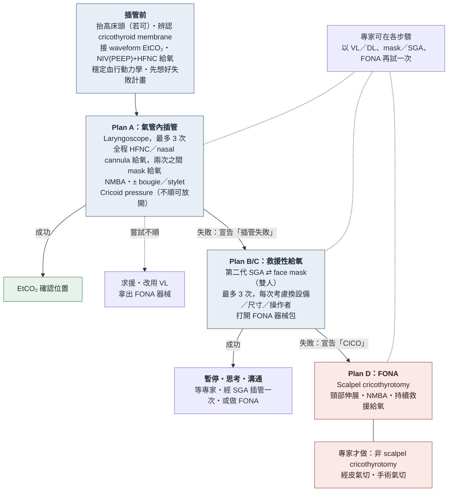

> [!abstract] 一句話重點
> ICU／急診的插管是**生理上的困難呼吸道**：病人缺氧耐受度低、血行動力學不穩。成功的關鍵在**插管前**——==checklist、團隊分工、好好 preoxygenation、先穩住血壓、先想好 Plan B==；插管時追求 **first-attempt success**，失敗就依 **Plan A → B/C → D（FONA）** 升級，最後一定用 **==waveform capnography（EtCO₂）確認位置==**。

> [!info] 本篇主要依據
> 林重甫、謝宗達〈緊急呼吸道處置的觀念更新〉*內科學誌* 2023（成大醫院），整理自 DAS 2018 critically ill adults 指引（Higgs 2018）等文獻。文末另附 **2023–2025 的新 RCT**（DEVICE、PREOXI、RSI trial），與原文不同處已標示。

## 為什麼 ICU 插管特別危險

- 重症病人緊急插管：**約 45% 至少發生一項嚴重 adverse event**，最常見是 ==cardiovascular instability（42.6%）==，其次 severe hypoxemia（9.3%）、cardiac arrest（3.1%）（INTUBE study）
- 插管引起的 cardiac arrest 中，約 1/4 是 hypoxemia 造成
- **嘗試次數越多**，hypotension、hypoxemia、esophageal intubation、cardiac arrest、airway trauma、**CICO**（can't intubate, can't oxygenate）都越多 → ==目標是 first-attempt success==
- NAP4（英國）：約 1/4 的 airway 重大事件發生在 ICU／急診，其中 ICU 有 61% 造成死亡或永久傷害

### 人為因素

ICU／急診不是為 airway 設計的環境，設備（VL、capnography）常不齊全，加上時間壓力、溝通不良、忽略 SpO₂ 警示音、忽略插管後照護。常見的認知偏誤：

| 偏誤 | 表現 | 後果 |
| --- | --- | --- |
| **Omission bias** | 下意識迴避「看起來」傷害較大的處置（例如 FONA） | 遲遲不做緊急氣切 → 缺氧時間拖長 |
| **Outcome bias** | 把「把管子放進去」當成唯一目標 | 忽略 face mask、SGA 也能先維持氧合 → 一直硬插 |

> [!tip] Pearl：降低人為錯誤
> - 至少準備**一種替代插管設備**、標準化急救車、**用 checklist**
> - 定期 team drill、併發症討論會
> - 指派一位助手專門**提醒下一步、看 vital signs**、幫忙扣 mask 或做 cricoid pressure

## 插管前準備：Checklist 與團隊分工

**Figure 1 插管過程核對清單**（依原圖內容重新整理）

| 病人準備 | 設備準備 | 團隊 |
| --- | --- | --- |
| 建立 IV access | Monitor：SpO₂、**EtCO₂**、ECG、BP | 指定角色（一人可兼多職）：指揮、第一／第二插管者、cricoid pressure、插管助手、給藥、監測、機動、FONA 執行者 |
| 擺位（sniffing／ramped） | ETT ×2（檢查 cuff）、DL ×2、**VL** | 指定**對外求援**的人 |
| Airway 評估：**定位 cricothyroid membrane**、是否需要 awake intubation | Bougie 或 stylet、suction | 指定**計時**的人 |
| **Preoxygenation 3 分鐘**（考慮 NIV＋nasal cannula） | SGA、oral／nasal airway、bronchoscope | |
| **穩定 vital signs**：輸液、升壓劑、NG 減壓 | **FONA kit** | |
| 藥物過敏、**hyperkalemia 風險**（有就避開 succinylcholine） | 藥物：ketamine、NMBA、vasopressor、插管後鎮靜 | |

**Figure 2 團隊站位**：六人團隊時，第一插管者在床頭，第二插管者在其旁，遞設備／cricoid pressure 在病人右側，給藥／監測在左側，指揮與機動在床尾；五人團隊則由給藥者兼任第二插管者。

## 生理與解剖

### Safe apnea time

- 缺氧原因：cardiac output 不足、低 FiO₂／高海拔、hypoventilation、airway obstruction、**V/Q mismatch**、anemia、組織無法用氧（sepsis）
- **Safe apnea time**（失去自發呼吸到 desaturation 的時間）：70 kg 健康成人約 ==6 分鐘==，127 kg 肥胖者縮短到**約 3 分鐘**
- 舌頭肥厚的病人平躺時舌根後倒，會阻塞上呼吸道，face mask ventilation 困難

### 喉部解剖

- Blade 過舌根後看到 **epiglottis**，其下為聲門，上方凹陷處為 **vallecula**
- Macintosh blade 的尖端要放在 ==vallecula 最深處再往上挑==，才能把 epiglottis 帶起、看清 glottis
- 聲門附近構造：vocal cords、**pyriform sinus**（兩側）、arytenoid 間凹窩

### 擺位：從三軸理論到雙曲線理論

| 理論 | 內容 | 評價 |
| --- | --- | --- |
| **Three-axis theory**（1944） | oral、pharyngeal、laryngeal 三軸要重合 | MRI 研究發現擺位時三軸其實不會重合 |
| **Two-curve theory**（2010） | **Primary curve**（oro-pharyngeal：口→舌根→聲門）＋ **secondary curve**（pharyngo-glotto-tracheal：聲門→氣管） | 擺位的目的是把兩條曲線拉直 |

- **Sniffing position**＝==cervical spine flexion＋atlanto-occipital joint extension==，把兩條曲線拉直、視野最清楚
- **肥胖病人**：肩背墊高到**外耳道與胸骨切跡同高**＝**ramped position**（本質上也是一種 sniffing position）

## 插管藥物

插管會引起強烈的 **sympathetic surge**（平均收縮壓升約 53 mmHg、HR 升約 23 下），也可能有 parasympathetic 反應；其他反射包括 cough、gag、**laryngospasm**（可用 NMBA 處理）、**bronchospasm**（加深麻醉）。插管時 cerebral metabolic rate 上升、咳嗽讓 venous return 下降 → **ICP 上升**。

### Induction agents

| 藥物 | 機轉 | 劑量（IV） | Onset／duration | 優點 | 注意 |
| --- | --- | --- | --- | --- | --- |
| **Propofol** | GABA-A agonist | 1–3 mg/kg | ~30 秒／5–15 分 | 抑制 airway reflex、降 ICP、無殘留 | ==低血壓==（周邊血管擴張、心肌抑制）、降 CPP；**休克病人避免** |
| **Ketamine** | NMDA antagonist（dissociative amnesia） | **RSI 1–2 mg/kg** | ~60 秒／15–20 分 | 有止痛效果、呼吸抑制少、**兼具 bronchodilator**、刺激交感 → 較不掉血壓 | 有直接心肌抑制：**交感已耗竭**的病人（嚴重 shock、heart failure、ACS）反而可能掉血壓；ICP 升高的病人研究顯示仍可安全使用 |
| **Etomidate** | GABA-A agonist | 0.2–0.3 mg/kg | ~30 秒／5–10 分 | ==血行動力學最穩定== | 12–24 小時內可能 **adrenal insufficiency** → 原文：**sepsis 不建議** |
| **Midazolam** | Benzodiazepine | 0.1–0.3 mg/kg | 1–2 分（較慢） | — | Bradycardia、呼吸抑制；要高劑量才能失去意識 → 多用於**插管後鎮靜維持** |

> [!note] Ketamine vs etomidate（原文觀點）
> 兩者的 first-attempt success、vital signs 變化、升壓劑需求、呼吸器天數無明顯差異（Jabre 2009）；EvK trial（Matchett 2022）day 7 死亡率 etomidate 較高，但 day 28 無顯著差異。→ 新的 RSI trial 見文末「新證據」。

### Adjunctive agents

| 藥物 | 重點 |
| --- | --- |
| **Opioid** | Fentanyl onset 30–60 秒、持續約 1 小時；morphine onset 約 15 分、持續 > 2 小時。副作用：低血壓（morphine 釋放 histamine）、呼吸抑制 |
| **Lidocaine** | 1.5 mg/kg，onset 1–3 分、持續約 20 分；目的是減少咳嗽、ICP 上升。但**研究顯示無法確實抑制 sympathetic surge**，在 **asthma 無法緩解 bronchospasm**，甚至可能增加 airway tone。擔心交感反應 → 給足 induction＋opioid 較實在 |

### Neuromuscular blocking agents（NMBA）

使用 NMBA ==提高 first-attempt success==、讓 face mask ventilation 與 SGA 更容易、減少 laryngospasm；**併發症（低血壓、低血氧、aspiration、airway trauma）並沒有增加**。不需因為怕副作用而不敢用或延後使用。

| 藥物 | 類型 | 劑量（IV） | Onset／duration | 注意 |
| --- | --- | --- | --- | --- |
| **Succinylcholine** | Depolarizing（先 fasciculation） | 1–2 mg/kg | < 1 分／5–10 分 | ==K⁺ 上升約 0.5–1 mEq/L==、ICP 上升、**malignant hyperthermia** → **高血鉀風險、MH 病史、燒燙傷禁用** |
| **Rocuronium** | Non-depolarizing | **1–1.5 mg/kg**（RSI 劑量，onset 和 succinylcholine 一樣快） | 1–1.5 分／45–80 分 | 作用久 → ==鎮靜藥退了要追加==，避免病人「清醒但不能動」；副作用：hypoxemia、hypercapnia、arrhythmia |
| **Cisatracurium** | Non-depolarizing | 0.15–0.2 mg/kg | ~1.5 分（較慢）／45–60 分 | 多用於插管後維持 |

- Succinylcholine vs rocuronium：first-attempt success 與併發症（esophageal intubation、aspiration、cardiac arrest）**沒有差異** → 依病人狀況與習慣選擇

> [!warning] Pitfall：不要把 sugammadex 當救命索
> **Sugammadex 16 mg/kg** 可在約 2 分鐘內包覆 rocuronium，但插管失敗＋無法通氣時**不可靠**：
> 1. 約 5% 病人 onset 長達 12 分鐘
> 2. 從插管失敗到決定給藥平均已過約 6 分鐘
> 3. 給藥後 face mask 與 SGA 反而更難放
> 4. 需要緊急氣切時，病人恢復自發呼吸與肌肉張力反而更難做
>
> → ==CICO 時應盡早進入下一步（FONA）==，不要等 sugammadex。

## Preoxygenation 插管前給氧

- 停止呼吸後，氧氣來源全靠 **FRC**（約 35 mL/kg，約 2500 mL）
  - 室內空氣：2500 × 21% ≈ **525 mL** 氧氣存量
  - 充分 preoxygenation（FiO₂ 100%）：2500 × 100% ≈ **2500 mL** → safe apnea time 大幅延長
- 有 NG 先**接引流袋減壓**；沒 NG 且狀況允許，先放 NG 減壓（減少嘔吐、aspiration、視野不佳）
- **Cricoid pressure**：給氧不順可視情況使用；若做了反而給氧不順 → 考慮**放開**（可能造成 airway obstruction）

**DAS 2018（Higgs）建議：NIV＋HFNC 併用**

| 設備 | 設定 | 好處 |
| --- | --- | --- |
| **NIV**（face mask） | ==PEEP 5–10 cmH₂O、Vt 7–10 mL/kg、peak pressure ≤ 20 cmH₂O== | 有 PEEP，避免肺泡在吐氣末塌陷；操作者不用分心擠 BVM |
| **HFNC**（戴在 NIV mask 內側） | 流量 30–70 L/min；沒有 HFNC 用 **nasal cannula 15 L/min** | 插管過程中可**持續給氧（apneic oxygenation）**，降低嚴重低血氧 |

- 和傳統 BVM 相比提供更多氧流與 PEEP → 降低 hypoxemia、延長 safe apnea time，且不增加併發症
- 只有 BVM 時：==兩人操作==（一人雙手扣 mask、一人擠球）
- **躁動無法配合**的病人：**Delayed sequence intubation（DSI）**——先給低劑量 ketamine 讓病人可以配合給氧，preoxygenation 完成後再給足 RSI 藥物並插管

## 氣管內插管 Endotracheal Intubation

### Cook modification of Cormack-Lehane grade

**Table 1**（依原表內容重新整理）

| Grade | Laryngoscopy 所見 | 建議插管方式 |
| --- | --- | --- |
| 1 | 聲門附近構造幾乎都看得到 | **DL** ± cricoid pressure ± bougie |
| 2A | 看得到後方 vocal cords | 同上 |
| 2B | 只看得到後方 arytenoid cartilage | **DL＋bougie** |
| 3A | 看得到 epiglottis，且**挑得起來** | DL＋bougie |
| 3B | 看得到 epiglottis，但**挑不起來** | ==VL== |
| 4 | 連 epiglottis 都看不到 | ==VL== |

### Bougie

- 又稱 **endotracheal tube introducer**：有彈性、前端上翹，比 ETT 細，適合 2A–3A **看不清聲帶**時先送入氣管，再把 ETT 沿 bougie 滑入
- **Frova intubating introducer**：前端有側孔、後端有接頭，必要時可接 ambu 或呼吸器暫時通氣
- 一般病人或困難插管都**增加 first-attempt success**、併發症相近；但不熟悉的人使用則沒有好處 → 要多練習

### Video laryngoscope（VL）

- 影像放大、較易專注在 glottis，**降低 Cormack-Lehane grade 2–4 的比例**；部分 VL 也可當 DL 使用
- 原文立場：手術室外 VL 能否提高 first-attempt success 的 RCT 結果不一；近期 meta-analysis 才顯示較少失敗與併發症，但也有研究顯示 VL 組嚴重併發症較多 → ==專家未建議一律使用 VL==，而是插管時**應備有 VL 與擅長的人**
- 需要練習：VL 使用 > 15 次者 first-attempt success 明顯高於 < 10 次者；**新手學 VL 比學 DL 容易上手**

## 困難插管評估

### MACOCHA score

**Table 2**（依原表內容重新整理）

| 字母 | 項目 | 分數 |
| --- | --- | --- |
| **M** | **Mallampati 3–4** | ==5== |
| **A** | **A**pnea：obstructive sleep apnea syndrome | 2 |
| **C** | **C**ervical spine 活動受限 | 1 |
| **O** | Mouth **o**pening < 3 cm | 1 |
| **C** | **C**oma | 1 |
| **H** | Severe **h**ypoxemia（SpO₂ < 80%） | 1 |
| **A** | 插管者非 **a**nesthesiologist | 1 |

- 總分 0–12；==≥ 3 分 → 建議用 VL 插管==

### Awake intubation 的時機

- **預期解剖困難**（頭頸異常）→ VL 清醒插管；**腫瘤或疾病造成 airway 扭曲阻塞** → bronchoscope 清醒插管
- **生理困難**：血行動力學極不穩（RSI 會讓血壓更低）、需要很高 minute ventilation、嚴重 hypoxemia 窒息耐受度低
- **ASA 2022 指引**：預期 face mask／SGA 通氣困難、aspiration 風險高、會快速 desaturate、或預期緊急 invasive airway 困難 → 可考慮 awake intubation
- 需要病人高度配合：先說明、局部麻醉＋IV analgesia、密切監測；沒有研究比較清醒 vs 鎮靜插管的優劣，==務必請麻醉科執行==

## 替代計畫：插管失敗時

ICU 插管失敗率約 **10–30%**。

### Plan B／C：SGA 或 face mask

- **SGA**：張口順勢放入食道方向即可，開口朝向聲門暫時通氣；部分可配合 bronchoscope 協助插管
  - 放置時**不建議 cricoid pressure**（會壓扁食道，反而不好放）
  - 建議用**第二代 SGA**：多一條食道通道可減壓或放 NG，密封性更好、放置更快

- **Face mask ventilation** 與 SGA 地位相同，都是第一備用方案：接呼吸器加 PEEP，**Vt 約 6–7 mL/kg、RR < 12、吸氣時間 1–2 秒**；擺好位（sniffing、jaw thrust）；沒呼吸器就兩人操作
  - 建議給 **NMBA**，尤其胸壁 compliance 差、laryngospasm、肥胖病人 → 改善 mask 通氣
- SGA／face mask 成功通氣後的選項：
  1. 持續通氣，**等專家**來插管
  2. 經 SGA 當導引插管（==失敗一次就停==，等專家）
  3. **叫醒病人**（BZD、NMBA 拮抗劑）——但通常**不建議**：內科病人（神經、心臟、呼吸衰竭）醒來 vital signs 與氧合往往更差
  4. 直接做 **FONA**（已瀕臨缺氧、bronchoscopy 困難、或 aspiration 風險高）

### Plan D：Front-of-neck airway（FONA）

SGA 與 face mask 都失敗（**CICO**）→ 最終步驟 FONA，期間繼續用 HFNC、nasal cannula、SGA 或 mask 供氧。

**首選：scalpel-bougie-tube cricothyrotomy**

1. 頸部最大 **hyperextension**，摸出 **cricothyroid membrane**
2. 10 或 20 號圓刀**垂直皮膚**，橫向切開 cricothyroid membrane
3. 刀片**旋轉 90 度**、刀刃朝向**病人腳側**，擴大切口
4. 刀片留在原位，沿切口放入 **bougie**
5. 拿開刀片，沿 bougie 放入**內徑 5–6 mm** 的 ETT

優點：快、步驟少、成功率高、幾乎所有人都適用；放好可監測 EtCO₂、建立穩定且有 airway protection 的通道、可接呼吸器給 PEEP。

| FONA 方式 | 評價 |
| --- | --- |
| **Scalpel-bougie-tube** | ==首選== |
| Transtracheal jet ventilation（TTJV，粗 IV catheter 穿 cricothyroid membrane 接高流量氧） | **預後差**：易失敗、**barotrauma**、無法 recruitment、無 PEEP、換氣不足 |
| Needle cricothyrotomy、percutaneous／surgical tracheostomy | 只限受過訓練的專家 |

FONA 後病人穩定 → 改經口插管或正式氣切。

### 呼吸道處置流程圖

**Figure 9**（依原圖內容重新繪製）

> [!danger] 大聲宣告每個轉折
> 插管失敗時要**明確說出**「插管失敗」、「插管失敗且無法通氣（CICO）」——讓全隊同步切換到下一個 plan，避免 outcome bias 讓人一直硬插。

## 插管中的病人監測

- 最常見 adverse event 是 **cardiovascular instability（42.6%）**：低血壓、新的升壓劑需求、或需輸液 > 15 mL/kg；整體死亡率 32.8%
- 原因：低血氧、潛在疾病、**RSI 藥物造成血管擴張**、hypovolemia、**PEEP 減少 venous return**
- 插管前先控制好潛在疾病與 vital signs：最好先放 **arterial line** 與 IV access；高風險病人避免容易造成低血壓的 induction agent（如 propofol）
- ==**Shock index（HR／SBP）> 0.8**== → 插管後低血壓與 cardiac arrest 機率上升 → 視情況**先給 vasopressor**
- 插管前**輸液 bolus 臨床很常用**，但 RCT 中**預防低血壓的效果不顯著**

## 插管後的病人照護

- 英國約 80% 的 airway 意外發生在**插管後**，其中 30% 是嚴重意外，最常見是 **ETT 位置異常**
- 避免過高的 RR、Vt 與 PEEP（會讓血壓下降）
- ETT 內徑要夠大，方便做 **subglottic suction**
- **Cuff pressure 20–30 cmH₂O**
- 狀況允許 → **床頭抬高約 35 度**，減少 airway edema 與分泌物堆積在上呼吸道

> [!warning] Pitfall：確認位置一定要靠 waveform capnography
> - 聽診、看胸廓起伏、CXR、DL／VL 直視、超音波確認位置的證據都不夠明確 → **EtCO₂ 無法確認時才加用**，可多種方法併用
> - Capnography 也用來確認 cardiac arrest 病人是否恢復自發循環、監測 CPR 品質
> - 加護病房 ==約 70% 的 airway 相關死亡與沒有使用 EtCO₂ 有關==（NAP4）

## 特殊情境：COVID-19 等高傳染性呼吸道疾病

- 預期會呼吸衰竭的病人**及早插管**（避免緊急時倉促穿防護裝備）
- 防護：**N95**、面罩或護目鏡、**雙層手套**、防水隔離衣，盡量拋棄式；在**負壓隔離室**插管，室內**最多 3 人**（插管者、助手、給藥監測者），外面至少 1 人負責求援
- **Preoxygenation**：台灣麻醉醫學會建議 **NRM 5 分鐘**；原本就用 NIV／HFNC 的可持續使用；低血氧需 BVM 時**兩人雙手扣 mask** 提高密合度；研究顯示 HFNC 與 NRM 的飛沫噴濺程度無顯著差異
- **藥物**：比照 RSI，**一定用 NMBA**（減少咳嗽噴濺）
- 由**最有經驗的人用 VL** 插管，**不要用不熟悉的工具**；有經驗、RSI、VL 都與 first-attempt success 有關
- 插管後用 **EtCO₂** 確認，**不建議聽診**（汙染風險、穿防護裝備也聽不清楚）
- 需要 FONA 時用 **scalpel-bougie-tube**（飛沫噴濺最少）

> [!info] 2023–2025 新證據（原文發表後）
> 以下 RCT 在原文（2023）之後發表，與原文立場不同處標出，供參考：
> - **VL vs DL — DEVICE trial**（Prekker, *NEJM* 2023；1417 位 ICU／急診病人）：VL 的 first-attempt success **85.1% vs 70.8%**，嚴重併發症無差異（21.4% vs 20.9%）→ 支持**重症插管優先用 VL**（原文：未建議一律使用）
> - **NIV preoxygenation — PREOXI trial**（Gibbs, *NEJM* 2024；1301 人）：NIV 比 oxygen mask 減少插管中 hypoxemia（SpO₂ < 85%：**9.1% vs 18.5%**，NNT 約 11），aspiration 沒有增加 → 支持原文的 NIV preoxygenation 建議
> - **Ketamine vs etomidate — RSI trial**（Casey, *NEJM* 2025；2365 人）：28 天院內死亡率無差異（**28.1% vs 29.1%**），但 ketamine 組插管時 **cardiovascular collapse 較多（22.1% vs 17.0%）** → 與原文「sepsis 不建議 etomidate」的觀點不同，etomidate 單次使用的 adrenal 疑慮在死亡率上未顯現

## 🎯 內專考點

> [!example] 出題規律
> 內專很少直接考插管技術；相關題目集中在**呼吸支持設備的生理**（HFNC、各種面罩的 FiO₂）與**敗血症／重症處置**。本篇的 preoxygenation（NIV、HFNC、NRM）內容可對照下列題目。

題號格式為「年份-題號」，可到 [內專刷題網站](http://imboard.dirty-wolf.com/) 用「依科目」→「胸腔」→ 考點 `RespFailure-O2` 查看原題與詳解。每張卡片點開即可看到內容。

### HFNC 的生理效應

> [!note]- 114-35｜HFNC 生理效應何者錯誤
> **情境**：關於 nasal high-flow oxygen therapy 的生理效應
>
> **問**：何者錯誤？
> - 流量常在 30–60 L/min → 對
> - 讓 end-expiratory lung volume 下降 → 錯
> - 讓 minute ventilation 下降 → 對
> - 可能降低 work of breathing → 對
> - 可能小幅增加 PEEP → 對
>
> **答**：**讓 end-expiratory lung volume 下降**
>
> **重點**：HFNC 有 low-level PEEP 效果（約 2–3 cmH₂O），肺泡較不塌陷 → **EELV 是上升**、compliance 上升
> - **Dead space washout** → minute ventilation 下降但 PaCO₂ 不變
> - 高流速滿足病人吸氣需求 → 吸氣努力與 WOB 下降、FiO₂ 較穩定；流速越高效果越明顯

### 氧氣治療裝置

> [!note]- 111-24｜各種給氧裝置的特性何者錯誤
> **情境**：比較各種給氧裝置的流量與 FiO₂ 特性
>
> **問**：何者錯誤？
> - Nasal cannula 流量原則上不超過 6 L/min → 對
> - Simple face mask 固定 5 L/min，病人 minute ventilation 上升時 FiO₂ 下降 → 對
> - NRM 的 FiO₂ 可達 0.6–1.0 → 錯
> - Venturi mask 提供相對固定的 FiO₂ → 對
> - HFNC 可產生 PEEP、減少肺泡塌陷 → 對
>
> **答**：**NRM 的 FiO₂ 可達 0.6–1.0**
>
> **重點**：NRM 雖有 reservoir bag 與單向瓣膜，但面罩邊緣漏氣、混入室內空氣，實際 FiO₂ 約 **0.6–0.8，到不了 1.0**
> - **Low-flow 裝置**（nasal cannula、simple mask、NRM）：給氧流量低於病人吸氣流速，其餘由室內空氣補足 → **換氣量越大，FiO₂ 越低**
> - **Venturi mask**：靠 entrainment 原理給固定 FiO₂（約 0.24–0.60），適合 hypercapnic 風險病人
> - **HFNC**：流量最高約 60 L/min、FiO₂ 可近 1.0，閉口時約產生 2–3 cmH₂O 的低度 PEEP
> - 這也是為什麼插管前 preoxygenation 會用 **NIV＋HFNC**，而不是只靠 NRM

### 模擬題

> [!question]- 模擬題 1（點開作答）
> 58 歲男性，septic shock 合併嚴重 pneumonia，在 ICU 準備緊急插管。HR 128、BP 82/50 mmHg（已用 norepinephrine），SpO₂ 88%（HFNC FiO₂ 100%、60 L/min），K⁺ 6.3 mmol/L。下列處置何者**最不恰當**？
>
> (A) 插管前以 NIV（PEEP 5–10 cmH₂O）合併 HFNC 給氧
> (B) 計算 shock index 後，先調高升壓劑再進行 induction
> (C) 使用 succinylcholine 1.5 mg/kg 作為 NMBA
> (D) 備妥 VL、bougie、第二代 SGA 與 FONA 器械
> (E) 插管後以 waveform capnography 確認 ETT 位置
>
> > [!success]- 答案與詳解
> > **答案：(C)**
> >
> > Succinylcholine 會讓 K⁺ 再上升約 0.5–1 mEq/L，**高血鉀病人禁用**，應改用 rocuronium 1–1.5 mg/kg。
> >
> > - (A) 對：NIV＋HFNC 提供 PEEP 與 apneic oxygenation
> > - (B) 對：shock index 128/82 ≈ 1.56 > 0.8，插管後低血壓與 arrest 風險高
> > - (D) 對：先想好 Plan B–D
> > - (E) 對：EtCO₂ 是確認位置的標準

> [!question]- 模擬題 2（點開作答）
> 承上，第一插管者用 DL 嘗試三次失敗，改用第二代 SGA 及雙人 face mask 也無法維持 SpO₂（降到 70%）。下一步最適當的是？
>
> (A) 給 sugammadex 16 mg/kg 讓病人恢復自發呼吸
> (B) 換另一位住院醫師再用 DL 試一次
> (C) 宣告 CICO，執行 scalpel-bougie-tube cricothyrotomy
> (D) 以粗 IV catheter 做 transtracheal jet ventilation
> (E) 加壓 cricoid pressure 後再放一次 SGA
>
> > [!success]- 答案與詳解
> > **答案：(C)**
> >
> > 插管失敗＋SGA／mask 也無法通氣＝**CICO**，應立即做 FONA，首選 scalpel-bougie-tube。
> >
> > - (A) 錯：sugammadex 可能 onset 延遲，且決策時間已拖長，不可依賴
> > - (B) 錯：繼續硬插是 outcome bias
> > - (D) 錯：TTJV 易失敗、barotrauma、無 PEEP，預後差
> > - (E) 錯：放 SGA 時 cricoid pressure 會壓扁食道、讓 SGA 更難放

## 相關筆記

- 呼吸器、ARDS、休克等重症筆記建立後會連結到這裡
- [[cardiology/resuscitation-aha-2025/index|心肺復甦與急救 CPR & ECC（2025 AHA 指引）]]

## 參考資料

- 林重甫、謝宗達。緊急呼吸道處置的觀念更新。*內科學誌*。2023;34:17–31. DOI: 10.6314/JIMT.202302_34(1).05（參考資料庫：`胸腔科/緊急呼吸道處置的觀念更新.pdf`）
- Higgs A, McGrath BA, Goddard C, et al. Guidelines for the management of tracheal intubation in critically ill adults. *Br J Anaesth*. 2018;120(2):323–352.
- Russotto V, Myatra SN, Laffey JG, et al. Intubation practices and adverse peri-intubation events in critically ill patients from 29 countries. *JAMA*. 2021;325(12):1164–1172.
- Cook TM, Woodall N, Harper J, Benger J. Major complications of airway management in the UK: results of the Fourth National Audit Project (NAP4), Part 2: intensive care and emergency departments. *Br J Anaesth*. 2011;106(5):632–642.
- Matchett G, Gasanova I, Riccio CA, et al. Etomidate versus ketamine for emergency endotracheal intubation: a randomized clinical trial. *Intensive Care Med*. 2022;48(1):78–91.
- Prekker ME, Driver BE, Trent SA, et al. Video versus direct laryngoscopy for tracheal intubation of critically ill adults. *N Engl J Med*. 2023;389(5):418–429.
- Gibbs KW, Semler MW, Driver BE, et al. Noninvasive ventilation for preoxygenation during emergency intubation. *N Engl J Med*. 2024;390(23):2165–2177.
- Casey JD, Seitz KP, Driver BE, et al. Ketamine or etomidate for tracheal intubation of critically ill adults. *N Engl J Med*. 2025. DOI: 10.1056/NEJMoa2511420
- 內專考古題詳解：[內專刷題網站](http://imboard.dirty-wolf.com/)（111-24、114-35）
